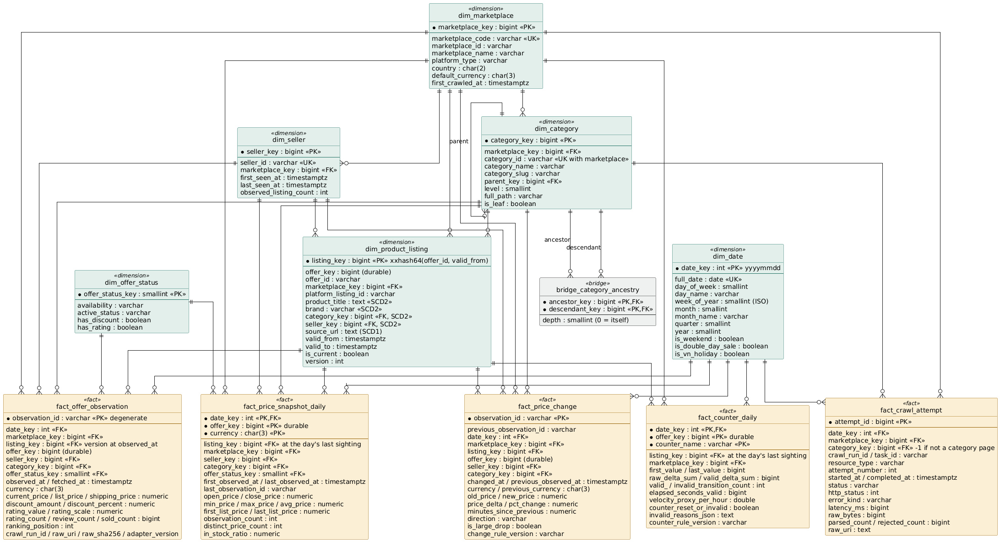

# Marketplace Price Intelligence: pipeline ELT đa nguồn

[](https://github.com/Duy-Duc82/ecommerce-lambda-architecture/actions/workflows/tests.yml)

Nền tảng dữ liệu theo dõi **trạng thái công khai của catalog và giá** trên sàn thương mại điện tử Việt Nam (Tiki, Lazada). Một lần crawl nuôi hai đường: **batch** (Spark, Airflow, chạy lại được, có phiên bản, qua cổng chất lượng) và **speed** (Spark Structured Streaming, sự kiện thay đổi giá trong vài giây).

Hệ thống chỉ thấy trạng thái công khai mà trang hiển thị: giá, giá niêm yết, tình trạng hàng, đánh giá và các bộ đếm. Không có đơn hàng, giỏ hàng hay người dùng; bộ đếm "đã bán" đổi giá trị không phải là một giao dịch.

## Luồng dữ liệu

```text
Tiki, Lazada (trang công khai, robots.txt, ≥ 2 s/request, một tab trình duyệt)
   -> ingestion: Fetcher -> Extractor           giữ mọi trường của dòng nguồn (ELT)
   -> Bronze/raw (phản hồi nguyên vẹn) + Bronze/records (JSONL.gz theo trang)
   -> Kafka marketplace.records.v1
        |-- speed: normalizer -> trạng thái theo offer -> change event -> Elasticsearch, Redis
        '-- batch (Airflow @hourly): silver -> dimensions -> facts -> marts -> quality -> publish -> promote
                                     Silver v2 Parquet   Gold theo run   PostgreSQL cache.*   Superset
```

Sơ đồ đầy đủ, bảng module, pattern và luật phụ thuộc nằm ở [`docs/ARCHITECTURE.md`](docs/ARCHITECTURE.md). Quyết định kiến trúc nằm ở [`docs/adr/`](docs/adr/).

## Mô hình dữ liệu

Gold là một star schema trên Delta Lake (`dw`), cập nhật tăng dần bằng `MERGE` theo cửa sổ ngày và chỉ được công bố sau khi qua cổng chất lượng. Các mart phục vụ dashboard (`cache`) dựng lại từ fact.

- **Dimension:** `dim_date`, `dim_marketplace`, `dim_seller`, `dim_brand`, `dim_category` (kèm `bridge_category_ancestry`), `dim_product_listing` (SCD2), `dim_listing_flags`.
- **Fact:** `fact_offer_observation`, `fact_price_snapshot_daily`, `fact_price_change`, `fact_counter_daily`, `fact_category_page_daily`, `fact_crawl_attempt`.



Chi tiết từng bảng, khoá và luật chất lượng: [`docs/DATA_MODEL.md`](docs/DATA_MODEL.md).

**Bài toán phân tích** (ADR-0009): độ tin cậy của khuyến mãi. Mức giảm mà trang hiển thị được so với lịch sử giá của chính offer (giá tham chiếu = giá thấp nhất 30 ngày trước, trần 50 %); năm luật cho lý do, Isolation Forest chỉ xếp hạng. Kết quả ở hai mart `discount_credibility_daily` và `discount_daily`.

## Cấu trúc mã

```text
src/ecomdata/
  domain/          thuần, không I/O: registry nguồn, record envelope, luật thay đổi, ordering
  settings/        cấu hình theo concern, đọc ở composition root
  infra/           adapter: Spark, Postgres, Kafka, object store, HTTP, trình duyệt
  ingestion/       thu thập: fetcher, extractor và discovery theo site, frontier, Bronze
  processing/      normalize, batch theo stage, speed
  orchestration/   DAG Airflow (marketplace_batch, marketplace_maintenance, source_discovery)
  serving/         projector Elasticsearch, Kibana, Superset
  ops/             CLI vận hành: smoke, validate, backup, bench, drill, evaluate
compose/  docker/  env/  scripts/  observability/  services/  tests/
```

`ingestion` và `processing` không import lẫn nhau; `domain` không import thư viện hạ tầng. `import-linter` và `tests/architecture/` kiểm các luật này.

## Chạy

Cần Docker Desktop, PowerShell và Python 3.12.

```powershell
python -m venv .venv
.\.venv\Scripts\python -m pip install -e ".[dev,spark]"

# Một stack cô lập (project mp-refactor, prefix rf-), nguồn thật:
.\scripts\mp.ps1 up -EnvFile env/refactor.env -With ops,crawl,crawl-browser
.\scripts\mp.ps1 migrate -EnvFile env/refactor.env
.\scripts\mp.ps1 seed -EnvFile env/refactor.env --source tiki --from-discovery --limit 25 --pages 1 --tier ACTIVE
.\scripts\mp.ps1 up -EnvFile env/refactor.env -With speed,orchestration,serve

# Smoke offline (stub, không chạm site thật):
.\scripts\mp.ps1 smoke -EnvFile env/bench.env
```

Cấu hình ghép lớp: `env/base.env`, rồi `env/ports.<stack>.env`, rồi `env/<stack>.env`. Mỗi stack có project, prefix container, volume và cổng riêng (`tests/unit/ops/test_compose_isolation.py`). Airflow ở `http://localhost:<AIRFLOW_HOST_PORT>`, Superset ở `<SUPERSET_HOST_PORT>`; các cổng nằm trong `env/ports.<stack>.env`.

Chạy một stage của batch bằng tay:

```powershell
python -m ecomdata.processing.batch run --run-id <id> --as-of <ISO> --stage silver|dimensions|facts|marts|quality|publish|promote   # hoặc --all
```

## Kiểm thử

GitHub Actions ([`.github/workflows/tests.yml`](.github/workflows/tests.yml)) chạy lint, unit test và test DAG Airflow ở mỗi lần push. Pull request vào `develop` hoặc `master` chạy thêm toàn bộ test Spark, chia trên 4 runner song song.

Chạy ở máy:

```powershell
.\.venv\Scripts\python -m pytest -q --ignore=tests/spark --ignore=tests/airflow   # unit, vài phút
.\.venv\Scripts\python -m pytest -q tests/spark                                   # Spark, khoảng 30 phút, nặng CPU
.\.venv\Scripts\python -m ruff check src tests services
.\.venv\Scripts\lint-imports.exe
```

Test Spark trên Windows truyền dữ liệu trong bộ nhớ (không có `winutils`); Parquet và MinIO chỉ chạy được trong Docker. Test `integration` chạm mạng (Lazada thật) và mặc định bị bỏ chọn; drill cần stack chạy (`-m drill`).

## Công nghệ

Kafka 4.2 (KRaft), Spark 4.0 (Python 3.12), MinIO (S3A), PostgreSQL 18, Elasticsearch và Kibana 8.18, Redis, Superset 4.1, Airflow 3.3, Playwright 1.55 (Lazada). Image: `ecommerce/marketplace-python:3`, `ecommerce/spark-marketplace:4.0.1-r4`, `ecommerce/crawler-browser:1`, `ecommerce/airflow:3.3.2-r3`.

## Tài liệu

| Tài liệu | Nội dung |
|---|---|
| [`docs/ARCHITECTURE.md`](docs/ARCHITECTURE.md) | thiết kế chi tiết, luật phụ thuộc, cách thêm một nguồn |
| [`docs/adr/`](docs/adr/) | các quyết định kiến trúc |
| [`docs/DATA_MODEL.md`](docs/DATA_MODEL.md) | hợp đồng dữ liệu, bảng, khoá |
| [`docs/RUNBOOK.md`](docs/RUNBOOK.md) | vận hành: seed, backfill, drill, backup |
| [`docs/DEMO_RUNBOOK.md`](docs/DEMO_RUNBOOK.md) | chạy và trình diễn stack dài hạn |
| [`docs/OBSERVABILITY.md`](docs/OBSERVABILITY.md) | metric, log, dashboard Grafana, cảnh báo |
| [`docs/DANH_GIA_HE_THONG_20261113.md`](docs/DANH_GIA_HE_THONG_20261113.md) | đánh giá hiện trạng so với yêu cầu và kế hoạch ổn định hoá (13/11) |
| [`docs/evidence/`](docs/evidence/) | bằng chứng chạy thật: refactor (25/10), end-to-end (31/10), toàn luồng (07/11) |
| [`docs/archive/`](docs/archive/) | kế hoạch, nhật ký và báo cáo của các giai đoạn trước |

Shopee không được crawl; hướng hợp lệ duy nhất là Affiliate Open API (ADR-0006).
