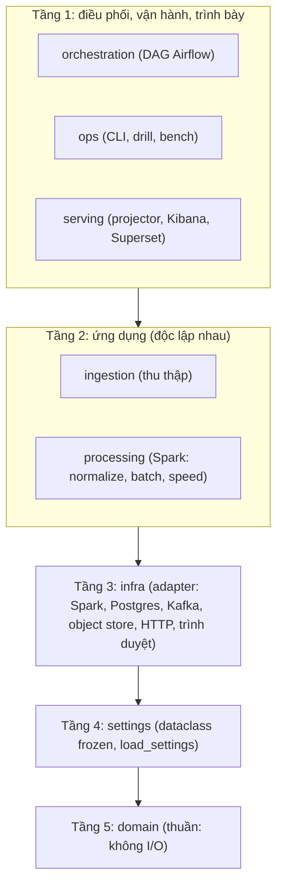
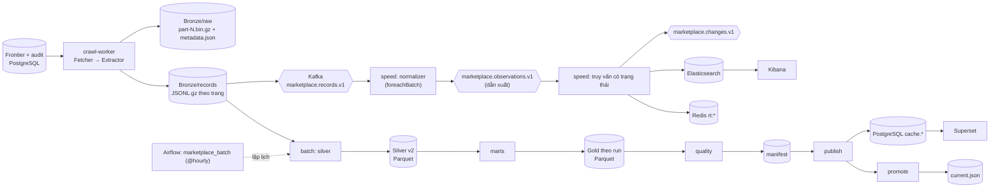

# Kiến trúc: pipeline ELT đa nguồn (Tiki, Lazada)

Hệ thống quan sát **trạng thái công khai của catalog và giá** trên sàn thương mại điện tử. Nó không thấy đơn hàng, thanh toán, giỏ hàng hay người dùng. Một bộ đếm mà sàn hiển thị (đã bán, số đánh giá) là một con số trên trang; thay đổi của nó không phải là một đơn hàng và không được mô tả như vậy.

Cấu trúc là Lambda: một lần crawl nuôi **đường batch** (chính xác, chạy lại được, có phiên bản) và **đường speed** (sự kiện thay đổi độ trễ thấp). Pipeline thu thập theo kiểu **ELT**: crawler lưu nguyên vẹn dòng dữ liệu của nguồn, Spark chuẩn hoá ở phía sau (ADR-0001).

Pipeline Kaggle cũ (dữ liệu hành vi) nằm trong `legacy/kaggle/`, chạy bằng `compose/docker-compose.legacy.yml`; `ecomdata` không import nó.

Quyết định kiến trúc nằm trong `docs/adr/`:

| ADR | Nội dung |
|---|---|
| 0001 | ELT và envelope `marketplace-record.v1` |
| 0002 | Airflow thay scheduler vòng lặp (đảo D2) |
| 0003 | Ports & Adapters và luật import |
| 0004 | Một `SourceRegistry` |
| 0005 | Batch theo stage và state machine |
| 0006 | Shopee: không crawl, chỉ Affiliate API |

## 1. Sơ đồ tầng



Luật được `import-linter` kiểm trong `pyproject.toml` (4 contract) và `tests/architecture/`:

- tầng trên import tầng dưới, không ngược lại; `ingestion` và `processing` **không import lẫn nhau**;
- `ecomdata.domain` không import `pyspark`, `requests`, `psycopg2`, `kafka`, `minio`, `boto3`, `playwright`, `redis`, `elasticsearch`, `ecomdata.settings`, `ecomdata.infra`;
- `ecomdata` không import `legacy`;
- settings chỉ được đọc ở composition root (`bootstrap.py`, `cli.py`, `service.py`, `dags/*`);
- literal riêng của site (`"tiki"`, `"lazada"`, `tiki.vn`, `lazada.vn`) chỉ nằm trong `ingestion/sources/<site>/`, `processing/normalize/sources/<site>.py`, `domain/sources.py` (cùng tests, ops/drills, env, docs).

## 2. Luồng dữ liệu



Hai điểm cần đọc kỹ:

1. **Bronze là sự thật**. `bronze/raw` giữ phản hồi nguyên vẹn (gzip, có manifest); `bronze/marketplace/records` giữ từng dòng nguồn với toàn bộ trường (trừ danh sách PII khai báo trong spec). Mọi bảng phía sau dựng lại được từ đó.
2. **Batch là bản đúng, speed là bản nhanh.** Cả hai chuẩn hoá bằng cùng một normalizer theo nguồn (`processing/normalize/sources/<site>.py`) và cùng quy tắc: thứ tự `domain/ordering.py`, luật thay đổi `domain/change_rules.py`.

## 3. Các module

### `domain/` (thuần)

| Module | Nội dung |
|---|---|
| `validation.py` | một bộ helper kiểm giá trị (`require_text`, `aware_utc`, ...) |
| `identity.py` | `deterministic_id`, `make_offer_id`, `make_observation_id`, `make_seller_id`, `make_change_id` |
| `sources.py` | `SourceSpec`, `SourceRegistry`, `SOURCES`, `TIKI`, `LAZADA` (ADR-0004) |
| `records.py` | `SourceRecord` (`marketplace-record.v1`), `build_records`, wire encode/decode |
| `acquisition.py` | `ListingPageRequest`, `FetchPart`, `FetchBundle`, `ExtractedPage`, report, cây lỗi, `FailureKind` |
| `observations.py` | `MarketplaceOffer`, `OfferObservation`, `MarketplaceObservationV1`, `MarketplaceChangeV1` |
| `ordering.py` | thứ tự `(observed_at, fetched_at, observation_id)` |
| `change_rules.py` | luật so sánh hai observation của một offer |
| `datasets.py`, `quality_rules.py`, `counter_semantics.py`, `topics.py`, `dlq.py` | registry dataset Gold, luật chất lượng, counter tin cậy, tên topic, bản ghi quarantine |
| `batch_run.py` | `BatchRunStatus` và bảng chuyển trạng thái |

### `settings/`, `infra/`

`settings/__init__.py`: `Settings` gồm các dataclass frozen theo concern (kafka, storage, postgres, redis, es, crawl, spark, batch, quality, speed, service, airflow); `load_settings(env, dotenv=False)` không có side effect lúc import. `infra/`: `spark.py` (`SparkSessionFactory`: UTC, shuffle, `spark.driver.memory`, S3A), `postgres.py` (`connection_factory`, `jdbc_url`), `kafka.py` (producer duy nhất, gửi có ack), `object_store.py` (MinIO/S3/local, gzip), `http.py` (`HttpClient`, `RobotsPolicy` cache theo host, `Throttle`), `browser.py` (`BrowserSession`, Playwright, một lần mỗi worker).

### `ingestion/`

`fetchers/{base,http,browser}.py` (Strategy: `HttpFetcher`, `BrowserFetcher`), `sources/<site>/{extractor,discovery}.py`, `pipeline.py` (Template Method: robots → throttle → fetch → lưu raw → extract → lưu records → report), `raw_store.py` (Bronze/raw v2, đọc được v1), `record_store.py`, `publisher.py` (Kafka sau khi ghi file), `reparse.py`, `frontier.py`, `scheduling.py`, `audit.py`, `worker.py`, `service.py`, `seed.py`, `cli.py`, `bootstrap.py`.

### `processing/`

- `normalize/`: `common.py` (đọc envelope, cột canonical, quarantine, drift), `sources/{tiki,lazada}.py` (`PAYLOAD_SCHEMA`, `to_wide`, `to_offer_observation`), `wire.py` (cột canonical → event `marketplace-observation.v1`).
- `batch/`: `stages/{base,silver,marts,quality,publish,promote}.py`, `runner.py`, `ports.py`, `context.py`, `lake.py` (`SparkLakeIO`), `inputs.py`, `memory.py` (bản trong bộ nhớ của các port), `marts.py`, `anomaly.py`, `quality.py`, `manifest.py`, `repositories.py`, `lock.py`, `scheduler.py` (vòng lặp cũ, profile `legacy-scheduler`), `cli.py`, `bootstrap.py`, `dimensions.py`, `keys.py`, `dim_date.py` (star Phase 10, chưa nối vào stage).
- `speed/`: `normalizer.py`, `stream.py`, `service.py`, `sinks.py`, `change_producer.py`.

### `orchestration/`, `serving/`, `ops/`

`orchestration/tasks.py` (lệnh và môi trường của task container) và `orchestration/dags/{marketplace_batch,marketplace_maintenance,source_discovery}.py`. `serving/`: `es_projector.py`, `kibana/`, `superset/`. `ops/`: CLI vận hành `python -m ecomdata.ops` (subcommand: `migrate`, `seed`, `evaluate`, `validate`, `backup`, `restore`, `backups`, `prune-raw`, `storage-snapshot`, `status`, ...), drill, bench, evidence.

## 4. Các pattern

| Pattern | Chỗ dùng |
|---|---|
| Ports & Adapters | `processing/batch/ports.py` (Protocol `ObjectStore`, `AuditRepo`, `QualityRepo`, `CachePublisher`, `LakeIO`), `infra/*`. Logic nhận Protocol; composition root inject bản thật; test inject `processing/batch/memory.py` |
| Strategy | `ingestion/fetchers/` (`HttpFetcher`, `BrowserFetcher`; sau này `ApiFetcher`), extractor theo site, normalizer Spark theo site |
| Registry + Factory | `domain/sources.py` (`SourceRegistry`: mã nguồn → `SourceSpec`), `domain/datasets.py` |
| Template Method | `ingestion/pipeline.py`: các bước thu thập cố định, các bước đổi được inject vào |
| Pipeline of Stages + State Machine | `processing/batch/stages/`, `runner.py`, `domain/batch_run.py` (ADR-0005) |
| Repository | frontier, crawl audit, batch audit, quality, cache publisher (sau Protocol) |
| Decorator | `ingestion/publisher.py` bọc executor của pipeline; `non_decreasing_clock` |
| Value Object | dataclass `frozen=True`, kiểm bằng `domain/validation.py` |
| Composition Root | mỗi entrypoint có `bootstrap.py` hoặc `cli.py`; không gọi `from_settings()` trong logic |

## 5. Batch theo stage

```
silver -> marts -> quality -> publish -> promote
```

| Stage | Đọc | Ghi | Trạng thái sau |
|---|---|---|---|
| `silver` | Bronze/records (đến `as_of`) | `offer_observations_v2`, `<source>_listing_wide`, `page_context`, `quarantine`, tóm tắt `_runs/<run>/silver.json` (drift, bản trùng) | `SILVER_BUILT` |
| `marts` | Silver v2, crawl audit (cắt tại `as_of`, bỏ quảng cáo) | 10 mart Gold theo run, `_runs/<run>/marts.json` | `GOLD_WRITTEN` |
| `quality` | Silver, Gold, audit | kết quả quality, manifest của run | `QUALITY_PASSED`, `QUALITY_FAILED` hoặc `HELD` |
| `publish` | Gold, manifest | PostgreSQL `cache.marketplace_*` | `PUBLISHED` (hoặc `HELD`) |
| `promote` | manifest | `current.json` (compare-and-swap) | `PROMOTED` (hoặc `HELD`) |

`publish` đứng trước `promote` để pointer không bao giờ trỏ vào Gold mà cache chưa ghi (ADR-0005). Lệnh:

```
python -m ecomdata.processing.batch run --run-id <id> --as-of <ISO> --stage <tên>|--all \
    [--resume] [--allow-backfill] [--quality-only] [--force] [--silver-since YYYY-MM-DD] [--skip-postgres]
```

## 6. Thêm một nguồn mới

1. `ingestion/sources/<site>/extractor.py`: tìm mảng dòng trong phần tải về và `page_context`; không ép kiểu, không chọn trường. `discovery.py` nếu nguồn có danh sách category công khai.
2. `processing/normalize/sources/<site>.py`: `PAYLOAD_SCHEMA` khai báo đủ các trường đã thấy, `to_wide`, `to_offer_observation`.
3. Một `SourceSpec` trong `domain/sources.py` (id, URL gốc, loại fetcher `http`/`browser`/`api`, extractor, normalizer, tiền tệ, counter, discovery, danh sách PII, mức politeness tối thiểu) và đăng ký vào `SOURCES`.
4. Fixture nhỏ (tối đa 5 sản phẩm, đã cắt bớt, không PII) trong `tests/fixtures/sources/<site>/`; test extractor, normalizer, và một dòng trong test parity.
5. Danh sách category cấu hình (`ingestion/sources/<site>/categories.json`, nằm trong package để image đã cài tìm thấy) nếu chưa có discovery; không cần sửa `ops`, `batch`, `speed`.

## 7. Hạ tầng

| Thành phần | Vị trí |
|---|---|
| Image | `docker/python` (`ecommerce/marketplace-python:2`), `docker/spark` (`ecommerce/spark-marketplace:4.0.1-r3`), `docker/crawler-browser` (`ecommerce/crawler-browser:1`, nền Playwright `v1.55.0-noble`), `docker/airflow` (`ecommerce/airflow:3.3.2-r1`) |
| Compose | `compose/docker-compose.yml` (lõi và profile `crawl`, `crawl-browser`, `speed`, `batch`, `orchestration`, `legacy-scheduler`, `serve`, `ops`, `smoke`), `compose/docker-compose.legacy.yml`, `compose/docker-compose.observability.yml`; `docker-compose.yml` ở gốc include file chính |
| Môi trường | `env/base.env` + `env/ports.<stack>.env` + `env/<stack>.env`; mỗi stack có project, prefix container và port riêng (`tests/unit/ops/test_compose_isolation.py`) |
| Phiên bản | `constraints.txt` là nơi duy nhất pin phiên bản chính xác; `pyproject.toml` giữ khoảng phiên bản |

## 8. Sinh lại các file sinh tự động

| File | Lệnh |
|---|---|
| `observability/grafana/dashboards/lambda-logs.json` | `python observability/build_grafana_dashboard.py` |
| dashboard Kibana (`marketplace_dashboards.ndjson`) | `python observability/build_kibana_demo_dashboard.py` |
| dashboard Superset `marketplace-batch-gold` | `python observability/build_superset_batch_dashboard.py` |

## 9. Pipeline Kaggle cũ

`legacy/kaggle/` giữ producer, speed layer 3.5.1, warehouse job, ML, serving và notebook. Chạy bằng `docker compose -f compose/docker-compose.yml -f compose/docker-compose.legacy.yml --profile legacy up`. Test nằm ở `tests/legacy/` (marker `legacy`).
