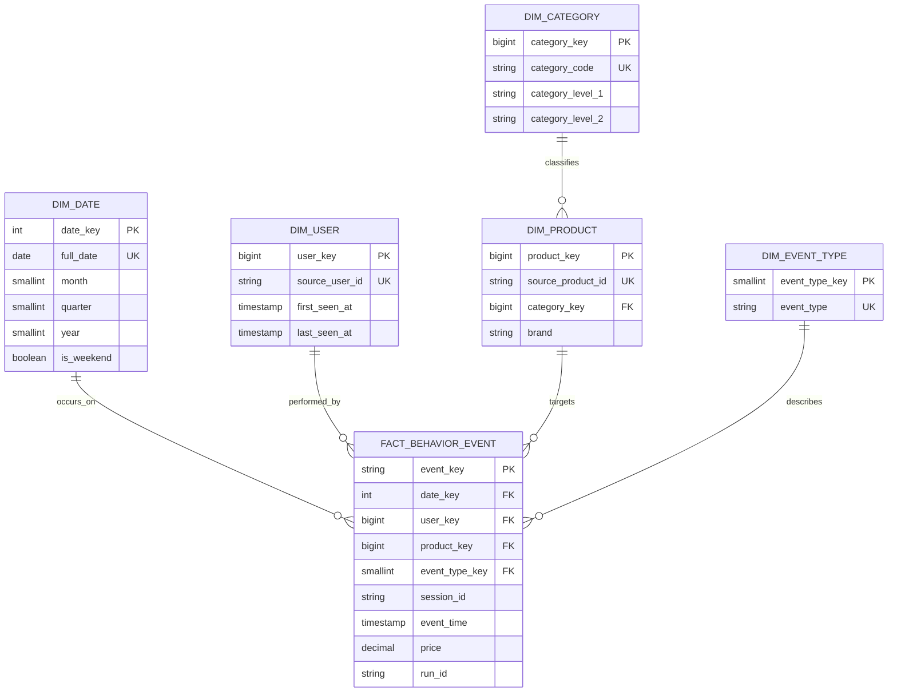

# Data model

The platform answers three questions about **public marketplace listings**:

1. How does an offer's advertised price move over time?
2. How complete and how fresh is each source's coverage?
3. When something changes on a listing, how quickly can we see it?

It observes only what a marketplace shows a visitor: a title, a price, an
availability word, a rating, and counters the site displays. There are no
orders, no payments, no carts, no users, and the model never invents them.

> **A counter change is not a sale.** `sold_count` is a number the site
> renders. It can jump, reset, or be rounded. Every table that touches it
> keeps the raw delta *and* the validity verdict side by side, and never
> calls the result demand.

Section 4 is the Gold model: a star schema (dimensions and facts) and the
serving marts built from it. The Kaggle behavior model the project started
from is still here, in section 9, and belongs to the `legacy` profile only.

## 1. The three frozen contracts

Owned by `config/marketplace_schema.py`, serialised and validated field for
field by `config/marketplace_wire.py`. A wire record carrying an unexpected
field is refused, so a contract cannot drift without a schema version bump.

### 1.1 Observation — `marketplace.observations.v1`

One row per *sighting* of one offer. The envelope carries the routing and the
crawl lineage; the payload carries the offer and the observation.

| Group | Fields |
|---|---|
| envelope | `event_id`, `schema_version`, `event_type`, `occurred_at`, `produced_at`, `marketplace`, `partition_key`, `crawl_run_id`, `raw_uri`, `payload` |
| `payload.offer` | `offer_id`, `marketplace_id`, `platform_listing_id`, `seller_id`, `product_title`, `brand`, `category_path`, `source_url`, `currency`, `first_seen_at`, `last_seen_at`, `active_status` |
| `payload.observation` | `observation_id`, `offer_id`, `observed_at`, `fetched_at`, `current_price`, `list_price`, `shipping_price`, `discount_amount`, `discount_percent`, `rating_value`, `rating_scale`, `rating_count`, `review_count`, `sold_count`, `availability`, `promotion`, `ranking_position` |
| raw lineage (on the observation) | `raw_uri`, `raw_sha256`, `adapter_version`, `crawl_run_id` |

The envelope is not free to disagree with its payload. Construction refuses a
record whose `event_id` is not the observation's `observation_id`, whose
`occurred_at` is not its `observed_at`, or whose `crawl_run_id` or `raw_uri`
differ from the observation's — so there is exactly one answer to "when was
this seen" and "where is the body".

**Identity.** `observation_id` is derived from the marketplace, the platform
listing id, `observed_at` and the raw hash; `offer_id` from the marketplace
and the platform listing id. Both are deterministic, which is what makes the
whole pipeline replayable: re-ingesting the same record overwrites itself.

Kafka key: `(marketplace, platform_listing_id)`, so every observation of one
listing lands on one partition and keeps its order.

### 1.2 Change — `marketplace.changes.v1`

Emitted by the speed layer when consecutive observations of one offer differ.
Exactly **seven** types, frozen (Brief section 10):

`NEW_OFFER`, `PRICE_CHANGED`, `LARGE_PRICE_DROP`, `RATING_CHANGED`,
`COUNTER_CHANGED`, `AVAILABILITY_CHANGED`, `OFFER_STALE`.

| Field | Notes |
|---|---|
| `event_id` | `SHA-256` of offer, current observation, type and rule version |
| `schema_version`, `rule_version` | the rules that produced this verdict travel with it |
| `change_type` | one of the seven |
| `detected_at` | when the speed layer decided, not when the site changed |
| `marketplace`, `offer_id` | |
| `previous_observation_id`, `current_observation_id` | null previous only for `NEW_OFFER` |
| `field_name` | null for `NEW_OFFER` and `OFFER_STALE`, required otherwise |
| `previous_value`, `current_value` | a scalar, except `NEW_OFFER`, which carries the whole offer |

Kafka key: the offer id.

`OFFER_STALE` means no observation arrived within
`MARKETPLACE_STALE_AFTER_SECONDS`. It does **not** mean the offer ended; it
means the crawler has not looked, or has not succeeded.

### 1.3 DLQ — `marketplace.observations.v1.dlq`

A record the Silver sink could not accept, with the evidence to diagnose it.

| Field | Notes |
|---|---|
| `dlq_id` | derived from topic, partition, offset and stage |
| `schema_version`, `failed_at` | the contract version, and when the sink refused it |
| `stage` | `DECODE` or `CONTRACT_VALIDATION` — those two, and nothing else |
| `source_topic`, `source_partition`, `source_offset`, `source_key` | where it came from |
| `marketplace`, `crawl_run_id`, `raw_artifact_id`, `raw_uri` | whatever could be salvaged |
| `error_type`, `error_message` | truncated to 2000 characters |
| `payload_text` | the record as received, capped at 1 MiB |

**A valid observation can never arrive here.** A write that failed is a
storage problem and is retried at the same offset; only a record that could
not be decoded or failed its contract is quarantined.

## 2. Medallion zones (MinIO — the authoritative warehouse)

| Zone | Path | Write policy |
|---|---|---|
| Bronze | `bronze/marketplace/raw/marketplace=<m>/observed_date=<d>/hour=<h>/crawl_run_id=<r>/raw_artifact_id=<a>/{body.bin,metadata.json}` | append-only; never rewritten |
| Silver | `silver/marketplace/offer_observations/marketplace=<m>/observed_date=<d>/observation_id=<o>.json` | one object per observation, idempotent by path |
| Silver quarantine | `silver/quarantine/offer_observations/observed_date=<d>/source_topic=<t>/partition=<p>/offset=<n>.json` | append-only |
| Silver, compacted (Phase 10) | `silver/marketplace/offer_observations_delta/observed_date=<d>/hour=<h>/` | Delta; rebuilt from the JSON objects, which stay the original |
| Gold star (Phase 10) | `gold/marketplace/dw/<table>/` | Delta; `MERGE` on the primary key, every version kept |
| Gold run | `gold/marketplace/runs/run_id=<run>/<dataset>/...` | one directory per run; never overwritten |
| Gold manifest | `gold/marketplace/manifests/run_id=<run>/manifest.json` | one per run, refused runs included |
| Gold pointer | `gold/marketplace/current.json` | replaced whole, by promotion only |

Every raw body has a metadata sidecar carrying `body_sha256`.
`crawler/reparse.py` verifies that checksum **before** parsing: a corrupted
artifact is never handed to a parser, because parsing it would launder
corruption into Silver-shaped output that looks canonical.

The Silver object path is a pure function of the observation, so a
re-delivered Kafka record rewrites the same object with the same bytes. That
is what makes "commit the offset only after the write" safe.

## 3. The Gold manifest and the serving pointer

```json
{
  "manifest_schema_version": "marketplace-gold-manifest.v1",
  "run_id": "mp-20261003T1617Z",
  "as_of": "2026-10-03T16:17:00+00:00",
  "silver_uri": "s3a://ecommerce-silver/marketplace/offer_observations",
  "gold_run_uri": "s3a://ecommerce-gold/marketplace/runs/run_id=mp-20261003T1617Z",
  "rule_versions": {"quality": "quality-rules.v2", "...": "..."},
  "datasets": [{"dataset_name": "offer_current", "uri": "...", "row_count": 12,
                "partition_columns": ["marketplace", "observed_date"]}],
  "quality": {"status": "PASS", "mandatory_failure_count": 0},
  "previous_run_id": "mp-20261002T0000Z"
}
```

`created_at` equals `as_of` by construction — nothing in the manifest reads a
wall clock, so two runs of the same context serialise to identical bytes and a
replay can be checked by comparing files. Wall-clock times live in
`audit.marketplace_batch_run`.

`current.json` is byte-identical to the run manifest it promoted. One write
replaces the whole document, so a reader never observes a torn pointer.

**Manifest v2 (Phase 10).** The star in `gold/marketplace/dw` is shared by
all runs rather than written per run, so a manifest alone no longer pins what a
run read. Version 2 adds, for each `dw` table, its Delta table version at the
time of the run, and the observation watermark (`max(observed_at)` loaded).
A replay reads the star at those versions. Readers keep accepting v1.

## 4. Gold: the dimensional model and the serving marts

> **Status.** This section is the Phase 10 design
> ([plan](PLAN_PHASE10_DIMENSIONAL_MODEL.md)), approved in P0, revised for two
> sources and the wide Silver tables
> ([revised plan](PLAN_PHASE10_REVISED.md) §3.4, D0 of
> [the plan on the refactor](PLAN_PHASE10_ON_REFACTOR.md)), and built in
> D1–D5. Until then the batch builds the ten marts of 4.9 straight from Silver
> (`processing/batch/marts.py`), and the mart tables in 4.9 describe what runs
> today. The column-level definitions live in
> [`model/star-schema.dbml`](model/star-schema.dbml). The star lives only in
> the lake as Delta tables (4.10);
> [`model/star-schema.sql`](model/star-schema.sql) is a PostgreSQL-dialect
> copy kept for drawing the diagram in a database tool, not a deployed schema.

### 4.1 Why a dimensional layer

Before Phase 10 the Gold zone was ten aggregate tables joined to each other on
natural keys. Each one fixed its grain inside its own code, nothing kept the
history of a listing's descriptive attributes, and every run reprocessed all of
Silver. A title, brand or seller that changed was simply overwritten in
`offer_current`, so the question "what was this listing called when it cost
that much" had no answer.

Phase 10 puts a Kimball star between Silver and the marts:

```
Silver observations ──────┐
<source>_listing_wide ────┼─► dimensions ─► facts ─► marts (cache.marketplace_*)
page_context ─────────────┤        (dw/, Delta, lake only)   (run-scoped, Postgres)
audit crawl tables ───────┘
```

Every mart is then a query over facts and dimensions, and a grain, a key or a
history rule is written down once, here, instead of once per mart.

### 4.2 Entity-relationship diagram

```mermaid
erDiagram
    DIM_MARKETPLACE ||--o{ DIM_SELLER : hosts
    DIM_MARKETPLACE ||--o{ DIM_BRAND : carries
    DIM_MARKETPLACE ||--o{ DIM_CATEGORY : owns
    DIM_MARKETPLACE ||--o{ DIM_PRODUCT_LISTING : lists
    DIM_CATEGORY ||--o{ DIM_CATEGORY : parent_of
    DIM_CATEGORY ||--o{ BRIDGE_CATEGORY_ANCESTRY : ancestor
    DIM_CATEGORY ||--o{ BRIDGE_CATEGORY_ANCESTRY : descendant
    DIM_CATEGORY ||--o{ DIM_PRODUCT_LISTING : version_category
    DIM_SELLER ||--o{ DIM_PRODUCT_LISTING : version_seller
    DIM_BRAND ||--o{ DIM_PRODUCT_LISTING : version_brand

    DIM_DATE ||--o{ FACT_OFFER_OBSERVATION : observed_on
    DIM_MARKETPLACE ||--o{ FACT_OFFER_OBSERVATION : listed_on
    DIM_PRODUCT_LISTING ||--o{ FACT_OFFER_OBSERVATION : version_seen
    DIM_SELLER ||--o{ FACT_OFFER_OBSERVATION : sold_by
    DIM_BRAND ||--o{ FACT_OFFER_OBSERVATION : branded
    DIM_CATEGORY ||--o{ FACT_OFFER_OBSERVATION : classified_as
    DIM_CATEGORY ||--o{ FACT_OFFER_OBSERVATION : found_on_page
    DIM_LISTING_FLAGS ||--o{ FACT_OFFER_OBSERVATION : flags

    DIM_DATE ||--o{ FACT_PRICE_SNAPSHOT_DAILY : day
    DIM_MARKETPLACE ||--o{ FACT_PRICE_SNAPSHOT_DAILY : listed_on
    DIM_PRODUCT_LISTING ||--o{ FACT_PRICE_SNAPSHOT_DAILY : version_at_close
    DIM_SELLER ||--o{ FACT_PRICE_SNAPSHOT_DAILY : sold_by
    DIM_BRAND ||--o{ FACT_PRICE_SNAPSHOT_DAILY : branded
    DIM_CATEGORY ||--o{ FACT_PRICE_SNAPSHOT_DAILY : classified_as
    DIM_LISTING_FLAGS ||--o{ FACT_PRICE_SNAPSHOT_DAILY : flags_at_close

    DIM_DATE ||--o{ FACT_PRICE_CHANGE : changed_on
    DIM_MARKETPLACE ||--o{ FACT_PRICE_CHANGE : listed_on
    DIM_PRODUCT_LISTING ||--o{ FACT_PRICE_CHANGE : version_seen
    DIM_SELLER ||--o{ FACT_PRICE_CHANGE : sold_by
    DIM_BRAND ||--o{ FACT_PRICE_CHANGE : branded
    DIM_CATEGORY ||--o{ FACT_PRICE_CHANGE : classified_as

    DIM_DATE ||--o{ FACT_COUNTER_DAILY : day
    DIM_MARKETPLACE ||--o{ FACT_COUNTER_DAILY : listed_on
    DIM_PRODUCT_LISTING ||--o{ FACT_COUNTER_DAILY : version_at_close

    DIM_DATE ||--o{ FACT_CATEGORY_PAGE_DAILY : day
    DIM_MARKETPLACE ||--o{ FACT_CATEGORY_PAGE_DAILY : listed_on
    DIM_CATEGORY ||--o{ FACT_CATEGORY_PAGE_DAILY : page

    DIM_DATE ||--o{ FACT_CRAWL_ATTEMPT : requested_on
    DIM_MARKETPLACE ||--o{ FACT_CRAWL_ATTEMPT : source
    DIM_CATEGORY ||--o{ FACT_CRAWL_ATTEMPT : target_page

    DIM_DATE {
        int date_key PK "yyyymmdd, -1 unknown"
        date full_date UK
        smallint day_of_week
        string day_name
        smallint week_of_year "ISO week"
        smallint month
        string month_name
        smallint quarter
        smallint year
        boolean is_weekend
        boolean is_double_day_sale "1/1 ... 12/12"
        boolean is_vn_holiday
    }
    DIM_MARKETPLACE {
        bigint marketplace_key PK
        string marketplace_code UK "tiki, lazada"
        string marketplace_id
        string marketplace_name
        string platform_type
        string country
        string default_currency
        timestamp first_crawled_at
    }
    DIM_SELLER {
        bigint seller_key PK
        string seller_id UK "already marketplace-scoped"
        bigint marketplace_key FK
        string seller_name "SCD1"
        string seller_type "SCD1, as the source names it"
        boolean is_official_store "SCD1"
        boolean is_trusted_store "SCD1, null if the source has no such badge"
        timestamp first_seen_at
        timestamp last_seen_at
        int observed_listing_count
    }
    DIM_BRAND {
        bigint brand_key PK "xxhash64(marketplace, brand_id)"
        bigint marketplace_key FK
        string brand_id "UK with marketplace"
        string brand_name "SCD1"
        timestamp first_seen_at
        timestamp last_seen_at
        int observed_listing_count
    }
    DIM_CATEGORY {
        bigint category_key PK
        bigint marketplace_key FK
        string category_id "UK with marketplace; Tiki id, Lazada slug"
        string category_name "nullable"
        string category_slug "nullable"
        bigint parent_key FK
        smallint level "root = 1"
        string full_path "1/2/1789/1795"
        string breadcrumb "named ancestors, top first"
        string category_l1_name
        string category_l2_name
        string category_l3_name
        string category_l4_name
        boolean is_leaf
    }
    BRIDGE_CATEGORY_ANCESTRY {
        bigint ancestor_key PK, FK
        bigint descendant_key PK, FK
        smallint depth "0 = the node itself"
    }
    DIM_PRODUCT_LISTING {
        bigint listing_key PK "xxhash64(offer_id, valid_from)"
        bigint offer_key "durable: xxhash64(offer_id)"
        string offer_id "UK with valid_from"
        bigint marketplace_key FK
        string platform_listing_id
        string sku "SCD1"
        string master_product_sku "SCD1, Tiki only"
        string product_title "SCD2"
        bigint brand_key FK "SCD2"
        bigint category_key FK "SCD2"
        bigint seller_key FK "SCD2"
        string origin "SCD1, Tiki only"
        boolean is_authentic "SCD1, Tiki only"
        boolean is_platform_verified "SCD1, Tiki only"
        string source_url "SCD1"
        timestamp valid_from
        timestamp valid_to "exclusive, 9999-12-31 if current"
        boolean is_current
        int version
    }
    DIM_LISTING_FLAGS {
        bigint listing_flags_key PK "xxhash64 of the flags"
        string availability
        string active_status
        boolean has_discount
        boolean has_rating
        boolean has_free_shipping "null = source does not say"
        boolean is_express_delivery "null = source does not say"
        boolean is_next_day_delivery "null = source does not say"
        boolean is_flash_deal "null = source does not say"
        boolean is_gift_available "null = source does not say"
    }
    FACT_OFFER_OBSERVATION {
        string observation_id PK "degenerate"
        int date_key FK
        bigint marketplace_key FK
        bigint listing_key FK "version valid at observed_at"
        bigint offer_key "durable"
        bigint seller_key FK
        bigint brand_key FK
        bigint category_key FK "the listing's category"
        bigint page_category_key FK "the page it was found on"
        bigint listing_flags_key FK
        timestamp observed_at
        timestamp fetched_at
        string currency "degenerate"
        decimal current_price
        decimal list_price
        decimal shipping_price
        decimal discount_amount
        decimal discount_percent
        decimal rating_value
        decimal rating_scale
        bigint rating_count
        bigint review_count
        bigint sold_count
        bigint ranking_position "organic rank, null for ads"
        bigint search_rank "display rank, ads included"
        int request_page
        boolean is_advertisement
        string crawl_run_id "lineage"
        string raw_uri "lineage"
        string raw_sha256 "lineage"
        string adapter_version "lineage"
    }
    FACT_PRICE_SNAPSHOT_DAILY {
        int date_key PK, FK
        bigint offer_key PK "durable"
        string currency PK
        bigint listing_key FK "version at the day's last sighting"
        bigint marketplace_key FK
        bigint seller_key FK
        bigint brand_key FK
        bigint category_key FK
        bigint listing_flags_key FK
        timestamp first_observed_at
        timestamp last_observed_at
        string last_observation_id
        decimal open_price
        decimal close_price
        decimal min_price
        decimal max_price
        decimal avg_price
        decimal first_list_price
        decimal last_list_price
        int observation_count
        int distinct_price_count
        decimal in_stock_ratio
    }
    FACT_PRICE_CHANGE {
        string observation_id PK "the sighting that showed the new price"
        string previous_observation_id
        int date_key FK
        bigint marketplace_key FK
        bigint listing_key FK
        bigint offer_key "durable"
        bigint seller_key FK
        bigint brand_key FK
        bigint category_key FK
        timestamp changed_at "when we saw it"
        timestamp previous_observed_at
        string currency
        string previous_currency
        decimal old_price
        decimal new_price
        decimal price_delta
        decimal pct_change
        decimal minutes_since_previous
        string direction "UP or DOWN"
        boolean is_large_drop
        string change_rule_version
    }
    FACT_COUNTER_DAILY {
        int date_key PK, FK
        bigint offer_key PK "durable"
        string counter_name PK
        bigint listing_key FK "version at the day's last sighting"
        bigint marketplace_key FK
        bigint first_value
        bigint last_value
        bigint raw_delta_sum
        bigint valid_delta_sum
        int valid_transition_count
        int invalid_transition_count
        bigint elapsed_seconds_valid
        double velocity_proxy_per_hour
        boolean counter_reset_or_invalid
        string invalid_reasons_json
        string counter_rule_version
    }
    FACT_CATEGORY_PAGE_DAILY {
        int date_key PK, FK
        bigint category_key PK, FK "the crawled page's category"
        string currency PK
        bigint marketplace_key FK
        int crawled_page_count
        bigint listed_product_count "the site's own total, last of the day"
        int observation_count
        int observed_offer_count
        int advertisement_count
        int seller_count
        int brand_count
        decimal min_price
        decimal p25_price
        decimal median_price
        decimal p75_price
        decimal max_price
        decimal avg_price
        int discounted_offer_count
        decimal discounted_offer_ratio
        decimal median_discount_percent
        decimal in_stock_ratio
    }
    FACT_CRAWL_ATTEMPT {
        bigint attempt_id PK "audit sequence"
        int date_key FK
        bigint marketplace_key FK
        bigint category_key FK "-1 if not a category page"
        string crawl_run_id
        string task_id
        string resource_type
        int attempt_number
        timestamp started_at
        timestamp completed_at
        string status
        int http_status
        string error_kind
        bigint latency_ms
        bigint raw_bytes
        bigint parsed_count
        bigint rejected_count
        string raw_uri "lineage"
    }
```



### 4.3 Bus matrix

| Business process \ Dimension | `dim_date` | `dim_marketplace` | `dim_product_listing` | `dim_seller` | `dim_brand` | `dim_category` | `dim_listing_flags` |
|---|:-:|:-:|:-:|:-:|:-:|:-:|:-:|
| Offer sighting — `fact_offer_observation` | ✓ | ✓ | ✓ | ✓ | ✓ | ✓ (listing and page) | ✓ |
| Daily price — `fact_price_snapshot_daily` | ✓ | ✓ | ✓ | ✓ | ✓ | ✓ | ✓ |
| Price change — `fact_price_change` | ✓ | ✓ | ✓ | ✓ | ✓ | ✓ | |
| Public counters — `fact_counter_daily` | ✓ | ✓ | ✓ | | | | |
| Category page — `fact_category_page_daily` | ✓ | ✓ | | | | ✓ (page) | |
| Crawling — `fact_crawl_attempt` | ✓ | ✓ | | | | ✓ (page) | |
| Kaggle behaviour — `fact_behavior_event` (section 9) | ✓ | | | | | | |

`dim_category` plays two roles on `fact_offer_observation`: `category_key` is
the category the listing itself declares, `page_category_key` the category
page the crawler found it on. They differ when a listing shows up on a parent
page or in another category's results, so "what is on this page" and "what
category is this product" stay two questions.

`dim_date` is the only dimension the marketplace star shares with the Kaggle
star. A Kaggle product (a Russian store, 2019–2020) and a Tiki listing are two
different populations, so no product, user or category dimension can be
conformed across them, and the model never draws one fact joining into the
other.

### 4.4 Dimensions

| Dimension | Natural key | History | Rows (8-hour Tiki run of 24/10) |
|---|---|---|---|
| `dim_date` | `full_date` | static | one per day of a fixed calendar, 2019-01-01 to 2030-12-31 |
| `dim_marketplace` | `marketplace_code` | SCD1 | 2 (Tiki, Lazada) |
| `dim_seller` | `seller_id` | SCD1 | about 1 155 |
| `dim_brand` | (`marketplace_code`, `brand_id`) | SCD1 | one per brand id seen |
| `dim_category` | (`marketplace_code`, `category_id`) | SCD1, rebuilt | every node on the 633 observed paths, plus Lazada's breadcrumb nodes |
| `bridge_category_ancestry` | (`ancestor_key`, `descendant_key`) | rebuilt | one per node and each of its ancestors, itself included |
| `dim_product_listing` | (`offer_id`, `valid_from`) | **SCD2** | about 8 530 current versions |
| `dim_listing_flags` | the nine flags | static | 8 748, generated up front |

The descriptive attributes that are not in the canonical observation (seller
name and type, store badges, brand id, SKUs, origin, delivery flags, category
names) come from Silver's `<source>_listing_wide` and `page_context` tables.
Each one is mapped per source below; a source that does not publish a field
leaves it `NULL`, which means *unknown*, never *false*.

Every dimension also holds an **unknown member** with key `-1` (section 4.5).

**`dim_date`** is one builder shared by both stars. It carries the columns the
Kaggle star already had (`day_of_week`, `day_name`, `week_of_year`, `month`,
`month_name`, `quarter`, `year`, `is_weekend`) and three more that matter for
Vietnamese retail prices: `is_double_day_sale` (1/1, 2/2 … 12/12, the
marketplace sale days), `is_vn_holiday` (a fixed list in code, lunar holidays
included) and the ISO week. A conformed dimension means the same rows and the
same meanings for both stars, so the Kaggle star moves to this builder in P1
instead of keeping its own.

**`dim_marketplace`** comes from the registered marketplaces in configuration,
plus `first_crawled_at` from the first observation. It has two real rows,
Tiki and Lazada; adding a marketplace is a new row, not a new column.

**`dim_seller`.** `seller_id` is already scoped to its marketplace
(`make_seller_id(marketplace, platform_seller_id)`), so it is the natural key
on its own. `first_seen_at`, `last_seen_at` and `observed_listing_count` are
overwritten each run (SCD1); they are what `seller_current` publishes. The
descriptive columns take the **latest value seen** (SCD1): the value on the
latest sighting that has one, so a sighting missing a field does not erase it:

| Column | Tiki (`tiki_listing_wide`) | Lazada (`lazada_listing_wide`) |
|---|---|---|
| `seller_name` | `seller_name` | `sellerName` |
| `seller_type` | `visible_impression_info.amplitude.seller_type` (`OFFICIAL_STORE`, `NONE`, …) | `LAZMALL` when an `icons[].bizType` is `lazMall`, else `NULL` |
| `is_official_store` | `is_from_official_store`, or `seller_type = 'OFFICIAL_STORE'` | an `icons[].bizType` is `lazMall` |
| `is_trusted_store` | `impression_info[].metadata.is_trusted_store = 1` | `NULL`: Lazada has no such badge |

Tiki's two official-store signals disagree on the sample page (4 of 5 rows
say `OFFICIAL_STORE` in `amplitude`, none in `is_from_official_store`), so
either one sets the flag and `seller_type` keeps the raw value. An observation
without a seller points to `-1`.

**`dim_brand`.** Brand ids are each marketplace's own numbers (Tiki
`brand_id`, Lazada `brandId`), so the natural key is (`marketplace_code`,
`brand_id`) and `brand_key = xxhash64(marketplace_code, brand_id)`.
`brand_name` is the latest name seen for the id (SCD1); `first_seen_at`,
`last_seen_at` and `observed_listing_count` are maintained like the seller's.
A listing without a brand id points to `-1`, even when it has a brand name:
a name alone is not a stable key, and 13.9 % of Tiki products carry no brand
at all. The same brand on two marketplaces is two rows; matching them is the
cross-marketplace work this phase does not take on.

**`dim_category` and `bridge_category_ancestry`.** A Tiki `category_path` such
as `1/2/1846/8095/2458` is a list of node ids from the root. Measured on
14 117 products (17/08) the depth varies from 4 to 8 levels, all under node
`1`. Each id on every observed path becomes one node row with `parent_key`,
`level` (the root is 1), `full_path` and `is_leaf` (no observed child). The
bridge is a closure table: one row per (ancestor, descendant) pair, including
the node itself at `depth = 0`, so "every listing anywhere under node X" is a
single join. Category ids are each marketplace's own, so the natural key
includes the marketplace. If one node is ever seen under two paths, a path a
page states (Lazada's breadcrumb) wins over one a listing implies, then the
most recently observed path; an advisory check reports the conflict.

The two sources describe their trees differently:

| | Tiki | Lazada |
|---|---|---|
| Node id (`category_id`) | the numeric id (`1789`) | the URL slug (`dien-thoai-di-dong`) |
| Path of a listing | `primary_category_path` of the row (`1/2/1789/1795`) | none: the listing takes its page's category |
| Path of a page | `page_context.categoryData` (`id`, `parent_id`, `ancestors[]`) | `page_context.mods.breadcrumb[]`, home entry dropped |
| Names | `categoryData.name` and `ancestors[].name` for the crawled pages, `primary_category_name` for a row's leaf | `breadcrumb[].title` |
| Slug | `categoryData.url_key`, and the frontier target `<slug>/c<id>` | the id itself |

Lazada's rows do carry numeric `categories` ids, but nothing on the page names
them or orders them into a path, so they stay in Silver (`category_ids`) and
the Lazada tree is the breadcrumb tree.

`category_name` and `category_slug` stay `NULL` where no page named the node:
Tiki's structural nodes `1` and `2` above every path, and nodes that appear
only inside other listings' paths. `breadcrumb` joins the names of the node's
**named** ancestors and itself, top first, with ` > `
(`Điện Thoại - Máy Tính Bảng > Máy tính bảng`); `category_l1_name` …
`category_l4_name` are the first four entries of that same list, for
dashboards that want fixed columns. Unnamed nodes are skipped rather than
shown as gaps, so `category_l1_name` is the top named level on both sources
even though Tiki's `level` counts the two structural nodes.

**`dim_product_listing`** is one row per *version* of an offer; section 4.6
gives the rules. It carries two keys: `listing_key` names one version, and
`offer_key = xxhash64(offer_id)` names the offer across all its versions (a
*durable key*). Tracked as SCD2: `product_title`, `brand_key`,
`category_key`, `seller_key`. Overwritten in every version (SCD1) with the
latest value seen: the columns below and `source_url`. `platform_listing_id` is part of the offer's
identity and never changes. The brand's name lives in `dim_brand`; the
listing keeps only the key, so a brand renamed by the site is one SCD1 update
there instead of a new version of every listing.

| Column | Tiki | Lazada |
|---|---|---|
| `sku` | `sku` | `sku` |
| `master_product_sku` | `master_product_sku` | `NULL` |
| `origin` | `origin` (free text: `China`, `Trung Quốc`, `Việt Nam`) | `NULL` (`location` is the seller's shipping place, not the product's origin) |
| `is_authentic` | `is_authentic = 1` | `NULL` |
| `is_platform_verified` | `tiki_verified = 1` | `NULL` |

`origin` is kept as the site writes it; the sample already spells China two
ways, and normalising it is a mart's job, not the dimension's.

**`dim_listing_flags`** is a junk dimension; it replaces `dim_offer_status`
and keeps its four flags. It folds the low-cardinality flags of a sighting
into one key instead of a column each on every fact row:

| Flag | Values | Tiki | Lazada |
|---|---|---|---|
| `availability` | `IN_STOCK`, `OUT_OF_STOCK`, `UNKNOWN` | canonical | canonical |
| `active_status` | `ACTIVE`, `INACTIVE`, `UNKNOWN` | canonical | canonical |
| `has_discount` | true, false | `list_price > current_price` or `discount_percent > 0` | same |
| `has_rating` | true, false | `rating_count > 0` | same |
| `has_free_shipping` | true, false, `NULL` | `freeship_campaign` set, or `amplitude.is_freeship_xtra` | an `icons[].bizType` is `Freeshipping` |
| `is_express_delivery` | true, false, `NULL` | `is_tikinow_delivery` | `NULL` |
| `is_next_day_delivery` | true, false, `NULL` | `is_nextday_delivery` | `NULL` |
| `is_flash_deal` | true, false, `NULL` | `amplitude.is_flash_deal` | `NULL` |
| `is_gift_available` | true, false, `NULL` | `isGiftAvailable` | `NULL` |

`has_rating` is `rating_count > 0` because 47 % of Tiki products show a
rating count of 0, which means *not yet rated*, not *rated zero*. A `NULL`
delivery flag means the source does not publish it, so a Lazada row is never
counted as "no express delivery". All 3 × 3 × 2 × 2 × 3⁵ = 8 748 combinations
are generated up front, so the table never changes and no fact can point at a
missing row. `listing_flags_key` is `xxhash64` of the nine values, with
`NULL` hashed as its own value. `is_advertisement` is **not** in this
dimension: it describes the placement of one sighting on one page, and the
fact keeps it next to `search_rank`.

### 4.5 Keys

- **Surrogate keys are deterministic:** `xxhash64` of the natural key, the
  same function the Kaggle star uses (`batch_layer/warehouse_job.py`).
  `listing_key = xxhash64(offer_id, valid_from)`;
  `category_key = xxhash64(marketplace_code, category_id)`;
  `brand_key = xxhash64(marketplace_code, brand_id)`. Rebuilding the
  same data produces the same keys, so a replay, a backfill and an incremental
  run all agree, and the facts can be loaded without first reading the
  dimension's key assignments back.
- `date_key` is the readable `yyyymmdd` integer; `listing_flags_key` is the
  `xxhash64` of the nine flags (4.4).
- **Unknown member.** Every dimension has a row with key `-1` and the label
  `Unknown`. A fact whose seller or category is missing points there, so **no
  foreign key in a fact is ever `NULL`** and an inner join never silently
  drops a row. The share of `-1` references is itself monitored (4.8).
- A hash could in principle collide or land on `-1`. The uniqueness check on
  every dimension key (4.8) turns that from a silent merge into a failed run.
- `date_key` on every marketplace fact is the **UTC** day: the batch runs with
  `spark.sql.session.timeZone=UTC`, and the existing marts already cut days
  that way.

### 4.6 SCD2 rules for `dim_product_listing`

1. Order the observations of one `offer_id` by `observed_at`, then
   `fetched_at`, then `observation_id` — the same tie-break the marts use
   (`marketplace_marts._ordered`), so two sightings at the same instant have a
   fixed order. Sightings that share an `observed_at` are reduced to the last
   of them before versions are cut: a version never opens and closes at the
   same instant, and (`offer_id`, `valid_from`) stays unique.
2. The first observation opens version 1 with `valid_from = observed_at`.
3. Each later observation whose tuple (`product_title`, `brand_key`,
   `category_key`, `seller_key`) differs from the open version — `NULL`
   compared null-safely — closes it at that observation's `observed_at` and
   opens the next version from the same instant.
4. A value that changes and later changes back (A → B → A) makes **three**
   versions. History records what was seen, not a set of distinct values.
5. `valid_to` is exclusive; the open version has `valid_to = 9999-12-31` and
   `is_current = true`. The versions of one offer never overlap and leave no
   gaps.
6. A fact row takes the version whose `[valid_from, valid_to)` contains its
   `observed_at` (for daily facts: the day's last sighting).
7. **Incremental runs** recompute the versions of every `offer_id` that has a
   new observation, from that offer's *whole* history, then `MERGE` the result.
   Recomputing only the new rows would mishandle an observation that arrives
   late, with an `observed_at` older than the current version.

Only these four attributes open a version. Price, rating and counters change
almost every sighting; they are measures on the facts, not attributes.

### 4.7 Facts and their grain

Every fact has a one-sentence grain. A row that does not match it is a defect,
and a uniqueness check enforces it on every run.

| Fact | Type | Grain | Primary key |
|---|---|---|---|
| `fact_offer_observation` | transaction | **one sighting of one offer by the crawler at one instant** (one Silver observation) | `observation_id` |
| `fact_price_snapshot_daily` | periodic snapshot (sparse) | **one offer, one UTC day, one currency, on which the offer was sighted at least once** | (`date_key`, `offer_key`, `currency`) |
| `fact_price_change` | transaction, derived | **one sighting whose price differs from the same offer's previous sighting** | `observation_id` |
| `fact_counter_daily` | periodic snapshot (sparse) | **one offer, one UTC day, one public counter** (`rating_count`, `review_count`, `sold_count`) | (`date_key`, `offer_key`, `counter_name`) |
| `fact_category_page_daily` | periodic snapshot (sparse) | **one crawled category page, one UTC day, one currency** | (`date_key`, `category_key`, `currency`) |
| `fact_crawl_attempt` | transaction | **one HTTP attempt to fetch one page** (one `audit.crawl_request_attempt` row) | `attempt_id` |

**`fact_offer_observation`** is the atomic fact; every price mart can be
derived from it. Besides the foreign keys it keeps the observation's measures
(`current_price`, `list_price`, `shipping_price`, `discount_amount`,
`discount_percent`, `rating_value`, `rating_scale`, the three counters),
the placement of the sighting on its page, `currency` and `fetched_at` as
degenerate attributes, and the raw lineage (`crawl_run_id`, `raw_uri`,
`raw_sha256`, `adapter_version`), so any row still leads back to the Bronze
body it was parsed from.

The placement columns come from the canonical observation:
`search_rank` is the position on the result list as displayed, sponsored rows
included; `ranking_position` is the organic position, `NULL` for a sponsored
row; `request_page` is the result page; `is_advertisement` marks a sponsored
row. The revised plan's `row_index` is `search_rank` and its `quantity_sold`
is `sold_count`, so neither gets a second column.

`category_key` is the listing's own category where the source declares one
(Tiki's `primary_category_path`, leaf node) and the page's category where it
does not (Lazada); `page_category_key` is always the page's category, parsed
from the request target (Tiki `<slug>/c<id>`, Lazada `<slug>`), or `-1`.

**`fact_price_snapshot_daily`** has open, close, min, max and average price,
first and last list price, `observation_count`, `distinct_price_count` and
`in_stock_ratio`. Its dimension keys are those of the day's **last** sighting.
It is keyed by the durable `offer_key`, not by `listing_key`: a title can
change at noon, and keying by version would split one offer-day into two rows
or make the grain depend on which version was chosen. The snapshot is
**sparse on purpose**: a day without a sighting has no row. Filling it forward
would invent observations, and "not seen today" is exactly what
`source_coverage_daily` measures.

**`fact_price_change`** holds `old_price`, `new_price`, `price_delta`,
`pct_change`, `minutes_since_previous`, `direction` (`UP`/`DOWN`) and
`is_large_drop`, computed with the speed layer's rule (drop ≥
`MARKETPLACE_LARGE_DROP_ABSOLUTE` or ratio ≥ `MARKETPLACE_LARGE_DROP_RELATIVE`)
and stamped with `change_rule_version`, so the batch and the speed layer cannot
disagree on what a large drop is. `changed_at` is when the crawler **saw** the
new price, not when the site changed it; the change happened somewhere in
`(previous_observed_at, changed_at]`. When the currency differs between the two
sightings, `pct_change` is `NULL` rather than a meaningless ratio. A
sighting's previous one is looked up across the whole history of the offer,
not within one run, so an incremental run reads the last known sighting of each
affected offer from the fact itself.

**`fact_counter_daily`** keeps the counter rules unchanged: transitions are
judged over the offer's whole ordered history, a negative delta is kept and
flagged (`counter_reset_or_invalid`, `invalid_reasons_json`), never clamped.

**`fact_category_page_daily`** describes what a category page showed on a
day, by the page's category (`page_category_key` of the sightings), not by the
listings' own categories. It is built from `fact_offer_observation` and
`page_context`:

- `crawled_page_count`: distinct (`request_target`, `request_page`) fetched
  that day; `observation_count`: sightings on those pages;
- `observed_offer_count`, `advertisement_count`, `seller_count`,
  `brand_count`: distinct offers, sponsored offers, sellers and brands (the
  `-1` members not counted);
- `listed_product_count`: the size of the category as the site states it on
  the page (Tiki `paging.total`, Lazada `mainInfo.totalResults`), the day's
  last value;
- prices and discounts over **offers, not sightings**: each offer contributes
  its last price of the day on this category's pages, so an offer seen twelve
  times does not weigh twelve times. `discounted_offer_count` and
  `discounted_offer_ratio` use `has_discount`; `median_discount_percent` is
  over the discounted offers only; `in_stock_ratio` is the share of offers
  whose last sighting was `IN_STOCK`.

Like the price snapshot it is sparse: a page not crawled on a day has no row.
`observed_offer_count` against `listed_product_count` is how much of the
category the crawl actually saw.

**`fact_crawl_attempt`** takes its marketplace through the frontier task (the
attempt table carries none, see `attach_marketplace_code`). Its
`category_key` is parsed from the frontier target of a `LISTING_PAGE` task
(Tiki `<slug>/c<id>`, Lazada `<slug>`), the same rule as `page_category_key`;
any other page points to `-1`.

**Additivity.** Which measures may be summed decides what a dashboard may do
with them:

| Measure | Additive across |
|---|---|
| `observation_count`, `parsed_count`, `rejected_count`, `raw_bytes`, `crawled_page_count`, row counts | every dimension |
| `observed_offer_count`, `advertisement_count`, `seller_count`, `brand_count` (distinct counts) | nothing: an offer on two pages or two days is counted on each |
| `listed_product_count` | categories that do not overlap only, never days or a node and its ancestor |
| `raw_delta_sum`, `valid_delta_sum`, `price_delta` | days, within one offer and counter |
| prices, `rating_value`, `pct_change`, `in_stock_ratio`, ratios | nothing: average, min, max or median only |
| `sold_count`, `review_count`, `rating_count` (the counters themselves) | nothing: they are running totals the site displays |

**Which sightings each fact judges (D3).** `fact_offer_observation` keeps every
sighting, sponsored ones marked by `is_advertisement`. `fact_price_snapshot_daily`,
`fact_price_change` and `fact_counter_daily` are built from the **organic**
sightings only, as the marts are: a sponsored placement rotates between loads and
would make an offer's price jump. So the reconciliations of 4.8 compare them with
`fact_offer_observation WHERE NOT coalesce(is_advertisement, false)` (the column is NULL for a source that does not say). `fact_category_page_daily`
counts every sighting a page showed (`observation_count`, `advertisement_count`)
and judges prices and discounts over its organic offers. A pair of sightings in
two currencies is a price change with `pct_change` NULL and never a large drop.

### 4.8 Model checks

Added to the quality gate (`config/quality_rules.py`) alongside the existing
rules, and stored per run in `audit.marketplace_quality_result` like every
other check.

Mandatory — any failure refuses the run:

- **Referential integrity:** every foreign key of every fact exists in its
  dimension (the `-1` row included), `page_category_key` and `brand_key`
  included.
- **Grain:** the primary key of every fact and dimension is unique.
- **SCD2:** each `offer_id` has exactly one current version; its versions do
  not overlap and leave no gap; `version` counts up from 1 without holes.
- **Reconciliation:** per day, `sum(fact_price_snapshot_daily.observation_count)`
  equals the number of `fact_offer_observation` rows, and the number of
  `fact_price_change` rows equals the sum of `price_change_count` in
  `offer_change_daily`, and `sum(fact_category_page_daily.observation_count)`
  equals the number of `fact_offer_observation` rows whose
  `page_category_key` is not `-1`.
- **Closure:** every category node has a depth-0 row in the bridge, and one row
  per ancestor on its path.

Advisory — reported, not blocking:

- the share of fact rows pointing at a `-1` member exceeds its threshold;
- a category node was seen under more than one parent;
- during the migration only: a mart rebuilt from the facts differs from the
  mart built the old way from Silver.

### 4.9 Serving marts — `cache.marketplace_*`

Ten tables. The lake holds every run; PostgreSQL holds exactly one version,
the one `current.json` names. Their names and columns do not change in
Phase 10: dashboards, `ops/*` and the tests keep reading the same tables, and
only the source behind them moves from Silver to the star.

| Table | Grain | What it carries |
|---|---|---|
| `marketplace_offer_current` | `offer_id` | the latest observed state of each offer, with its raw lineage |
| `marketplace_seller_current` | `(seller_id, marketplace)` | first and last seen, observed offer count |
| `marketplace_offer_price_history_daily` | `(marketplace, offer_id, observed_date, currency)` | first/last/min/max/avg price, observation and distinct-price counts |
| `marketplace_offer_change_daily` | same | transitions per day: price changes, drops, increases, rating, counter, availability |
| `marketplace_offer_freshness` | `offer_id` | `age_seconds` and `FRESH`/`STALE`/`FUTURE` **at the run's `as_of`** |
| `marketplace_category_price_daily` | `(marketplace, category_path, observed_date, currency)` | min, p25, median, p75, max, avg across observed offers |
| `marketplace_source_coverage_daily` | `(marketplace, observed_date)` | eligible vs observed vs missing offers, parsed and rejected counts, coverage and rejection rates |
| `marketplace_crawl_reliability_daily` | `(marketplace, request_date)` | requests, successes, failures, latency avg and p95, raw bytes, and a count for each of the five error kinds a crawl produces (rate limited, transport, server, parse, validation) |
| `marketplace_counter_delta_daily` | `(marketplace, offer_id, observed_date, counter_name)` | raw and valid delta sums, a velocity proxy, and the invalid-transition evidence |
| `marketplace_price_anomaly_daily` | `(marketplace, offer_id, observed_date, currency)` | a robust outlier verdict against this offer's own recent history |

Four of them carry a rule version in every row — `freshness_rule_version` on
freshness and coverage, `counter_rule_version`, `anomaly_rule_version` — so a
stored verdict stays checkable after the configuration moves on.

#### Three gradings that are easy to misread

**Freshness** is judged at the run's `as_of`, not at query time. A `FUTURE`
row is a clock problem, not a fresh one.

**Counter deltas** are never clamped. A negative delta is kept and the row is
marked `counter_reset_or_invalid` with the reasons in
`invalid_reasons_json`. Hiding the reset would turn a site quirk into a
plausible-looking number. `velocity_proxy_per_hour` is a proxy for *how fast
the displayed number moved*, and is not a sales rate.

**Price anomaly** compares one offer against **its own** recent observed
price history, never against another offer. `anomaly_status` distinguishes
`NORMAL`, `ANOMALOUS_HIGH`, `ANOMALOUS_LOW`, `INSUFFICIENT_HISTORY` and
`INSUFFICIENT_DISPERSION` — the last two say "no verdict", which is not the
same as "normal". `currency` is part of the key, so an offer that switched
currency mid-day yields one row per currency rather than one nonsense row.
The row carries its own `window_days`, `min_samples`, `mad_threshold` and
`iqr_multiplier`. It is a statistical statement about a series, not a claim
that a price is wrong, dishonest or a bargain.

#### Where each mart comes from

| Mart | Built from | Notes |
|---|---|---|
| `offer_current` | `dim_product_listing` (current version) + the offer's last `fact_offer_observation` row + `dim_listing_flags`, `dim_marketplace`, `dim_category`, `dim_brand` | `category_path` is the leaf's `full_path`; `brand` is `dim_brand.brand_name` |
| `seller_current` | `dim_seller` | already holds first/last seen and the count |
| `offer_price_history_daily` | `fact_price_snapshot_daily` | `first_price`/`last_price` are `open_price`/`close_price` |
| `offer_change_daily` | `fact_price_change` for the price columns; `fact_offer_observation` (previous sighting per offer) for the rating, counter and availability columns | a price-only fact cannot supply the other three change counts |
| `offer_freshness` | the offer's last `fact_offer_observation` row, judged at `as_of` | stays a mart: a verdict that depends on `as_of` is not a fact |
| `category_price_daily` | `fact_offer_observation` × `dim_category` | percentiles over sightings, as today; `__UNKNOWN__` is the `-1` member |
| `source_coverage_daily` | `fact_offer_observation` + `dim_listing_flags` (`active_status`) + `fact_crawl_attempt` | eligibility calendar unchanged |
| `crawl_reliability_daily` | `fact_crawl_attempt` | |
| `counter_delta_daily` | `fact_counter_daily` | |
| `price_anomaly_daily` | `fact_price_snapshot_daily` | it already read the daily price table; it keeps reading the same numbers |

P4 accepts this rebuild only if, on the same `as_of`, every rebuilt mart
matches the old one row for row; any difference is listed with its reason.

#### Three new marts

| Mart | Grain | Built from | Answers |
|---|---|---|---|
| `category_price_index_daily` | marketplace × category node (any level) × day × currency | `fact_price_snapshot_daily` × `bridge_category_ancestry` | median close price of the offers under the node, as an index with the node's first day = 100 |
| `listing_price_volatility` | offer × window (7 and 30 days) × day | `fact_price_snapshot_daily`, `fact_price_change` | standard deviation and coefficient of variation of the daily close price, number of price changes |
| `discount_daily` | marketplace × category node × day | `fact_price_snapshot_daily` × `dim_listing_flags` × bridge | share of offers on discount, p25/median/p75 of the discount percentage |

The category index compares price *levels* by category without matching
products across marketplaces, which per-product comparison would require.
It is a median over whichever offers were seen that day, so a change in the
mix of offers moves it as well as a change in prices; the mart publishes the
offer count next to the index so that can be read.

### 4.10 Storage and publication

| Layer | Where | Format and write |
|---|---|---|
| Silver | `silver/marketplace/offer_observations_v2/` (partitioned by `source_code`, `observed_date`), `silver/marketplace/<source>_listing_wide/`, `silver/marketplace/page_context/` | written by the `silver` stage; the day partitions it covers are replaced whole |
| Star | `gold/marketplace/dw/<table>/`, outside the run directories | Delta, `MERGE` on the primary key; daily facts replace the affected days. Lake only: never copied to PostgreSQL |
| Marts | `gold/marketplace/runs/run_id=<run>/marts/<mart>/` | one directory per run, as before |
| PostgreSQL | schema `cache` (the marts) only | published in one transaction, as before; a serving cache, rebuilt from the lake at any time |

Delta keeps every version of a `dw` table, so a run can be replayed against
exactly the star it read: manifest v2 (section 3) records the Delta version of
each `dw` table the run used.

### 4.11 Why this design

**Why a star.** The questions are all "a measure, sliced by date, listing,
seller, category". A star answers each with one join per dimension, BI tools
model it directly, and every mart becomes a short query over shared, tested
tables instead of its own pass over Silver. The ten existing marts stay as the
serving layer; the star is what they are built from.

**Why the category tree is the one snowflake.** Snowflaking for its own sake
buys nothing here: Parquet's dictionary encoding already makes repeated
strings nearly free, and the dimensions are rebuilt, not updated in place, so
there is no update anomaly to avoid. The Tiki category tree is different: it
is a ragged hierarchy, 4 to 8 levels deep, which does not fit fixed
`category_level_1 … N` columns. A node table with a parent key plus a closure
table is the standard answer; it lets one query aggregate at any level. The
facts still carry `category_key` directly, so the common query stays one join.

**Why SCD2 for the listing, SCD1 elsewhere.** A listing's title, brand,
category and seller change while we watch, and a price only means something
next to what was being sold at that moment. Overwriting would rewrite past
facts with today's description. Sellers and categories have no history we
could observe — only aggregates and a name — so SCD1 is enough. The Kaggle
star is SCD1 for the same reason in the opposite direction: it is a closed
historical file, nothing changes after the fact.

**Why a durable key next to the version key.** `listing_key` answers "which
description applied to this sighting"; `offer_key` answers "the same offer,
across all its descriptions". Daily facts are keyed by `offer_key`, so their
grain does not depend on when a version opened.

**Why deterministic surrogate keys.** A sequence would make keys depend on
load order: a replay or a backfill would number rows differently, and every
fact would have to look keys up in the dimension before loading. A hash of the
natural key gives the same key in every run, in any order, which is what the
pipeline's replayability (section 1.1) already relies on.

**Why an unknown member instead of `NULL`.** A `NULL` foreign key disappears
from an inner join without a trace. A `-1` row keeps the fact in every total,
labels it `Unknown` on a dashboard, and can be counted.

**Why a junk dimension.** Nine flags as nine dimensions would add nine joins
for almost no content; as columns on the fact they would be repeated on every
row. One static table of 8 748 rows keeps both the fact and the queries narrow,
and a new source fills the flags it has and leaves the rest `NULL` without a
schema change. A flag that turns out to need history or many values is the
sign it belongs somewhere else: `is_advertisement` stays on the fact for that
reason.

## 5. Audit — `audit.*`

Operational metadata only. No raw body, no cookie, no authorization header,
no traceback, in any of these tables.

### 5.1 The crawl

| Table | Key | Notes |
|---|---|---|
| `crawl_frontier` | `task_id` | what to crawl and when: tier, priority, `scheduled_for`, `status`, attempts, and the lease. A constraint enforces that only a `LEASED` row carries lease fields, and that it carries both |
| `crawl_run` | `crawl_run_id` | one pass of a worker: requested, succeeded, failed, adapter version |
| `crawl_request_attempt` | `attempt_id` | one HTTP attempt: status, latency, raw bytes and URI, `parsed_count`, `rejected_count`, `error_kind` |
| `crawl_source_state` | `marketplace_code` | consecutive failures and `opened_until`. **There is no boolean**: the circuit is open only while `opened_until > now()` |

`error_kind` is a closed set: `RATE_LIMITED`, `TRANSIENT_NETWORK`,
`SERVER_ERROR`, `CLIENT_ERROR`, `ROBOTS_DENIED`, `STORAGE_ERROR`,
`PARSE_ERROR`, `VALIDATION_ERROR`, `PUBLISH_ERROR`, `UNKNOWN`.

`PUBLISH_ERROR` was added in Phase 8 for a Kafka failure *after* a good fetch
and parse. Its `parsed_count` is the **acknowledged** count, not the parsed
one — so an attempt that parsed eight and published three records three. The
raw body is in Bronze either way.

### 5.2 The batch

| Table | Key | Notes |
|---|---|---|
| `marketplace_batch_run` | `run_id` | `as_of`, both URIs, row counts, `dataset_counts`, `cache_published`, `manifest_uri`, `manifest_promoted`, and `status` |
| `marketplace_quality_result` | `(run_id, check_name)` | severity, dataset, `PASS`/`FAIL`/`SKIPPED`, observed value, expectation, rule version, and a small identifiers-only failure sample |
| `marketplace_cache_version` | singleton | which `run_id` the cache currently holds, when, its dataset counts, the quality rule version and the manifest URI |

`status` is one of `RUNNING`, `GOLD_WRITTEN`, `QUALITY_FAILED`, `SUCCEEDED`,
`FAILED`. **`QUALITY_FAILED` is deliberately distinct from `FAILED`**: the run
produced complete, inspectable Gold and was refused, which is a different
operational situation from a crash. A row is written for every rule on every
run, refused runs included — a blocked publication with no stored evidence
cannot be told apart from a crash.

`marketplace_cache_version` is a singleton by constraint, so "which version is
live" has exactly one answer, and `ops validate` compares it to the pointer.

### 5.3 The speed layer

`marketplace_speed_batch`, keyed `(query_name, query_id, batch_id)`.

The `query_id` is not decoration. Batch IDs restart at 0 under a new
checkpoint, so without it a replay's batch 0 is mistaken for the old run's and
skipped as already `SUCCEEDED` — which is exactly what stopped the Phase 8
index rebuild until it was fixed. A check constraint also enforces
`input_rows = invalid + applied + duplicate + late`.

Besides the counts, each `SUCCEEDED` row carries the batch's latency
(`latency_p50_ms`, `latency_p95_ms`, `latency_max_ms`: completion minus each
applied observation's `produced_at`) and where its time went, in ms on the
monotonic clock: `stage_clients_ms` (opening the Kafka, Elasticsearch and
Redis clients), `stage_collect_ms` (Spark computing the batch, the stateful
comparison included), `stage_kafka_ms`, `stage_es_ms`, `stage_redis_ms`. All
are nullable: a `FAILED` row and rows from before these columns have none.
`marketplace_stream_progress` holds Spark's own progress for the same key.

## 6. Elasticsearch

| Index | Written by | `_id` | Holds |
|---|---|---|---|
| `marketplace-changes-v1` | speed layer | `event_id` | change events |
| `marketplace-offers-current-v1` | speed layer | `offer_id` | current offer state |
| `marketplace-source-health-v1` | `ops/es_projector.py` | `marketplace_code` | circuit state, consecutive failures, last success, freshness |
| `marketplace-crawl-attempts-v1` | projector | `attempt_id` | the attempt audit, joined to the frontier's marketplace |
| `marketplace-speed-batches-v1` | projector | `query_name:query_id:batch_id` | micro-batch outcomes and durations |
| `marketplace-dlq-v1` | projector | `dlq_id` | quarantined records, **without `payload_text`** |

Every `_id` is derived from the row's own key, which makes a projection
idempotent: the projector re-reads an overlap window every pass, and a
re-projected row overwrites itself.

Mappings come from composable index templates. Money is `scaled_float` with
scaling factor 1 000 000 — the same six decimal places as the
`decimal(38,6)` cache columns, where a `float` would round 199000.99 away.
Identifiers are `keyword`. The four projector indices are `dynamic: strict`,
so a field the projector did not mean to write is a loud failure rather than a
silent new column.

`previous_value` / `current_value` are the one awkward case: a scalar for most
change types, the whole offer for `NEW_OFFER`, and no Elasticsearch field is
both. The sink stores an object value as its canonical JSON string, and the
template maps the field as `keyword` with a `scaled_float` sub-field carrying
`ignore_malformed`, so price charts aggregate and the JSON string is skipped
rather than rejecting the document. The wire contract is unchanged.

A template applies only to an index created after it. Recreating an index
that predates its template is in the runbook.

## 7. Redis

| Key | Type | Member / value | TTL |
|---|---|---|---|
| `rt:changes:recent` | sorted set | `event_id`, scored by `detected_at` in epoch microseconds, trimmed to `REDIS_MARKETPLACE_RECENT_CHANGES_MAX` | — |
| `rt:change:<event_id>` | string | the change event as canonical JSON | `REDIS_MARKETPLACE_OFFER_TTL_SECONDS` |
| `rt:offer:<offer_id>` | hash | `state_json`, `offer_id`, `marketplace`, `observation_id` | same |
| `rt:source:<marketplace>:last_observation` | string | the newest `observed_at` seen, advanced only forwards | — |

Membership by `event_id` and `offer_id` is what keeps a replay from
duplicating anything: the same event written twice is the same member.

## 8. Backup

What a backup carries, and why, is in [RUNBOOK.md](RUNBOOK.md). The short
version for this document: Bronze and Silver whole, the Gold manifests and
pointer, the Gold run the pointer names, and `pg_dump` of `audit` and `cache`.
Phase 10 adds the star — `gold/marketplace/dw` and the `dw` schema — to that
list, since the marts of every later run are built from it. Kafka, Elasticsearch, Redis and the speed checkpoints are **not** backed up —
they are derived, and they refill from new crawls.

## 9. Legacy: the Kaggle behavior model

Belongs to the `legacy` and `jobs` profiles. Kept because the project started
here and the report compares the two.

The Kaggle Multi-Category Store dataset contains only `view`, `cart` and
`purchase` events — no orders, payments, reviews, fraud or geography — and the
model never invents them. The one canonical event contract is in
`config/schema.py`: `event_time`, `event_type`, `user_id`, `user_session`,
`product_id`, `category_id`, `category_code`, `brand`, `price`.

Zones: `bronze/ecommerce_events`, `silver/behavior_events` (plus a
quarantine), `gold/warehouse/*` and `gold/mart/*`.



`fact_behavior_event` has one row per valid source event; `event_key` is
`SHA-256(event_type ‖ user_id ‖ product_id ‖ session_id ‖ event_time)`, so
reprocessing never duplicates a fact.

The dimensions of **this** star are SCD Type 1: every run rebuilds them from
Silver and keeps the latest value. That fits a closed historical file, where
nothing changes after the fact. It does not fit the marketplace, whose listings
change while they are watched, which is why `dim_product_listing` (section 4.6)
is SCD Type 2. `dim_date` is the one dimension both stars share; from Phase 10
it is built by one builder with the columns of section 4.4.

Marts in `cache`: `funnel_daily`, `product_daily`, `category_daily`,
`session_daily`, `daily_revenue`. `revenue` sums `price` over purchase events
and is never described as an order metric; funnel rates are same-day
population ratios, not ordered-path attribution. ML outputs go to
`cache.predictions` (Darts N-BEATS and LSTM) and `cache.anomalies` (PyOD
AutoEncoder).

Its audit is `audit.pipeline_run` and `audit.data_quality_result` — separate
tables from the marketplace ones on purpose: that pair belongs to the
behavioural pipeline, its `checked_at` is a naive timestamp, and its key has
no room for severity or dataset. Sharing them would couple two unrelated
pipelines through one migration.

## Publish consistency (both pipelines)

Spark writes each mart to the `staging` schema, then one transaction truncates
and refills the `cache` tables. Superset therefore always sees either the last
good version or the complete new version — never a half-loaded dashboard. A
refused publish rolls the truncate back with it, which is why drill D9 leaves
the twelve serving rows untouched.
