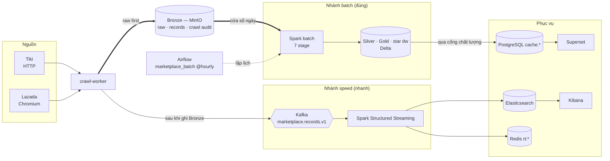

# 01. Toàn hệ thống trong một hình

> Đúng với: commit `f82f5b5` · Cập nhật: 2026-11-02 · Nguồn chân lý: `docs/ARCHITECTURE.md`, `compose/docker-compose.yml`

**Dùng ở đâu:** `README.md` (hình duy nhất), báo cáo chương 1 (giới thiệu) và đầu chương kiến trúc.

**Câu hỏi:** dữ liệu đi từ đâu tới đâu, và vì sao đây là kiến trúc Lambda?

**Loại và bố cục:** flowchart trái → phải, năm cột:

1. Nguồn;
2. Thu thập;
3. Lưu trữ gốc (Bronze);
4. Hai nhánh xử lý: batch ở trên, speed ở dưới;
5. Phục vụ.

Airflow nằm trên cùng, nối vào batch bằng nét đứt. Không vẽ chi tiết stage và topic; hình 02 và 13 làm việc đó.

## Thành phần

| id | Nhãn hiển thị | Nhóm | Ghi chú |
|---|---|---|---|
| tiki | Tiki (HTTP, `__NEXT_DATA__`) | Nguồn | ≥ 2 s/request, tuân thủ robots.txt |
| lazada | Lazada (Chromium một tab, XHR) | Nguồn | ≥ 5 s/trang |
| crawler | crawl-worker | Thu thập | frontier trong PostgreSQL, raw first |
| bronze | Bronze (MinIO) — raw + records + crawl audit | Lưu trữ gốc | nguồn sự thật |
| kafka | Kafka `marketplace.records.v1` | Speed | bản nhanh của Bronze |
| speed | Speed (Spark Structured Streaming) | Speed | chuẩn hoá + phát hiện thay đổi |
| es | Elasticsearch | Phục vụ | sự kiện thay đổi, offer hiện tại |
| redis | Redis `rt:*` | Phục vụ | trạng thái realtime |
| batch | Batch (Spark, 7 stage) | Batch | silver → dimensions → facts → marts → quality → publish → promote |
| lake | Silver + Gold + star `dw` (Delta) | Batch | bản đúng, có version |
| cache | PostgreSQL `cache.*` | Phục vụ | chỉ là cache của Gold |
| superset | Superset | Phục vụ | BI trên Gold |
| kibana | Kibana | Phục vụ | dashboard speed |
| airflow | Airflow (`marketplace_batch` @hourly) | Điều phối | |

## Quan hệ

| Từ | Tới | Nhãn | Nét |
|---|---|---|---|
| tiki, lazada | crawler | trang công khai | liền |
| crawler | bronze | ghi trước (raw first) | đậm |
| crawler | kafka | publish sau khi Bronze đã ghi | liền |
| kafka | speed | | liền |
| speed | es, redis | | liền |
| bronze | batch | đọc theo cửa sổ ngày | đậm |
| batch | lake | MERGE Delta | liền |
| lake | cache | publish khi qua cổng chất lượng | liền |
| cache | superset | | liền |
| es | kibana | | liền |
| airflow | batch | lập lịch | đứt |

**Chú thích dưới hình:** "Kiến trúc Lambda của hệ thống. Crawler ghi Bronze trước khi phát lên Kafka. Nhánh batch dựng lại mọi thứ từ Bronze (chính xác, có version). Nhánh speed cho sự kiện thay đổi độ trễ thấp."

## Bản nháp Mermaid

## Kiểm chứng

`compose/docker-compose.yml` (service), `src/ecomdata/ingestion/pipeline.py` (raw first), `src/ecomdata/ingestion/service.py` (`publishing_executor`: Kafka sau Bronze), `src/ecomdata/orchestration/dags/marketplace_batch.py`.
