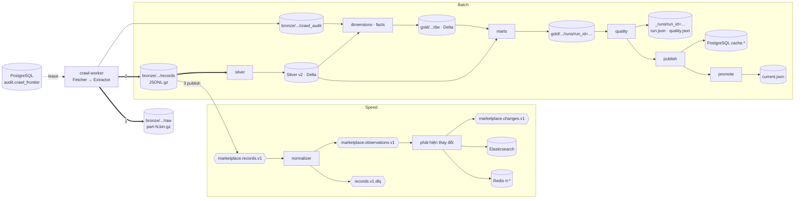

# 02. Luồng dữ liệu chi tiết

> Đúng với: commit `f82f5b5` · Cập nhật: 2026-11-02 · Nguồn chân lý: `src/ecomdata/ingestion/`, `src/ecomdata/processing/`, `src/ecomdata/domain/topics.py`

**Dùng ở đâu:** `docs/ARCHITECTURE.md` §2 (thay hình hiện tại, vốn còn ghi Silver và Gold là Parquet), báo cáo chương kiến trúc.

**Câu hỏi:** mỗi dữ liệu nằm ở đâu, được ghi bởi ai, và đọc bởi ai?

**Loại và bố cục:** flowchart trái → phải, ba làn ngang:

1. trên: batch;
2. giữa: Bronze và crawler;
3. dưới: speed.

Mỗi kho là một hình trụ có ghi đường dẫn; mỗi topic là một hình lục giác.

## Thành phần

| id | Nhãn | Nhóm | Ghi chú |
|---|---|---|---|
| frontier | `audit.crawl_frontier` + `audit.crawl_*` (PostgreSQL) | Thu thập | hàng đợi việc và audit vận hành |
| worker | crawl-worker: Fetcher → Extractor | Thu thập | `ingestion/pipeline.py` |
| raw | `bronze/marketplace/raw/` — `part-N.bin.gz` + `metadata.json` | Bronze | phản hồi nguyên vẹn |
| rec | `bronze/marketplace/records/` — JSONL.gz theo trang | Bronze | mỗi dòng nguồn một record `marketplace-record.v1` |
| caudit | `bronze/marketplace/crawl_audit/` — JSONL.gz theo crawl run | Bronze | bản lưu của audit (ADR-0008) |
| k_rec | `marketplace.records.v1` | Kafka | |
| k_rec_dlq | `marketplace.records.v1.dlq` | Kafka | record bị quarantine |
| norm | speed: normalizer (`foreachBatch`) | Speed | |
| k_obs | `marketplace.observations.v1` | Kafka | dẫn xuất |
| k_obs_dlq | `marketplace.observations.v1.dlq` | Kafka | |
| state | speed: truy vấn có trạng thái theo offer | Speed | `domain/change_rules.py` |
| k_chg | `marketplace.changes.v1` | Kafka | |
| es | ES `marketplace-changes-v1`, `marketplace-offers-current-v1` | Phục vụ | |
| redis | Redis `rt:offer:*`, `rt:change:*`, `rt:changes:recent` | Phục vụ | |
| s_silver | stage `silver` | Batch | |
| silver | `silver/marketplace/` — `offer_observations_v2`, `<source>_listing_wide`, `page_context`, `quarantine` | Lake | Delta, partition `source_code`, `observed_date` |
| s_star | stage `dimensions`, `facts` | Batch | |
| dw | `gold/marketplace/dw/` — 8 dim/bridge, 6 fact | Lake | Delta MERGE |
| s_marts | stage `marts` | Batch | |
| gold | `gold/marketplace/runs/run_id=<run>/` — 10 mart | Lake | |
| s_quality | stage `quality` | Batch | |
| runs | `silver/marketplace/_runs/run_id=<run>/` — `run.json`, `quality.json`, tóm tắt stage | Lake | |
| s_pub | stage `publish` | Batch | |
| cache | PostgreSQL `cache.marketplace_*` (10 bảng) | Phục vụ | |
| s_prom | stage `promote` | Batch | |
| cur | `gold/marketplace/current.json` | Lake | pointer |

## Quan hệ

| Từ | Tới | Nhãn | Nét |
|---|---|---|---|
| frontier | worker | lease task | đứt |
| worker | raw | 1. lưu phản hồi | đậm |
| worker | rec | 2. lưu record | đậm |
| worker | caudit | khi run kết thúc | liền |
| worker | frontier | kết quả, attempt | đứt |
| rec | k_rec | 3. publish (có ack) | liền |
| k_rec | norm | | liền |
| norm | k_obs | | liền |
| norm | k_rec_dlq | record lỗi | liền |
| k_obs | state | | liền |
| state | k_chg, es, redis | | liền |
| rec | s_silver | partition ngày của cửa sổ | đậm |
| s_silver | silver | replaceWhere theo ngày | liền |
| silver | s_star | | liền |
| s_star | dw | MERGE | liền |
| caudit | s_star | `fact_crawl_attempt` | liền |
| silver, dw, caudit | s_marts | cắt tại `as_of` | liền |
| s_marts | gold | | liền |
| gold, dw, silver | s_quality | | liền |
| s_quality | runs | kết quả và manifest | liền |
| gold | s_pub | | liền |
| s_pub | cache | một transaction | liền |
| s_prom | cur | compare-and-swap | liền |

**Chú thích:** "Đường đi của dữ liệu. Bronze được ghi trước và là nguồn sự thật. Kafka chỉ là bản sao nhanh. Batch đọc lại Bronze theo cửa sổ ngày rồi ghi Silver, star `dw` và Gold vào lake. PostgreSQL chỉ nhận bản cache của Gold."

## Bản nháp Mermaid

## Kiểm chứng

`ingestion/raw_store.py` (`RAW_ROOT`), `ingestion/record_store.py` (`RECORDS_ROOT`), `domain/crawl_audit.py`, `domain/topics.py`, `processing/speed/sinks.py` (index, khoá Redis), `processing/batch/stages/*.py` (`produces`), `processing/batch/manifest.py` (`CURRENT_POINTER_PATH`).
