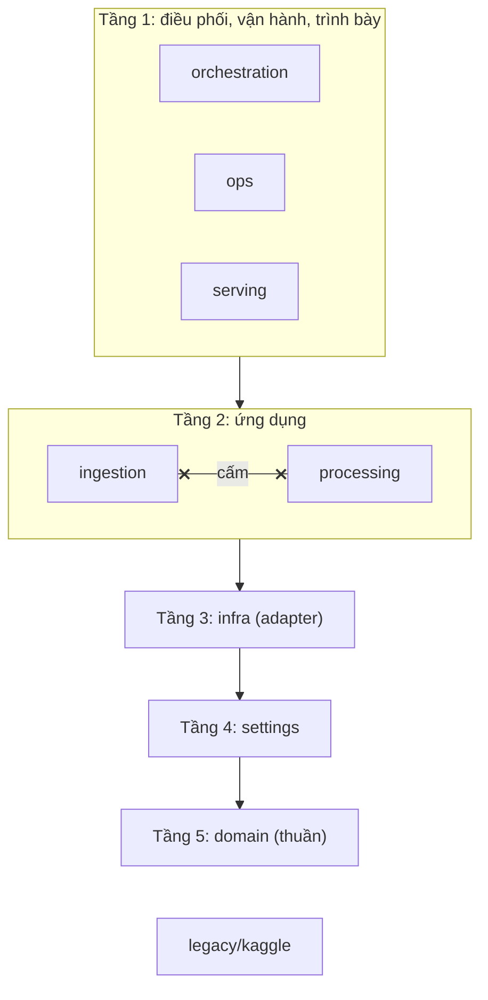

# 03. Các tầng module và luật import

> Đúng với: commit `f82f5b5` · Cập nhật: 2026-11-02 · Nguồn chân lý: `pyproject.toml` (`[tool.importlinter]`), `tests/architecture/`, ADR-0003

**Dùng ở đâu:** `docs/ARCHITECTURE.md` §1, báo cáo chương thiết kế phần mềm (Ports & Adapters).

**Câu hỏi:** module nào được phụ thuộc vào module nào, và cái gì kiểm điều đó?

**Loại và bố cục:** flowchart trên → dưới, năm tầng xếp chồng. Tầng 2 chia làm hai ô đứng cạnh nhau, giữa chúng có một cạnh gạch chéo màu đỏ ("cấm import"). Bên phải đặt một khung ghi chú liệt kê 4 contract.

## Thành phần

| id | Nhãn | Tầng | Ghi chú |
|---|---|---|---|
| orchestration | `orchestration` (DAG Airflow, `tasks.py`) | 1 | |
| ops | `ops` (CLI, drill, bench, evidence) | 1 | |
| serving | `serving` (ES projector, Kibana, Superset) | 1 | |
| ingestion | `ingestion` (fetcher, extractor, frontier, worker) | 2 | |
| processing | `processing` (normalize, batch, speed) | 2 | |
| infra | `infra` (Spark, Postgres, Kafka, object store, HTTP, browser) | 3 | adapter |
| settings | `settings` (dataclass frozen, `load_settings`) | 4 | chỉ đọc ở composition root |
| domain | `domain` (thuần, không I/O) | 5 | |
| legacy | `legacy/kaggle` | ngoài | `ecomdata` không import |

## Quan hệ

| Từ | Tới | Nhãn | Nét |
|---|---|---|---|
| tầng 1 | tầng 2 | được import | liền |
| tầng 2 | infra | | liền |
| infra | settings | | liền |
| settings | domain | | liền |
| ingestion | processing | cấm (cả hai chiều) | đỏ, gạch chéo |
| ecomdata | legacy | cấm | đỏ, gạch chéo |

**Khung ghi chú, 4 contract của import-linter:**

1. Các tầng theo thứ tự trên → dưới.
2. `ingestion` và `processing` độc lập nhau.
3. `domain` không import `pyspark`, `requests`, `psycopg2`, `kafka`, `minio`, `boto3`, `playwright`, `redis`, `elasticsearch`, `ecomdata.settings`, `ecomdata.infra`.
4. Không import `legacy`.

`tests/architecture/` kiểm thêm hai luật:

- literal của từng site chỉ nằm trong `ingestion/sources/<site>/`, `processing/normalize/sources/<site>.py` và `domain/sources.py`;
- settings chỉ được đọc ở composition root.

**Chú thích:** "Năm tầng của package `ecomdata`. Import chỉ đi xuống. Hai ứng dụng ingestion và processing không biết nhau, chỉ gặp nhau qua hợp đồng dữ liệu ở `domain`. `lint-imports` kiểm luật này ở mỗi lần chạy test."

## Bản nháp Mermaid

## Kiểm chứng

`pyproject.toml` (`[tool.importlinter]`, 4 contract), `tests/architecture/`. Kết quả `lint-imports` ngày 2026-11-02: "4 kept, 0 broken".
