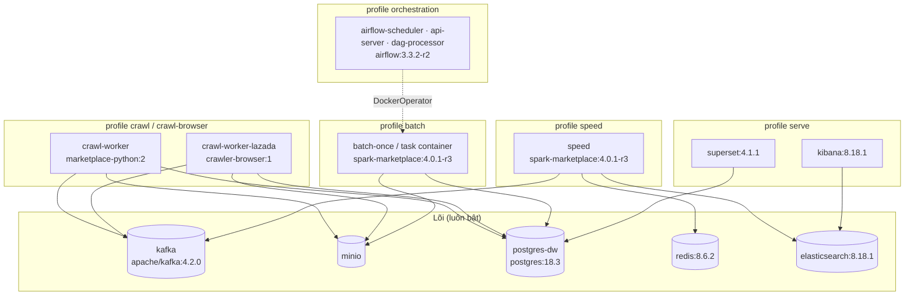

# 04. Triển khai: container, image, profile compose

> Đúng với: commit `f82f5b5` · Cập nhật: 2026-11-02 · Nguồn chân lý: `compose/docker-compose.yml`, `compose/docker-compose.observability.yml`, `env/`

**Dùng ở đâu:** `docs/ARCHITECTURE.md` §7, báo cáo chương triển khai.

**Câu hỏi:** lệnh `up` với từng profile bật những container nào, chạy image nào, và giữ dữ liệu ở volume nào?

**Loại và bố cục:**

- Một khung lớn là "máy Docker (một host, một compose project)", bên trong chia các nhóm con theo profile. Lõi (không profile, luôn bật) đặt ở giữa dưới.
- Mỗi container là một hộp có hai dòng: tên service, rồi image.
- Volume vẽ hình trụ nhỏ dưới container sở hữu nó.
- Góc trên phải đặt một khung "Một stack = project + prefix container + port riêng", kèm 5 stack.

## Thành phần

**Lõi** (không profile, luôn bật):

| Service | Image | Volume |
|---|---|---|
| kafka, kafka-init | `apache/kafka:4.2.0` | `kafka_data` |
| minio, minio-init | `minio/minio` (pin sha256), `minio/mc` | `minio_data` |
| postgres-dw | `postgres:18.3` | `pg_data` |
| redis | `redis:8.6.2` | `redis_data` |
| elasticsearch | `elasticsearch:8.18.1` | `es_data` |

**Theo profile:**

| Profile | Service | Image | Ghi chú |
|---|---|---|---|
| `crawl` | crawl-worker | `ecommerce/marketplace-python:2` | Tiki |
| `crawl-browser` | crawl-worker-lazada | `ecommerce/crawler-browser:1` | Playwright `v1.55.0-noble` |
| `speed` | speed | `ecommerce/spark-marketplace:4.0.1-r3` | volume `speed_checkpoints` |
| `batch` | batch-once | `ecommerce/spark-marketplace:4.0.1-r3` | chạy một lần (`run --rm`) |
| `orchestration` | airflow-init, airflow-api-server, airflow-scheduler, airflow-dag-processor | `ecommerce/airflow:3.3.2-r2` | task chạy bằng DockerOperator; volume `airflow_logs` |
| `serve` | kibana, kibana-marketplace-setup, superset, superset-init | `kibana:8.18.1`, `apache/superset:4.1.1` | volume `superset_home` |
| `ops` | ops, es-projector | `ecommerce/marketplace-python:2` | CLI `python -m ecomdata.ops` |
| `smoke` | stub-source | `ecommerce/marketplace-python:2` | nguồn giả cho smoke, bench |
| `legacy-scheduler` | batch-scheduler | `ecommerce/spark-marketplace:4.0.1-r3` | vòng lặp cũ, Airflow đã thay (ADR-0002) |

**File observability** (`docker-compose.observability.yml`):

| Service | Image |
|---|---|
| alloy | `grafana/alloy:v1.10.0` |
| prometheus | `prom/prometheus:v3.2.1` |
| loki | `grafana/loki:3.4.2` |
| grafana | `grafana/grafana:11.5.2` |

**Khung "stack"**: mỗi stack nạp `env/base.env`, `env/ports.<stack>.env` và `env/<stack>.env`. Có 5 stack: `mp-live`, `mp-refactor` (prefix `rf-`), `mp-tikihtml` (`th-`), `mp-bench`, `mp-demo`. `tests/unit/ops/test_compose_isolation.py` kiểm các stack không trùng port.

## Quan hệ

| Từ | Tới | Nhãn | Nét |
|---|---|---|---|
| airflow-scheduler | batch task container | DockerOperator, image `spark-marketplace` | đứt |
| crawl-worker | postgres-dw, minio, kafka | | liền |
| speed | kafka, elasticsearch, redis | | liền |
| batch-once | minio, postgres-dw | | liền |
| superset | postgres-dw | đọc `cache.*` | liền |
| kibana | elasticsearch | | liền |
| alloy | mọi container | log, metrics | đứt |

**Chú thích:** "Một compose project chạy trên một máy. Lõi lưu trữ luôn bật, mỗi profile bật thêm một phần của pipeline. Bốn image tự build gói sẵn package `ecomdata`."

## Bản nháp Mermaid

## Kiểm chứng

`compose/docker-compose.yml` (anchor `x-marketplace-python`, `x-spark-marketplace`, `x-airflow`; mục `volumes:`), `compose/docker-compose.observability.yml`, `env/*.env`, `scripts/mp.ps1`.
