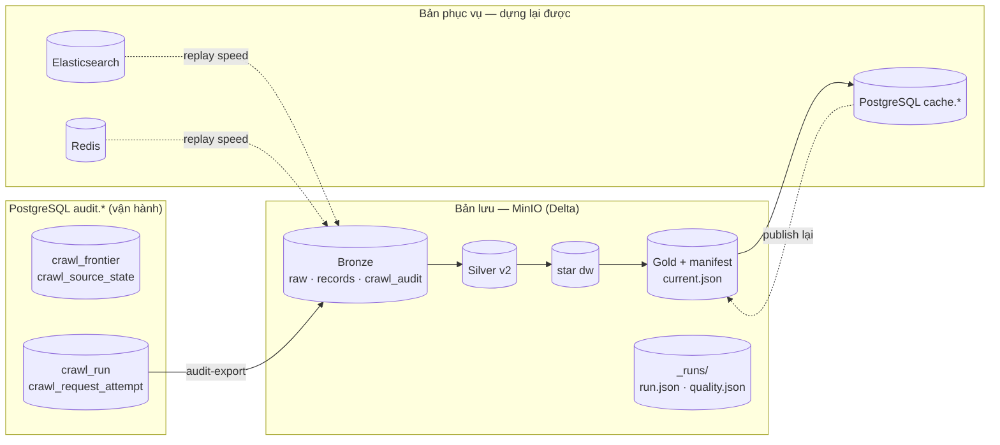

# 05. Vai trò lưu trữ: lake là bản lưu, PostgreSQL là cache

> Đúng với: commit `f82f5b5` · Cập nhật: 2026-11-02 · Nguồn chân lý: ADR-0008, `src/ecomdata/processing/batch/stages/publish.py`, quyết định ngày 26/10/2026

**Dùng ở đâu:** `docs/ARCHITECTURE.md` (mục vai trò lưu trữ), báo cáo, khi trả lời câu hỏi của hội đồng "vì sao Postgres chỉ là cache?".

**Câu hỏi:** mất từng kho thì dựng lại được không, và dựng từ đâu?

**Loại và bố cục:** flowchart trái → phải, hai cột:

- **Bản lưu** (bên trái, nền vàng): MinIO, gồm Bronze, Silver, `dw`, Gold, `_runs`;
- **Bản phục vụ, dựng lại được** (bên phải, nền xanh lá): PostgreSQL `cache.*`, Elasticsearch, Redis.

PostgreSQL `audit.*` ở giữa, chia đôi: phần "vận hành" (frontier, circuit) và phần "có bản trong lake" (crawl audit).

Mỗi kho ở cột phải có một mũi tên nét đứt quay về nguồn dựng lại của nó, nhãn "dựng lại bằng …".

## Thành phần

| id | Nhãn | Cột | Mất thì |
|---|---|---|---|
| bronze | Bronze: raw, records, crawl audit | Bản lưu | mất dữ liệu gốc; chỉ khôi phục từ backup |
| silver | Silver v2 (Delta) | Bản lưu | dựng lại từ Bronze (`--rebuild`) |
| dw | star `dw` (Delta, có version) | Bản lưu | dựng lại từ Silver |
| gold | Gold theo run + manifest + `current.json` | Bản lưu | dựng lại bằng một run mới |
| runs | `_runs/run_id=<run>/` (`run.json`, `quality.json`) | Bản lưu | bằng chứng của run |
| audit_ops | `audit.crawl_frontier`, `audit.crawl_source_state` | Vận hành | hàng đợi crawl, seed lại được |
| audit_copy | `audit.crawl_run`, `audit.crawl_request_attempt` | Vận hành, có bản trong lake | `ops audit-export` chép sang lake |
| batch_audit | `audit.marketplace_batch_run`, `audit.marketplace_quality_result` | Vận hành | bản lưu nằm ở `_runs/` |
| cache | `cache.marketplace_*` (10 bảng) | Phục vụ | publish lại từ Gold của run hiện hành |
| es | Elasticsearch | Phục vụ | đầy lại từ speed (Kafka) |
| redis | Redis `rt:*` | Phục vụ | đầy lại từ speed |

## Quan hệ

| Từ | Tới | Nhãn | Nét |
|---|---|---|---|
| bronze | silver | stage silver | liền |
| silver | dw | dimensions, facts | liền |
| dw | gold | marts | liền |
| gold | cache | publish | liền |
| cache | gold | dựng lại bằng publish | đứt |
| es, redis | bronze | dựng lại bằng replay speed | đứt |
| audit_copy | bronze | `LakeCrawlAuditLog`, `ops audit-export` | liền |

**Chú thích:** "Mọi thứ cần giữ nằm trong lake (Delta trên MinIO). PostgreSQL, Elasticsearch và Redis chỉ chứa bản phục vụ, dựng lại được. Đó là lý do hệ thống chuyển sang Databricks được mà không phải đổi mô hình dữ liệu."

## Bản nháp Mermaid

## Kiểm chứng

`docs/adr/0008-crawl-audit-in-the-lake.md`, `src/ecomdata/ingestion/audit.py` (`LakeCrawlAuditLog`), `src/ecomdata/ops/audit_export.py`, `src/ecomdata/processing/batch/runner.py` (`run_record_key`), `src/ecomdata/processing/batch/stages/quality.py` (`results_key`).
