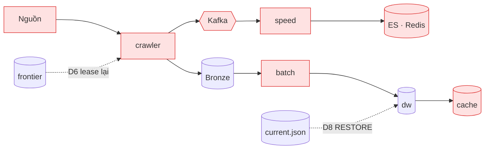

# 06. Ranh giới lỗi: hỏng chỗ nào thì mất gì

> Đúng với: commit `f82f5b5` · Cập nhật: 2026-11-02 · Nguồn chân lý: `src/ecomdata/ops/drills.py` (D1–D11), `docs/RUNBOOK.md`

**Dùng ở đâu:** `docs/ARCHITECTURE.md` (ranh giới lỗi), `docs/RUNBOOK.md`, báo cáo chương đánh giá độ tin cậy.

**Câu hỏi:** khi một thành phần hỏng, phần nào vẫn chạy, cái gì được giữ lại, và hệ thống tự hồi phục thế nào?

**Loại và bố cục:** lấy lại hình 01, rồi đặt một tia sét đỏ đánh số D1…D11 lên đúng thành phần mà mỗi drill làm hỏng. Bảng bên dưới hình giải thích từng số. Vùng hỏng tô đỏ nhạt; vùng vẫn chạy giữ màu gốc.

## Thành phần (điểm lỗi)

| Drill | Làm hỏng | Gắn vào node | Hệ thống phản ứng | Cái được giữ |
|---|---|---|---|---|
| D1 | Nguồn trả 429, rồi 500, rồi timeout | tiki | phân loại lỗi, retry có backoff; đủ 5 lỗi liên tiếp thì circuit mở 900 s, rồi tự đóng khi có lần thành công | frontier, không mất task |
| D2 | Kafka dừng giữa chu kỳ crawl | kafka | `PUBLISH_ERROR`, task retry; Bronze đã ghi | raw và records trong Bronze; check reconciliation vẫn khớp |
| D4 | ES rồi Redis dừng khi speed đang chạy | es, redis | đúng micro-batch đó lỗi, query retry chính batch ấy (cùng `batch_id`) | checkpoint Spark, audit `marketplace_speed_batch` |
| D5 | Kill speed giữa micro-batch; replay từ checkpoint mới | speed | chạy lại, không trùng sự kiện (id tất định) | Kafka, checkpoint |
| D6 | Kill worker đang giữ lease | crawler | worker khác lấy lại task khi lease hết hạn | frontier |
| D7 | Nguồn đổi cấu trúc trang (schema drift) | crawler (extractor) | `PARSE_ERROR`, task kết thúc, circuit không đổi | raw body; `reparse` báo `PARSE_FAILED`, không ghi gì |
| D8 | Một dòng audit mà Silver không khớp | batch quality | cổng từ chối; `RESTORE` star; cache và pointer giữ nguyên | kết quả quality, manifest của run hỏng |
| D9 | PostgreSQL từ chối một dòng khi publish | cache | transaction rollback cả lệnh truncate; pointer không đổi | cache cũ, pointer cũ; `--resume` publish lại |
| D10 | Hai batch chạy cùng lúc | batch | lock: một run chạy, run kia bị từ chối và không ghi gì | |
| D11 | Mất máy: backup rồi restore sang project khác | toàn bộ | `ops backup`, `ops restore`, batch quality-only, `validate --restored` | Bronze, Silver, Gold, audit (Kafka, ES, Redis không backup) |

(Không có D3 trong `ops/drills.py`.)

## Quan hệ

Dùng lại cạnh của hình 01. Thêm các cạnh nét đứt màu xanh cho đường hồi phục:

| Từ | Tới | Nhãn |
|---|---|---|
| frontier | crawler | lease hết hạn → lease lại (D6) |
| bronze | kafka | publish lại khi retry (D2) |
| checkpoint | speed | chạy lại micro-batch (D4, D5) |
| manifest `current` | `dw` | `RESTORE` (D8) |

**Chú thích:** "Mười drill đã chạy thật, mỗi drill làm hỏng một chỗ. Ở mọi drill, Bronze và phiên bản đang phục vụ không bị đụng tới; phần hỏng tự hồi phục hoặc chạy lại được."

## Bản nháp Mermaid

Đặt nhãn D1…D11 lên các node tô đỏ theo bảng trên.

## Kiểm chứng

`src/ecomdata/ops/drills.py` (docstring từng drill), `src/ecomdata/settings/__init__.py` (`circuit_failure_threshold=5`, `circuit_open_seconds=900`), `src/ecomdata/ingestion/scheduling.py` (`_RETRYABLE_KINDS`), `src/ecomdata/processing/batch/lock.py`. Bằng chứng chạy drill: `docs/evidence/` (bộ của Phase 9).
