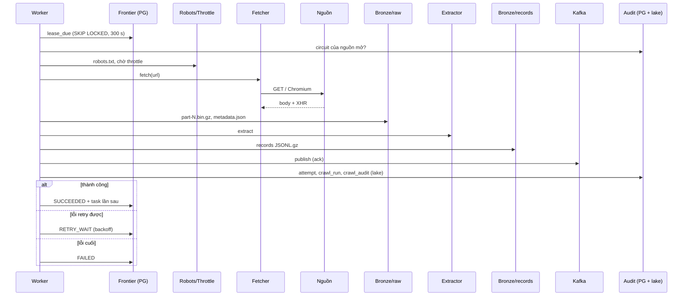

# 07. Một lượt thu thập một trang (raw first)

> Đúng với: commit `f82f5b5` · Cập nhật: 2026-11-02 · Nguồn chân lý: `src/ecomdata/ingestion/pipeline.py`, `ingestion/worker.py`, `ingestion/service.py`, ADR-0001

**Dùng ở đâu:** `docs/ARCHITECTURE.md` §3 (`ingestion/`), báo cáo chương thu thập dữ liệu (Template Method, raw first).

**Câu hỏi:** trong một lượt crawl, cái gì được ghi trước cái gì, và lỗi ở mỗi bước dừng ở đâu?

**Loại và bố cục:** sequence diagram. Các participant xếp từ trái sang phải:

1. Worker
2. Frontier (PostgreSQL)
3. Robots/Throttle
4. Fetcher (HTTP hoặc Browser)
5. Nguồn
6. Raw store (Bronze/raw)
7. Extractor
8. Record store (Bronze/records)
9. Kafka
10. Audit (PostgreSQL + lake)

Mỗi bước có thể hỏng thì vẽ một khối `alt` ở cạnh, ghi `AcquisitionStage` và `FailureKind` tương ứng.

## Thành phần (các bước, theo thứ tự trong `pipeline.py`)

| # | Bước | Ai làm | Lỗi → stage, kind |
|---|---|---|---|
| 0 | lease task (`FOR UPDATE SKIP LOCKED`, lease 300 s) | Frontier | |
| 0b | kiểm circuit của nguồn | Audit | circuit mở → `RETRY_WAIT`, không fetch |
| 1 | dựng URL | Worker | |
| 2 | robots.txt theo host thực fetch | `RobotsPolicy` | `ROBOTS` → `ROBOTS_DENIED` |
| 3 | throttle (Tiki ≥ 2 s, Lazada ≥ 5 s) | `Throttle` | |
| 4 | fetch (HTTP, hoặc Chromium bắt XHR) | Fetcher | `FETCH` → `TRANSIENT_NETWORK`, `BLOCKED` |
| 5 | **lưu raw**: `part-N.bin.gz` rồi `metadata.json` | Raw store | `STORAGE` → `STORAGE_ERROR` |
| 6 | kiểm HTTP status | Worker | `HTTP` → `RATE_LIMITED` (429), `SERVER_ERROR` (5xx), `CLIENT_ERROR` |
| 7 | extract: tìm mảng dòng và `page_context` | Extractor | `PARSE` → `PARSE_ERROR` |
| 8 | dựng record `marketplace-record.v1` | `build_records` | `VALIDATION` → `VALIDATION_ERROR` |
| 9 | **lưu records** (JSONL.gz) | Record store | `STORAGE` → `STORAGE_ERROR` |
| 10 | publish Kafka (có ack) | `publishing_executor` | `PUBLISH_ERROR` (retry, không tính vào circuit) |
| 11 | ghi attempt, đóng run; lên lịch lần sau | Audit, Frontier | |
| 12 | ghi crawl audit vào lake | `LakeCrawlAuditLog` | lỗi chỉ ghi log, không làm hỏng task |

## Quan hệ (message)

`Worker→Frontier: lease_due` · `Worker→Audit: source_is_open?` · `Worker→Robots: allowed?` · `Worker→Fetcher: fetch(url)` · `Fetcher→Nguồn: GET` · `Nguồn→Fetcher: body (+XHR)` · `Worker→Raw store: persist_fetch_bundle` · `Worker→Extractor: extract(bundle)` · `Worker→Record store: persist_records` · `Worker→Kafka: send + ack` · `Worker→Audit: record attempt, finish run` · `Worker→Frontier: mark_succeeded (+ task lần sau)` hoặc `mark_retry` hoặc `mark_failed`.

**Chú thích:** "Một lượt thu thập theo kiểu raw first. Phản hồi gốc được lưu trước khi parse, record được lưu trước khi phát lên Kafka. Vì vậy lỗi ở parser hay Kafka không làm mất dữ liệu đã tải."

## Bản nháp Mermaid

## Kiểm chứng

`ingestion/pipeline.py` (docstring thứ tự bước), `domain/acquisition.py` (`AcquisitionStage`), `ingestion/scheduling.py` (`FailureKind`, `classify_failure`), `ingestion/worker.py`, `ingestion/service.py` (`publishing_executor`), `settings/__init__.py` (`lease_seconds=300`).
