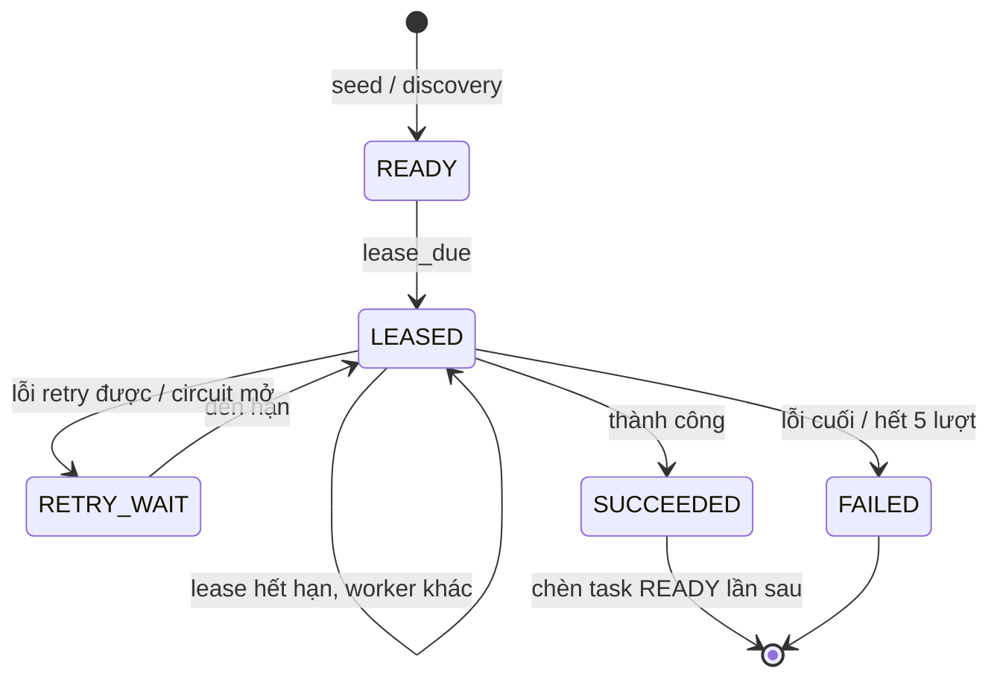
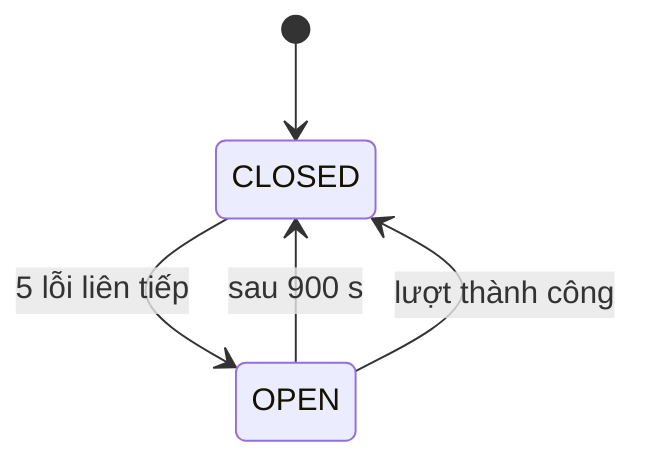

# 08. Vòng đời task crawl và circuit breaker

> Đúng với: commit `f82f5b5` · Cập nhật: 2026-11-02 · Nguồn chân lý: `src/ecomdata/ingestion/scheduling.py`, `ingestion/frontier.py`, `ingestion/audit.py`, `settings/__init__.py` (`CrawlSettings`)

**Dùng ở đâu:** `docs/ARCHITECTURE.md` (thu thập), `docs/RUNBOOK.md` (task kẹt, circuit mở), báo cáo chương thu thập (lập lịch, chịu lỗi).

**Câu hỏi:** một task crawl đi qua những trạng thái nào, khi nào retry, khi nào bỏ, và khi nào cả nguồn bị tạm dừng?

**Loại và bố cục:** hai state diagram đặt cạnh nhau.

- Trái: task trong `audit.crawl_frontier`.
- Phải: circuit của một nguồn trong `audit.crawl_source_state`.

Dưới hai hình là bảng tham số và bảng tầng lịch.

## Thành phần

**Trạng thái task** (`CrawlTaskStatus`):

| Trạng thái | Nghĩa |
|---|---|
| `READY` | đến hạn khi `scheduled_for ≤ now` |
| `LEASED` | một worker đang giữ, đến `lease_expires_at` |
| `RETRY_WAIT` | chờ retry, `scheduled_for` = now + backoff |
| `SUCCEEDED` | lần này xong; lần sau đã được chèn thành một task `READY` mới |
| `FAILED` | lỗi không retry được, hoặc hết `max_attempts`; không tự chèn lần sau |
| `DISABLED` | tắt tay (ví dụ `ops park-smoke`) |

**Trạng thái circuit:** `CLOSED` (khi `opened_until` NULL hoặc đã qua) và `OPEN` (khi `opened_until` > now). Không có cột boolean, nên circuit tự đóng khi hết giờ.

**Tham số mặc định** (env `CRAWL_*`):

| Tham số | Giá trị |
|---|---|
| `lease_seconds` | 300 |
| `max_attempts` | 5 |
| backoff | `retry_base_seconds` × 2^(attempts−1), từ 30 tới tối đa 1800 s, có jitter; nếu nguồn gửi `Retry-After` thì dùng giá trị đó |
| `circuit_failure_threshold` | 5 lỗi liên tiếp |
| `circuit_open_seconds` | 900 |

**Tầng lịch** (`DEFAULT_CADENCE_MINUTES`, đổi bằng `CRAWL_<TIER>_CADENCE_MINUTES`):

| Tầng | Chu kỳ (phút) |
|---|---|
| `ACTIVE` | 60 |
| `HOT` | 120 |
| `NORMAL` | 240 |
| `COLD` | 720 |
| `SWEEP` | 1440 |

**Lỗi retry được** (`_RETRYABLE_KINDS`): `RATE_LIMITED`, `TRANSIENT_NETWORK`, `SERVER_ERROR`, `STORAGE_ERROR`, `PUBLISH_ERROR`, `BLOCKED`; thêm HTTP 408, 425, 429. Mọi lỗi khác là lỗi cuối, gồm `PARSE_ERROR`, `ROBOTS_DENIED`, `CLIENT_ERROR`, `VALIDATION_ERROR`.

## Quan hệ (chuyển trạng thái)

| Từ | Tới | Điều kiện |
|---|---|---|
| (seed / discovery) | READY | `ops seed`, DAG `source_discovery` |
| READY, RETRY_WAIT | LEASED | đến hạn, `lease_due`; `attempts` + 1 |
| LEASED | LEASED (worker khác) | lease hết hạn (D6) |
| LEASED | SUCCEEDED | lượt thành công → chèn task `READY` cho lần sau (`next_scheduled_for` theo tầng) |
| LEASED | RETRY_WAIT | lỗi retry được và `attempts` < `max_attempts`; hoặc circuit đang mở |
| LEASED | FAILED | lỗi cuối, hoặc hết lượt |
| bất kỳ | DISABLED | thao tác tay |
| CLOSED | OPEN | lỗi của nguồn lần thứ 5 liên tiếp (`PUBLISH_ERROR` và `PARSE_ERROR` không tính) |
| OPEN | CLOSED | qua `opened_until`, hoặc có lượt thành công (reset streak) |

**Chú thích:** "Mỗi lần crawl một target là một task có id tất định theo (nguồn, loại, target, giờ lên lịch). Lỗi tạm thời thì retry với backoff mũ. Nguồn lỗi liên tiếp thì circuit tạm dừng cả nguồn 15 phút thay vì tiếp tục gõ cửa."

## Bản nháp Mermaid

## Kiểm chứng

`ingestion/scheduling.py` (`CrawlTier`, `DEFAULT_CADENCE_MINUTES`, `CrawlTaskStatus`, `_RETRYABLE_KINDS`, `retry_decision`), `ingestion/frontier.py` (`lease_due`, `mark_succeeded` chèn task lần sau, `mark_retry`, `mark_failed`), `ingestion/audit.py` (`source_is_open`, `record_source_failure`), `settings/__init__.py` (`CrawlSettings`).
