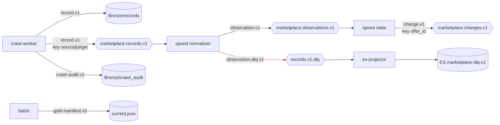

# 09. Hợp đồng dữ liệu, topic Kafka, DLQ

> Đúng với: commit `f82f5b5` · Cập nhật: 2026-11-02 · Nguồn chân lý: `src/ecomdata/domain/records.py`, `domain/observations.py`, `domain/dlq.py`, `domain/topics.py`, `domain/crawl_audit.py`, `processing/batch/manifest.py`

**Dùng ở đâu:** `docs/CONTRACTS.md` (doc mới theo brief), báo cáo chương mô hình dữ liệu (hợp đồng giữa các tầng).

**Câu hỏi:** giữa hai thành phần, dữ liệu đi theo hợp đồng nào, phiên bản nào, khoá Kafka là gì, và bản ghi lỗi đi đâu?

**Loại và bố cục:** flowchart trái → phải. Thành phần là hình chữ nhật. Trên mỗi cạnh dán một "nhãn hợp đồng" màu vàng ghi tên schema version. Topic là hình lục giác, ghi khoá Kafka bên dưới. DLQ đặt ngay dưới topic nguồn của nó, nối bằng nét đỏ.

## Thành phần: các hợp đồng

| Hợp đồng (schema version) | Định nghĩa ở | Mang gì | Đi qua |
|---|---|---|---|
| `marketplace-record.v1` | `domain/records.py` (`SourceRecord`) | một dòng nguồn nguyên vẹn: `record_id`, `source_code`, `marketplace_id`, `record_kind` (`listing_row` / `page_context`), `record_index`, `raw_artifact_id`, `raw_uri`, `crawl_run_id`, `adapter_version`, `extractor_version`, `request_target`, `request_page`, `fetched_at`, `http_status`, `payload`, `dropped_fields` | Bronze/records, topic `marketplace.records.v1` |
| `marketplace-observation.v1` | `domain/observations.py` | event chuẩn hoá: `event_id`, `event_type`, `occurred_at`, `produced_at`, `marketplace`, `partition_key`, `crawl_run_id`, `raw_uri`, `payload` | topic `marketplace.observations.v1` |
| `marketplace-change.v1` | `domain/observations.py` | sự kiện thay đổi: `event_id`, `change_type`, `detected_at`, `offer_id`, `previous_observation_id`, `current_observation_id`, `field_name`, `previous_value`, `current_value`, `rule_version` | topic `marketplace.changes.v1`, ES |
| `marketplace-observation-dlq.v1` | `domain/dlq.py` | bản ghi bị quarantine: `dlq_id`, `failed_at`, `stage` (`DECODE` / `CONTRACT_VALIDATION`), nguồn (topic, partition, offset, key), `crawl_run_id`, `raw_artifact_id`, `raw_uri`, `error_type`, `error_message`, `payload_text` | topic `*.dlq`, ES `marketplace-dlq-v1` |
| `marketplace-crawl-audit.v1` | `domain/crawl_audit.py` | một dòng `run` và mỗi attempt một dòng `attempt` | `bronze/marketplace/crawl_audit/` |
| `marketplace-gold-manifest.v2` | `processing/batch/manifest.py` | manifest của run và `current.json` (xem hình 12) | `gold/marketplace/` |

## Thành phần: topic (`domain/topics.py`, mặc định 3 partition, replication 1)

| Topic | Khoá Kafka | Ghi bởi | Đọc bởi |
|---|---|---|---|
| `marketplace.records.v1` | `<source_code>\|<request_target>`: mọi record của một trang category vào cùng một partition, giữ thứ tự | crawl-worker | speed normalizer |
| `marketplace.records.v1.dlq` | | speed normalizer | ES projector |
| `marketplace.observations.v1` | `partition_key` của event | speed normalizer | speed truy vấn trạng thái |
| `marketplace.observations.v1.dlq` | | speed | ES projector |
| `marketplace.changes.v1` | `offer_id` | speed (`change_producer.py`) | Kibana qua ES |

## Quan hệ

| Từ | Tới | Hợp đồng trên cạnh | Nét |
|---|---|---|---|
| crawl-worker | Bronze/records | `marketplace-record.v1` | liền |
| crawl-worker | `marketplace.records.v1` | `marketplace-record.v1` | liền |
| crawl-worker | Bronze/crawl_audit | `marketplace-crawl-audit.v1` | liền |
| normalizer | `marketplace.observations.v1` | `marketplace-observation.v1` | liền |
| normalizer | `records.v1.dlq` | `marketplace-observation-dlq.v1` | đỏ |
| speed | `marketplace.changes.v1` | `marketplace-change.v1` | liền |
| batch | `gold/.../current.json` | `marketplace-gold-manifest.v2` | liền |

**Quy tắc đổi hợp đồng** (ghi trong khung chú thích):

- Version nằm trong tên (`.v1`).
- Thêm trường tuỳ chọn thì không đổi version.
- Đổi nghĩa, đổi kiểu hoặc bỏ một trường thì ra version mới, kèm topic mới.
- Bên đọc phải đọc được version cũ: manifest v2 vẫn đọc được v1, raw store v2 vẫn đọc được v1.

**Chú thích:** "Các hợp đồng giữa các tầng. Mỗi hợp đồng có version trong tên và được kiểm khi ghi lẫn khi đọc. Bản ghi không hợp lệ không bị bỏ đi mà vào DLQ, kèm toạ độ để truy lại byte gốc."

## Bản nháp Mermaid

## Kiểm chứng

`domain/records.py` (`RECORD_SCHEMA_VERSION`, `partition_key`), `domain/observations.py` (`OBSERVATION_SCHEMA_VERSION`, `CHANGE_SCHEMA_VERSION`), `domain/dlq.py`, `domain/topics.py`, `processing/speed/change_producer.py` (khoá theo offer), `serving/es_projector.py`.
