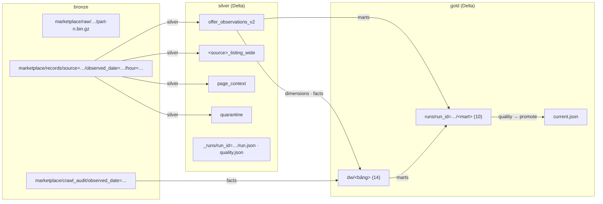

# 10. Các zone Medallion và layout thư mục lake

> Đúng với: commit `f82f5b5` · Cập nhật: 2026-11-02 · Nguồn chân lý: `ingestion/raw_store.py`, `ingestion/record_store.py`, `domain/crawl_audit.py`, `processing/batch/context.py`, `processing/batch/manifest.py`, `processing/batch/runner.py`

**Dùng ở đâu:** `docs/DATA_MODEL.md` (Medallion zones), báo cáo chương lưu trữ.

**Câu hỏi:** mỗi zone giữ gì, ở đường dẫn nào, partition theo gì, và định dạng gì?

**Loại và bố cục:** ba cột Bronze → Silver → Gold, mỗi cột là một cây thư mục (bucket ở gốc). Trên đầu mỗi cột ghi một dòng: "giữ gì, định dạng, ai ghi". Mũi tên giữa các cột ghi tên stage.

## Thành phần

**Bucket `bronze`**:

| Đường dẫn | Định dạng | Partition | Ghi bởi |
|---|---|---|---|
| `marketplace/raw/marketplace=<code>/observed_date=<d>/hour=<h>/crawl_run_id=<id>/raw_artifact_id=<id>/part-<n>.bin.gz` + `metadata.json` | phản hồi gốc, gzip, manifest có sha256 | nguồn, ngày, giờ, run | crawl-worker |
| `marketplace/records/source=<code>/observed_date=<d>/hour=<h>/raw_artifact_id=<id>.jsonl.gz` | JSONL.gz, `marketplace-record.v1` | nguồn, ngày, giờ | crawl-worker |
| `marketplace/crawl_audit/observed_date=<d>/hour=<h>/crawl_run_id=<id>.jsonl.gz` | JSONL.gz, `marketplace-crawl-audit.v1` | ngày, giờ | crawl-worker, `ops audit-export` |

**Bucket `silver`** (gốc `marketplace/`, đổi bằng `MARKETPLACE_SILVER_ROOT`):

| Đường dẫn | Định dạng | Partition | Ghi bởi |
|---|---|---|---|
| `offer_observations_v2/` | Delta | `source_code`, `observed_date` | stage `silver` (replaceWhere theo ngày của cửa sổ) |
| `<source>_listing_wide/` (`tiki_listing_wide`, `lazada_listing_wide`) | Delta | như trên | stage `silver` |
| `page_context/` | Delta | như trên | stage `silver` |
| `quarantine/` | Delta | như trên | stage `silver` |
| `_runs/run_id=<run>/` gồm `run.json`, `quality.json`, `silver.json`, `dimensions.json`, `facts.json`, `marts.json`, `timings/<stage>.json` | JSON | run | runner, các stage |

**Bucket `gold`** (gốc `marketplace/`):

| Đường dẫn | Định dạng | Ghi bởi |
|---|---|---|
| `dw/<bảng>/`: 8 dimension và bridge, 6 fact | Delta (MERGE; fact partition `date_key`) | stage `dimensions`, `facts` |
| `runs/run_id=<run>/<mart>/`: 10 mart | Delta | stage `marts` |
| manifest của run | JSON `marketplace-gold-manifest.v2` | stage `quality` |
| `current.json` | JSON, giống hệt manifest đã promote | stage `promote` |

## Quan hệ

| Từ | Tới | Nhãn |
|---|---|---|
| Bronze/records | Silver | `silver`: đọc đúng các partition ngày của cửa sổ |
| Bronze/crawl_audit | Gold/dw (`fact_crawl_attempt`), mart | `facts`, `marts` |
| Silver | Gold/dw | `dimensions`, `facts` |
| Silver + dw | Gold/runs | `marts` |
| Gold/runs | `current.json` | `quality` → `promote` |

**Chú thích:** "Ba zone trên MinIO. Bronze giữ nguyên những gì nguồn trả về, phân vùng theo ngày và giờ thu. Silver là bảng chuẩn hoá dạng Delta, thay theo ngày. Gold gồm star `dw` (MERGE, có version) và mart của từng run. Pointer `current.json` chỉ ra run đang được phục vụ."

## Bản nháp Mermaid

## Kiểm chứng

`ingestion/raw_store.py` (`RAW_ROOT`, `RawArtifactRef.base`), `ingestion/record_store.py` (`RECORDS_ROOT`), `domain/crawl_audit.py` (`audit_path`), `processing/batch/context.py` (`gold_run_uri`, `dw_root_uri`), `processing/batch/manifest.py` (`CURRENT_POINTER_PATH`), `processing/batch/runner.py` (`run_record_key`, `timing_key`), ADR-0007 (partition Silver).
