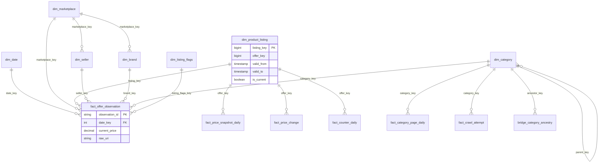

# 11. Star schema `dw` (bản rút gọn cho báo cáo)

> Đúng với: commit `f82f5b5` · Cập nhật: 2026-11-02 · Nguồn chân lý: `src/ecomdata/domain/datasets.py` (`STAR`, `KEY_ROLES`, `foreign_keys`), `docs/model/star-schema.dbml`

**Dùng ở đâu:** `docs/DATA_MODEL.md`, báo cáo chương mô hình dữ liệu. Bản đầy đủ cột đã có ở `docs/model/` (dbml là nguồn). File này lên bản **rút gọn**: mỗi bảng chỉ ghi khoá và vài cột đo, để hình vừa một trang A4.

**Câu hỏi:** fact nào nối tới dimension nào, grain của từng fact là gì?

**Loại và bố cục:** ER.

- `dim_date` ở trên cùng, `dim_marketplace` ở dưới cùng; cả hai được mọi fact dùng.
- Sáu fact xếp thành một hàng ngang ở giữa.
- `dim_product_listing`, `dim_seller`, `dim_brand`, `dim_category`, `dim_listing_flags` xếp quanh.
- `bridge_category_ancestry` nằm cạnh `dim_category`.
- Viền đậm cho fact; ghi grain ở dòng đầu mỗi fact.

## Thành phần

**Dimension và bridge:**

| Bảng | Khoá | Cột tiêu biểu | Ghi chú |
|---|---|---|---|
| `dim_date` | `date_key` | `full_date`, `day_of_week`, `month`, `quarter`, `year`, `is_weekend`, `is_double_day_sale`, `is_vn_holiday` | 12 cột |
| `dim_marketplace` | `marketplace_key` | `marketplace_code`, `marketplace_name`, `platform_type`, `country`, `default_currency` | |
| `dim_seller` | `seller_key` | `seller_id`, `seller_name`, `seller_type`, `is_official_store` | 7 cột |
| `dim_brand` | `brand_key` | `brand_id`, `brand_name` | 4 cột |
| `dim_category` | `category_key` | `category_id`, `parent_key`, `level`, `full_path`, `category_l1..l4_name`, `is_leaf` | phân cấp tự tham chiếu; inferred member có `level` NULL |
| `bridge_category_ancestry` | (`ancestor_key`, `descendant_key`) | | đóng bắc cầu của cây category |
| `dim_product_listing` | `listing_key` (khoá bền: `offer_key`) | `offer_id`, `platform_listing_id`, `product_title`, `valid_from`, `valid_to`, `is_current`, `version` | **SCD2** |
| `dim_listing_flags` | `listing_flags_key` | `availability`, `has_discount`, `has_free_shipping`, `is_flash_deal`… | junk dimension, 10 cột |

**Fact:**

| Bảng | Grain (một dòng là) | Khoá | Cột đo |
|---|---|---|---|
| `fact_offer_observation` | một lần thấy một offer | `observation_id` | `current_price`, `list_price`, `discount_percent`, `rating_value`, `sold_count`, `ranking_position`; lineage `raw_uri`, `raw_sha256`, `crawl_run_id` |
| `fact_price_snapshot_daily` | offer × ngày × tiền tệ | (`date_key`, `offer_key`, `currency`) | `open_price`, `close_price`, `min_price`, `max_price`, `avg_price`, `observation_count`, `in_stock_ratio` |
| `fact_price_change` | một lần đổi giá | `observation_id` | `old_price`, `new_price`, `price_delta`, `pct_change`, `direction`, `is_large_drop` |
| `fact_counter_daily` | offer × ngày × bộ đếm | (`date_key`, `offer_key`, `counter_name`) | `first_value`, `last_value`, `valid_delta_sum`, `invalid_transition_count`, `velocity_proxy_per_hour` |
| `fact_category_page_daily` | category × ngày × tiền tệ | (`date_key`, `category_key`, `currency`) | `crawled_page_count`, `observed_offer_count`, `median_price`, `p25_price`, `p75_price`, `discounted_offer_ratio` |
| `fact_crawl_attempt` | một lần thử request | `attempt_id` (băm `crawl_run_id`, `task_id`, `attempt_number`) | `status`, `http_status`, `error_kind`, `latency_ms`, `raw_bytes`, `parsed_count`, `rejected_count` |

Mọi fact partition theo `date_key`.

## Quan hệ (khoá ngoại, từ `datasets.foreign_keys`)

| Fact / dim | Nối tới |
|---|---|
| `fact_offer_observation` | dim_date, dim_marketplace, dim_product_listing (`listing_key`, `offer_key`), dim_seller, dim_brand, dim_category (`category_key`, `page_category_key`), dim_listing_flags |
| `fact_price_snapshot_daily` | dim_date, dim_product_listing (`offer_key`, `listing_key`), dim_marketplace, dim_seller, dim_brand, dim_category, dim_listing_flags |
| `fact_price_change` | dim_date, dim_marketplace, dim_product_listing (`listing_key`, `offer_key`), dim_seller, dim_brand, dim_category |
| `fact_counter_daily` | dim_date, dim_product_listing (`offer_key`, `listing_key`), dim_marketplace |
| `fact_category_page_daily` | dim_date, dim_category, dim_marketplace |
| `fact_crawl_attempt` | dim_date, dim_marketplace, dim_category |
| `dim_product_listing` | dim_marketplace, dim_brand, dim_category, dim_seller |
| `dim_seller`, `dim_brand` | dim_marketplace |
| `dim_category` | dim_marketplace, dim_category (`parent_key`) |
| `bridge_category_ancestry` | dim_category (`ancestor_key`, `descendant_key`) |

Tổng cộng 44 tham chiếu: 40 khoá ngoại và 4 tham chiếu `offer_key` tới khoá bền của SCD2. Luật `star_foreign_keys_resolve` kiểm cả 44.

**Chú thích:** "Star schema của tầng Gold: 6 fact và 8 dimension/bridge, lưu bằng Delta trong `gold/marketplace/dw/`. `dim_product_listing` giữ lịch sử theo SCD2. Mọi khoá ngoại được cổng chất lượng kiểm ở mỗi run."

## Bản nháp Mermaid (rút gọn)

## Kiểm chứng

Chạy `python -c "from ecomdata.domain.datasets import STAR_NAMES, foreign_keys; ..."` để in lại danh sách khoá ngoại. `docs/model/star-schema.dbml` là bản đầy đủ cột. ADR-0007 nói về số 44 tham chiếu và inferred member.
