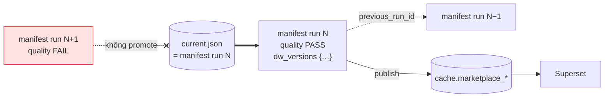

# 12. Manifest của run và pointer `current.json`

> Đúng với: commit `f82f5b5` · Cập nhật: 2026-11-02 · Nguồn chân lý: `src/ecomdata/processing/batch/manifest.py`, `stages/publish.py`, `stages/promote.py`, ADR-0005, ADR-0007

**Dùng ở đâu:** `docs/DATA_MODEL.md` (manifest), báo cáo chương batch, khi trả lời câu hỏi "run hỏng thì vì sao không tới dashboard?".

**Câu hỏi:** người đọc biết phiên bản Gold nào là phiên bản đúng bằng cách nào, và pointer được đổi an toàn ra sao?

**Loại và bố cục:**

- Bên trái: ba manifest của ba run xếp chồng (run N−1, N, N+1), mỗi cái là một tờ giấy có các trường chính.
- Bên phải: `current.json`, một mũi tên đậm chỉ vào manifest của run đang phục vụ.
- Dưới cùng: các dashboard (Superset qua `cache.*`), đọc theo pointer.

Run N+1 hỏng cổng: tờ của nó gạch chéo đỏ, không có mũi tên nào tới.

## Thành phần: các trường của manifest (`marketplace-gold-manifest.v2`)

| Trường | Ý nghĩa |
|---|---|
| `manifest_schema_version` | `marketplace-gold-manifest.v2` (vẫn đọc được v1) |
| `run_id`, `as_of`, `created_at` | `created_at` = `as_of`, nên hai lần chạy cùng ngữ cảnh cho ra cùng byte |
| `silver_uri`, `gold_run_uri` | Silver đã đọc, thư mục Gold của run |
| `rule_versions` | `anomaly`, `counter`, `freshness`, `quality` (`quality-rules.v3`) |
| `datasets[]` | mỗi mart một mục: `dataset_name`, `uri`, `row_count`, `partition_columns` |
| `quality` | kết quả cổng: passed, số lỗi bắt buộc, số luật khuyến nghị trượt |
| `previous_run_id` | run mà pointer chỉ trước đó |
| `dw_versions` | version Delta của từng bảng star mà run đã dựng và đã kiểm |

## Quan hệ

| Từ | Tới | Nhãn | Nét |
|---|---|---|---|
| stage quality | manifest của run | luôn ghi, kể cả khi run hỏng | liền |
| stage publish | `cache.marketplace_*` | trước khi đổi pointer | liền |
| stage promote | `current.json` | ghi cả document (không ghi tham chiếu), compare-and-swap với `previous_run_id` | đậm |
| `current.json` | manifest run N | giống hệt từng byte | đậm |
| `current.json` | `dw` | `dw_versions` = star đã chứng nhận | đứt |
| Superset | `cache.*` | | liền |

**Ba lý do bị giữ lại (HELD)**, ghi trong khung nhỏ:

- `BACKFILL_REFUSED`: `as_of` cũ hơn run đang phục vụ, và không có `--allow-backfill`.
- `PROMOTION_CONFLICT`: pointer đã bị run khác đổi trong lúc chạy.
- `QUALITY_ONLY` hoặc `SCRATCH_GOLD_ROOT`: run chỉ để kiểm.

**Chú thích:** "Mỗi run để lại một manifest, kể cả run bị từ chối. Pointer `current.json` là bản sao nguyên vẹn của manifest đã qua cổng và đã publish, nên người đọc không bao giờ thấy một pointer ghi dở. Run hỏng không tới được dashboard vì pointer không đổi."

## Bản nháp Mermaid

## Kiểm chứng

`processing/batch/manifest.py` (`serialize_manifest`, `CURRENT_POINTER_PATH`, `BACKFILL_REFUSED`, `PROMOTION_CONFLICT`), `processing/batch/context.py` (`QUALITY_ONLY`, `SCRATCH_GOLD_ROOT`), `stages/publish.py` (publish trước promote), `stages/promote.py`.
