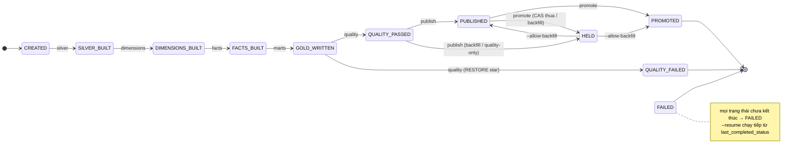

# 13. Bảy stage và state machine của một batch run

> Đúng với: commit `f82f5b5` · Cập nhật: 2026-11-02 · Nguồn chân lý: `src/ecomdata/domain/batch_run.py`, `processing/batch/runner.py`, `processing/batch/stages/*.py`, ADR-0005

**Dùng ở đâu:** ADR-0005, `docs/ARCHITECTURE.md` §5, báo cáo chương batch (Pipeline of Stages + State Machine).

**Câu hỏi:** một run đi qua những trạng thái nào; khi hỏng thì dừng ở đâu và chạy tiếp từ đâu?

**Loại và bố cục:** state diagram trái → phải theo đường chính:

```
CREATED → SILVER_BUILT → DIMENSIONS_BUILT → FACTS_BUILT → GOLD_WRITTEN → QUALITY_PASSED → PUBLISHED → PROMOTED
```

Các nhánh phụ:

- `QUALITY_FAILED` rẽ xuống dưới từ `GOLD_WRITTEN`.
- `HELD` nằm phía trên, giữa `QUALITY_PASSED` và `PROMOTED`.
- `FAILED` là một ô ở đáy; mọi trạng thái chưa kết thúc nối tới nó bằng nét mảnh.

Trên mỗi mũi tên chính ghi tên stage gây ra chuyển trạng thái đó. Dưới hình là bảng stage.

## Thành phần: trạng thái (`BatchRunStatus`)

| Trạng thái | Kết thúc? | Ghi chú |
|---|---|---|
| CREATED | | |
| SILVER_BUILT | | |
| DIMENSIONS_BUILT | | |
| FACTS_BUILT | | |
| GOLD_WRITTEN | | |
| QUALITY_PASSED | | |
| PUBLISHED | | |
| PROMOTED | có | duy nhất được tính là "xong" (`COMPLETED`) |
| QUALITY_FAILED | có | star đã `RESTORE` |
| HELD | | chạy tiếp được: `--allow-backfill` |
| FAILED | có | `--resume` chạy tiếp từ `last_completed_status` |

## Quan hệ: chuyển trạng thái (`TRANSITIONS`)

| Từ | Tới | Do stage |
|---|---|---|
| CREATED | SILVER_BUILT | `silver` |
| SILVER_BUILT | DIMENSIONS_BUILT | `dimensions` |
| DIMENSIONS_BUILT | FACTS_BUILT | `facts` |
| FACTS_BUILT | GOLD_WRITTEN | `marts` |
| GOLD_WRITTEN | QUALITY_PASSED hoặc QUALITY_FAILED | `quality` |
| QUALITY_PASSED | PUBLISHED hoặc HELD | `publish` |
| PUBLISHED | PROMOTED hoặc HELD | `promote` |
| HELD | PUBLISHED, PROMOTED | chạy lại với `--allow-backfill` |
| mọi trạng thái chưa kết thúc | FAILED | lỗi bất kỳ |

**Bảng stage** (đặt dưới hình):

| Stage | Đọc | Ghi |
|---|---|---|
| `silver` | Bronze/records (các ngày của cửa sổ) | Silver v2 |
| `dimensions` | Silver | 8 dim và bridge (MERGE) |
| `facts` | Silver, `dim_product_listing`, crawl audit | 6 fact (MERGE) |
| `marts` | Silver, star tại version vừa dựng, crawl audit | 10 mart của run |
| `quality` | Silver, Gold, star, audit | kết quả, manifest; trượt thì `RESTORE` star |
| `publish` | Gold, manifest | `cache.marketplace_*` (một transaction) |
| `promote` | manifest | `current.json` |

Ghi chú thêm dưới bảng:

- Sau mỗi stage, thời gian chạy được ghi vào `_runs/run_id=<run>/timings/<stage>.json` và bản ghi run vào `run.json`.
- Một lock bảo đảm mỗi lúc chỉ một batch chạy (D10).

**Chú thích:** "Vòng đời của một batch run. Trạng thái được ghi ở `audit.marketplace_batch_run` và ở `run.json` trong lake. Bảng chuyển trạng thái trong `domain/batch_run.py` từ chối mọi bước nhảy sai. `publish` đứng trước `promote`, nên pointer không bao giờ chỉ vào một Gold mà cache chưa có."

## Bản nháp Mermaid



## Kiểm chứng

`domain/batch_run.py` (`TRANSITIONS`, `TERMINAL`, `COMPLETED`, `PROGRESS`), `processing/batch/runner.py` (ghi timings, `run.json`, lock), `processing/batch/stages/*.py` (`produces`, `allowed_from`).
