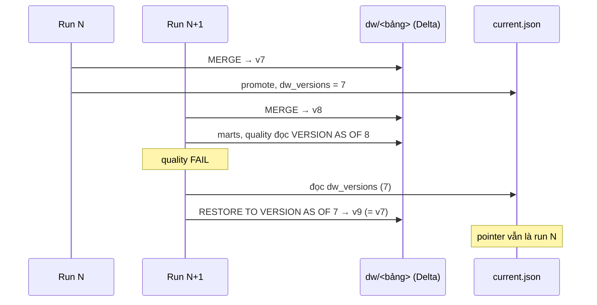

# 14. Cửa sổ ngày, star đã chứng nhận và RESTORE

> Đúng với: commit `f82f5b5` · Cập nhật: 2026-11-02 · Nguồn chân lý: ADR-0007, `processing/batch/stages/silver.py`, `stages/facts.py` (`built_star_versions`), `stages/quality.py` (`_restore_star`), `processing/batch/lake.py` (`merge_dw`)

**Dùng ở đâu:** ADR-0007, báo cáo chương batch (tính đúng khi chạy lại, chạy bù, và khi run hỏng).

**Câu hỏi:** một run chạm vào phần dữ liệu nào; vì sao chạy lại hay chạy run cũ không làm mất dòng; và run hỏng được gỡ khỏi star thế nào?

**Loại và bố cục:** hai hình đặt cạnh nhau.

- **Hình A (dòng thời gian):** trục ngang là ngày `observed_date`. Ba thanh ngang phía trên trục cho ba chế độ cửa sổ:
  1. mặc định: ngày của `as_of` cùng 1 ngày trước (`late_days` = 1);
  2. `--silver-since D`: từ ngày D tới ngày của `as_of`;
  3. `--rebuild`: mọi ngày Bronze có.

  Dưới trục là các partition Silver theo ngày. Ô thuộc cửa sổ tô đậm, ghi "replaceWhere".
- **Hình B (sequence):** trục dọc là version Delta của một bảng `dw`.
  - Run N (PASS) đưa bảng lên v7 và pointer ghi `dw_versions` = 7.
  - Run N+1 MERGE lên v8, rồi quality FAIL.
  - Lệnh `RESTORE TO VERSION AS OF 7` sinh ra v9, có nội dung giống v7.
  - Marts và quality của run N+1 đọc star bằng `VERSION AS OF 8`.

## Thành phần

| id | Nhãn | Hình |
|---|---|---|
| bronze_days | partition Bronze `observed_date=<d>` | A |
| window | tập ngày của run | A |
| silver_parts | partition Silver theo (`source_code`, `observed_date`) | A |
| dw_table | một bảng `dw/<bảng>` (Delta) | B |
| v7, v8, v9 | version Delta | B |
| manifest_N | manifest run N, `dw_versions` | B |
| current | `current.json` | B |

## Quan hệ

| Từ | Tới | Nhãn | Hình |
|---|---|---|---|
| bronze_days (trong cửa sổ) | silver_parts (cùng ngày) | đọc **toàn bộ** record của ngày, thay đúng partition ngày đó | A |
| `as_of` | đọc Silver, star | chỉ cắt khi đọc (marts, quality), không cắt khi ghi | A |
| run N | v7 | MERGE | B |
| current | v7 | `dw_versions` | B |
| run N+1 | v8 | MERGE | B |
| quality N+1 | v8 | `VERSION AS OF 8` | B |
| quality N+1 | v9 | FAIL → `RESTORE` về version mà `current` ghi | B |

**Hệ quả để ghi dưới hình:**

- Chạy lại cùng cửa sổ cho cùng kết quả: MERGE theo khoá, partition ngày được thay chứ không cộng dồn.
- Một run có `as_of` cũ hơn không làm mất dòng: nó thay đúng các ngày của nó bằng toàn bộ dữ liệu của những ngày đó. Run ấy cũng không được promote (`BACKFILL_REFUSED`).
- `marketplace_reprocess` là một run thường, mới hơn, với cửa sổ dài hơn. Vì vậy không có "backfill" nào ghi đè dữ liệu mới.
- Script `scripts/h7.ps1` kiểm cả ba điều trên trên MinIO.

**Chú thích:** "Mỗi run sở hữu một tập ngày và thay đúng những ngày đó. Star giữ mọi version, và pointer ghi version đã qua cổng. Run trượt cổng thì star được đưa về đúng version đã chứng nhận."

## Bản nháp Mermaid

## Kiểm chứng

ADR-0007 (mục "Quyết định"), `processing/batch/stages/silver.py` (cửa sổ, replaceWhere), `processing/batch/lake.py` (`merge_dw`, `restore_dw`, `read_dw` với `versionAsOf`), `processing/batch/stages/quality.py` (`_restore_star`), `orchestration/dags/marketplace_reprocess.py`, `scripts/h7.ps1`.
