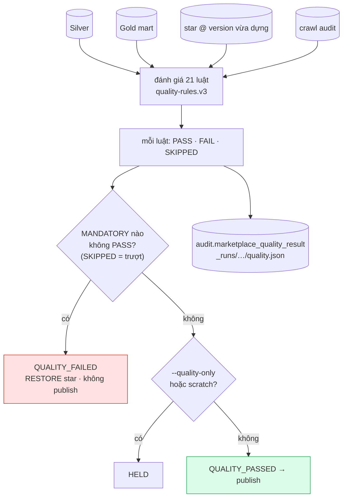

# 15. Cổng chất lượng

> Đúng với: commit `f82f5b5` · Cập nhật: 2026-11-02 · Nguồn chân lý: `src/ecomdata/domain/quality_rules.py` (registry), `processing/batch/quality.py` (`evaluate_quality_gates`, `decide`), `processing/batch/stages/quality.py`

**Dùng ở đâu:** `docs/QUALITY.md` (doc mới theo brief), báo cáo chương chất lượng dữ liệu.

**Câu hỏi:** cái gì chặn dữ liệu xấu trước khi nó tới người dùng, và một luật không chạy được thì tính là gì?

**Loại và bố cục:** flowchart trên → dưới dạng cây quyết định.

- Trên cùng: bốn nguồn vào (Silver, Gold mart, star tại version vừa dựng, crawl audit) đổ vào ô "đánh giá 21 luật".
- Giữa: ô "mỗi luật → PASS / FAIL / SKIPPED".
- Dưới: hai hình thoi.
- Bên phải: bảng 21 luật nhóm theo dataset, mỗi dòng có nhãn MANDATORY (đỏ) hoặc ADVISORY (xám).

## Thành phần: luật (`QUALITY_RULES`, version `quality-rules.v3`)

| Nhóm | Mức | Luật |
|---|---|---|
| silver | MANDATORY | `raw_artifact_checksum_and_uri_present`, `silver_observation_raw_lineage_complete`, `observation_id_unique`, `offer_key_and_price_complete`, `price_non_negative`, `observed_at_within_future_tolerance`, `currency_valid`, `offer_listing_key_unique` |
| audit | MANDATORY | `silver_parse_attempt_reconciliation`: số dòng Silver của mỗi crawl run bằng `parsed_count` trong audit |
| Gold mart | MANDATORY | `offer_current_single_row_per_offer`, `gold_daily_row_count_reconciles`, `gold_daily_price_aggregates_reconcile`, `freshness_rule_version_and_as_of_applied` |
| Gold mart | ADVISORY | `counter_invalid_transition_rate`, `price_anomaly_evaluation_coverage`, `source_coverage_rate_denominator_present`, `crawl_reliability_evidence_present` |
| star | MANDATORY | `star_foreign_keys_resolve` (44 tham chiếu), `star_surrogate_keys_unique`, `star_listing_versions_consistent` |
| star | ADVISORY | `star_unknown_member_rate` |

Tổng: 16 MANDATORY, 5 ADVISORY.

## Quan hệ (luồng quyết định)

| Từ | Tới | Điều kiện |
|---|---|---|
| đánh giá | kết quả từng luật | PASS, FAIL, hoặc SKIPPED (không chạy được, ví dụ audit không truy cập được) |
| kết quả | ◇ "có luật MANDATORY không PASS?" | **SKIPPED tính là trượt** |
| ◇ có | QUALITY_FAILED | ghi kết quả và manifest; `RESTORE` star; không publish; pointer giữ nguyên |
| ◇ không | ◇ "chỉ để kiểm?" | |
| ◇2 có (`--quality-only`, Gold root scratch) | HELD | |
| ◇2 không | QUALITY_PASSED → publish | ADVISORY trượt chỉ được báo cáo, không chặn |
| mọi nhánh | `audit.marketplace_quality_result`, `_runs/run_id=<run>/quality.json` | luôn ghi |

**Chú thích:** "Cổng chất lượng chạy sau khi Gold và star đã dựng, trước khi bất cứ thứ gì được publish. Một luật bắt buộc không chạy được bị tính là trượt, để một cơ sở dữ liệu audit không truy cập được không bao giờ trông như đèn xanh."

## Bản nháp Mermaid

## Kiểm chứng

`domain/quality_rules.py` (in danh sách: `python -c "from ecomdata.domain.quality_rules import QUALITY_RULES; ..."`), `processing/batch/quality.py` (`decide`, `QualityGateFailure`), `processing/batch/stages/quality.py`, drill D8. Theo brief, bảng luật trong `docs/QUALITY.md` nên được sinh từ registry bằng script, không chép tay.
