# 16. Lineage: truy ngược một dòng mart về byte gốc, và reparse

> Đúng với: commit `f82f5b5` · Cập nhật: 2026-11-02 · Nguồn chân lý: `src/ecomdata/domain/identity.py`, `domain/datasets.py` (cột lineage), `ingestion/raw_store.py`, `ingestion/reparse.py`

**Dùng ở đâu:** `docs/LINEAGE.md` (doc mới theo brief), báo cáo chương chất lượng và truy vết, demo Step 2.

**Câu hỏi:** một con số trên dashboard từ đâu ra, đi ngược tới tận byte mà sàn trả về?

**Loại và bố cục:** flowchart phải → trái. Dashboard ở bên phải, byte gốc ở bên trái. Mỗi bước là một hộp ghi tên bảng hoặc file, kèm **cột dùng để nhảy sang bước tiếp theo**, viết đậm trên cạnh. Dưới hình là một hàng ví dụ thật, ghi giá trị cụ thể của từng khoá.

Một nhánh phụ nét đứt từ "raw artifact" quay ngược lên "records" là lệnh reparse.

## Thành phần

| # | Bước | Ở đâu | Cột lineage |
|---|---|---|---|
| 1 | dòng trên Superset | `cache.marketplace_offer_current` | `offer_id`, `current_observation_id`, `raw_uri`, `raw_sha256`, `crawl_run_id`, `adapter_version` |
| 2 | mart Gold của run | `gold/marketplace/runs/run_id=<run>/offer_current/` | như trên; run lấy từ `current.json` |
| 3 | fact | `dw/fact_offer_observation` | `observation_id`, `raw_uri`, `raw_sha256`, `crawl_run_id` |
| 4 | Silver | `silver/marketplace/offer_observations_v2/` | `observation_id` = băm(`obs`, marketplace, `platform_listing_id`, `observed_at`, `raw_sha256`) |
| 5 | record Bronze | `bronze/marketplace/records/.../raw_artifact_id=<id>.jsonl.gz` | `record_id`, `raw_artifact_id`, `raw_uri` |
| 6 | raw artifact | `bronze/marketplace/raw/.../raw_artifact_id=<id>/metadata.json` + `part-N.bin.gz` | `body_sha256`, sha256 của từng part |
| 7 | crawl run | `bronze/marketplace/crawl_audit/.../crawl_run_id=<id>.jsonl.gz` | `crawl_run_id`, `task_id`, `http_status` |

Mart theo ngày (`offer_price_history_daily`) không mang `raw_uri`. Nó mang `last_observation_id`, rồi đi tiếp từ bước 3.

## Quan hệ

| Từ | Tới | Khoá nhảy |
|---|---|---|
| 1 | 2 | `run_id` của `current.json` |
| 2 | 3 | `current_observation_id` = `observation_id` |
| 3 | 4 | `observation_id` |
| 4 | 5 | `raw_uri` (thư mục artifact) |
| 5 | 6 | `raw_artifact_id` |
| 6 | 7 | `crawl_run_id` |
| 6 | 5 (nét đứt) | `python -m ecomdata.ingestion.reparse`: đọc raw, kiểm checksum, chạy lại extractor, so với records |

**Kết quả của reparse** (ghi cạnh nhánh nét đứt): `IDENTICAL`, `DIVERGED`, `RECORDS_MISSING`, `CHECKSUM_MISMATCH`, `PARSE_FAILED`, `ADAPTER_VERSION_CHANGED`. Reparse chỉ đọc, không ghi gì. Nó báo khác biệt chứ không sửa.

**Replay ảnh hưởng lineage thế nào** (ghi chú dưới hình):

- id tất định (`observation_id`, `record_id`, `raw_artifact_id`), nên chạy lại batch từ Bronze cho ra cùng id;
- record file đặt tên theo `raw_artifact_id`, nên re-extract ghi đè đúng file cũ, không sinh bản thứ hai;
- thứ tự giữa các observation do `(observed_at, fetched_at, observation_id)` quyết định (`domain/ordering.py`).

**Ví dụ thật:** còn trống. Lấy trên PC sau khi chạy H7:

1. chọn một dòng `cache.marketplace_offer_current`;
2. ghi lại `offer_id`, `current_observation_id`, `raw_uri`, `raw_sha256`;
3. mở `metadata.json` trên MinIO và đối chiếu sha256;
4. chạy `reparse` cho artifact đó;
5. chụp màn hình từng bước.

**Chú thích:** "Một con số trên dashboard đi ngược được tới đúng byte mà sàn đã trả về, chỉ bằng các cột lineage mà mỗi tầng mang theo. Lệnh reparse chứng minh parser hiện tại vẫn ra đúng record từ byte đó."

## Bản nháp Mermaid

```mermaid
flowchart RL
    dash["Superset<br/>cache.marketplace_offer_current"] -->|run_id của current.json| mart["Gold mart offer_current"]
    mart -->|current_observation_id| fact["dw/fact_offer_observation"]
    fact -->|observation_id| silver["Silver offer_observations_v2"]
    silver -->|raw_uri| rec["Bronze/records<br/>raw_artifact_id=….jsonl.gz"]
    rec -->|raw_artifact_id| raw["Bronze/raw<br/>metadata.json · part-N.bin.gz<br/>sha256"]
    raw -->|crawl_run_id| audit["Bronze/crawl_audit"]
    raw -. "reparse (chỉ đọc)" .-> rec
```

## Kiểm chứng

`domain/identity.py` (`make_observation_id`, `make_raw_artifact_id`), `domain/datasets.py` (cột của `offer_current`, `fact_offer_observation`), `ingestion/raw_store.py`, `ingestion/record_store.py`, `ingestion/reparse.py` (trạng thái, CLI `--marketplace --observed-date --hour --crawl-run-id --raw-artifact-id`), `docs/DEMO_SCRIPT.md` Step 2.
