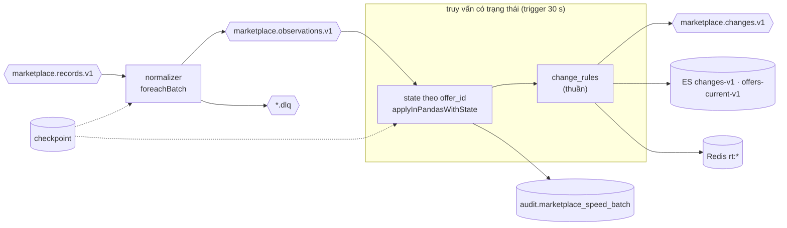

# 17. Speed layer: chuẩn hoá, phát hiện thay đổi, ghi sink

> Đúng với: commit `f82f5b5` · Cập nhật: 2026-11-02 · Nguồn chân lý: `src/ecomdata/processing/speed/{normalizer,stream,service,sinks,change_producer}.py`, `domain/change_rules.py`, `settings/__init__.py` (`SpeedSettings`)

**Dùng ở đâu:** `docs/ARCHITECTURE.md` (speed), báo cáo chương xử lý thời gian thực.

**Câu hỏi:** một record trên Kafka trở thành sự kiện "giá đổi" trên Kibana qua những bước nào, và vì sao phát lại không sinh bản trùng?

**Loại và bố cục:** flowchart trái → phải, hai query Structured Streaming đặt trong hai khung:

1. **normalizer**: đọc `marketplace.records.v1`, ghi `marketplace.observations.v1`;
2. **truy vấn có trạng thái**: đọc `marketplace.observations.v1`, ghi các sink.

Trong khung 2, vẽ một ô "state theo `offer_id`" (`applyInPandasWithState`) với vòng tròn tự trỏ. Checkpoint là hình trụ nhỏ gắn vào mỗi query. Bảng loại thay đổi đặt dưới hình.

## Thành phần

| id | Nhãn | Ghi chú |
|---|---|---|
| k_rec | `marketplace.records.v1` | |
| norm | normalizer (`foreachBatch`) | cùng normalizer theo nguồn với batch (`processing/normalize/sources/<site>.py`) |
| k_obs | `marketplace.observations.v1` | |
| dlq | `marketplace.records.v1.dlq`, `marketplace.observations.v1.dlq` | DECODE, CONTRACT_VALIDATION |
| state | trạng thái theo `offer_id` (`applyInPandasWithState`) | thứ tự `(observed_at, fetched_at, observation_id)` |
| rules | `domain/change_rules.py` | thuần; batch và test dùng chung |
| k_chg | `marketplace.changes.v1` | khoá `offer_id` |
| es | ES `marketplace-changes-v1` (`_id` = `event_id`), `marketplace-offers-current-v1` (`_id` = `offer_id`) | |
| redis | `rt:offer:<offer_id>` (TTL 86 400 s), `rt:change:<event_id>`, `rt:changes:recent` (giữ 5 000), `rt:source:<mp>:last_observation` | |
| audit | `audit.marketplace_speed_batch`, `audit.marketplace_stream_progress` | khoá `(query_name, query_id, batch_id)` |
| ckpt | checkpoint (volume `speed_checkpoints`) | |

**Tham số** (`MARKETPLACE_*`):

| Tham số | Giá trị |
|---|---|
| trigger | 30 giây |
| `LARGE_DROP_ABSOLUTE` | 100 000 |
| `LARGE_DROP_RELATIVE` | 0,20 (rớt ≥ 100 000 **hoặc** ≥ 20 %) |
| `STALE_AFTER_SECONDS` | 21 600 (6 giờ không thấy lại thì `OFFER_STALE`) |

**Loại thay đổi** (`MarketplaceChangeType`): `NEW_OFFER`, `PRICE_CHANGED`, `LARGE_PRICE_DROP`, `RATING_CHANGED`, `COUNTER_CHANGED`, `AVAILABILITY_CHANGED`, `OFFER_STALE`.

## Quan hệ

| Từ | Tới | Nhãn |
|---|---|---|
| k_rec | norm | |
| norm | k_obs | `marketplace-observation.v1` |
| norm | dlq | record lỗi |
| k_obs | state | nhóm theo `offer_id` |
| state | rules | so observation mới với state cũ |
| rules | k_chg, es, redis | sự kiện thay đổi và state mới |
| state | audit | mỗi micro-batch một dòng |
| ckpt | norm, state | offset và state |

**Chú thích:** "Speed layer gồm hai query Structured Streaming. Luật so sánh nằm trong một module thuần mà batch và test cũng dùng. Mọi sự kiện có id tất định, nên khi phát lại sau sự cố, Elasticsearch và Redis chỉ bị ghi đè, không có bản trùng (drill D4, D5)."

## Bản nháp Mermaid

## Kiểm chứng

`processing/speed/service.py` (trigger, checkpoint), `processing/speed/stream.py` (`applyInPandasWithState`), `processing/speed/sinks.py` (index, khoá Redis, TTL), `domain/change_rules.py` (điều kiện `LARGE_PRICE_DROP`), `domain/observations.py` (`MarketplaceChangeType`), `settings/__init__.py` (giá trị mặc định).
