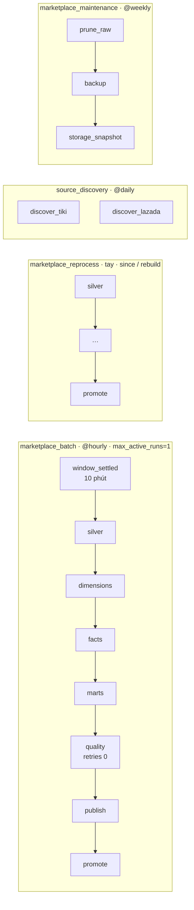

# 18. Bốn DAG Airflow

> Đúng với: commit `f82f5b5` · Cập nhật: 2026-11-02 · Nguồn chân lý: `src/ecomdata/orchestration/dags/*.py`, `orchestration/tasks.py`, ADR-0002, ADR-0007 (mục Điều phối)

**Dùng ở đâu:** báo cáo chương điều phối, ADR-0002. Ảnh chụp giao diện Airflow thật đã có trong `docs/evidence/refactor-20261025/screenshots/`.

**Câu hỏi:** việc gì chạy theo lịch nào, các task nối nhau ra sao, và khi lỗi thì retry thế nào?

**Loại và bố cục:** bốn làn ngang, mỗi DAG một làn.

- Đầu làn: tên DAG và lịch chạy.
- Task là hộp bo góc; dưới mỗi hộp ghi image chạy task đó.
- Thanh thuộc tính đặt bên phải mỗi làn: `max_active_runs`, retries, timeout.

Mọi task là `DockerOperator`, khởi chạy một container trên mạng của stack.

## Thành phần

| DAG | Lịch | Task (theo thứ tự) | Image | Thuộc tính |
|---|---|---|---|---|
| `marketplace_batch` | `@hourly`, `catchup=False` | `window_settled` (TimeDeltaSensor, chờ `MARKETPLACE_BATCH_SETTLE_MINUTES` = 10 phút, mode reschedule) → `silver` → `dimensions` → `facts` → `marts` → `quality` → `publish` → `promote` | `spark-marketplace:4.0.1-r3` | `max_active_runs=1`; retries 2 (riêng `quality` 0), cách nhau 2 phút; timeout mỗi stage 45 phút, cả run 3 giờ; param `allow_backfill` |
| `marketplace_reprocess` | chạy tay | `silver` → … → `promote` | `spark-marketplace:4.0.1-r3` | param `since` (ngày) hoặc `rebuild`; retries 1; timeout 4 giờ; run id `mp-reprocess-<giờ>` |
| `source_discovery` | `@daily` | `discover_<nguồn>` (mỗi nguồn một task, song song) | `marketplace-python:2` | retries 1, cách 10 phút; nạp category vào tầng `SWEEP`, idempotent |
| `marketplace_maintenance` | `@weekly` | `prune_raw` → `backup` → `storage_snapshot` | `marketplace-python:2` | retries 1; `storage_snapshot` gắn volume Kafka chỉ đọc |

**Lệnh của một task batch:**

```
python3 -m ecomdata.processing.batch run --run-id mp-<data_interval_end> --as-of <data_interval_end> --stage <stage> [--allow-backfill] [--resume chỉ khi try_number > 1]
```

## Quan hệ

Mũi tên `>>` nối các task theo thứ tự trong bảng. Thêm hai cạnh nét đứt:

| Từ | Tới | Nhãn |
|---|---|---|
| `source_discovery` | `audit.crawl_frontier` | nạp target |
| `marketplace_batch` | `current.json` | promote |

**Chú thích:** "Airflow chỉ điều phối; mỗi task là một container chạy đúng một lệnh của package. Batch chạy mỗi giờ, từng stage một, sau khi cửa sổ đã ổn định 10 phút. Stage `quality` không retry, vì một cổng đã từ chối thì chạy lại cũng sẽ từ chối."

## Bản nháp Mermaid



## Kiểm chứng

`orchestration/dags/marketplace_batch.py`, `marketplace_reprocess.py`, `source_discovery.py`, `marketplace_maintenance.py`; `orchestration/tasks.py` (`STAGE_TIMEOUT`, `_STAGE_RETRIES`, `settle_delay`, template run id, `--resume`, `maintenance_commands`); `tests/airflow/test_dags.py`.
