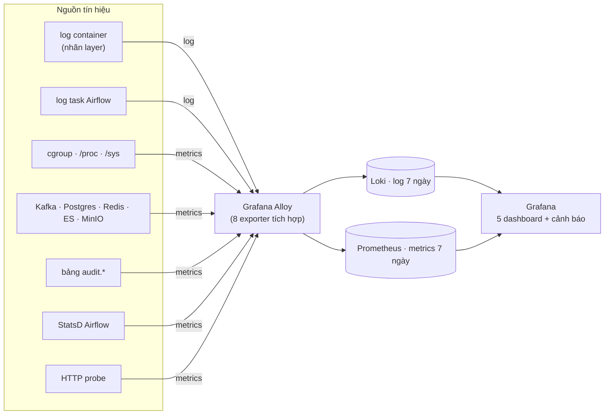

# 19. Giám sát: Alloy, Prometheus, Loki, Grafana

> Đúng với: commit `f82f5b5` · Cập nhật: 2026-11-02 · Nguồn chân lý: `docs/OBSERVABILITY.md`, `compose/docker-compose.observability.yml`, `observability/`

**Dùng ở đâu:** `docs/OBSERVABILITY.md` §1 (thay hình ASCII), báo cáo chương vận hành.

**Câu hỏi:** log và metrics của mọi thành phần được gom về đâu, và ai đọc chúng?

**Loại và bố cục:** flowchart trái → phải, ba cột:

1. **Nguồn tín hiệu**: nhóm các container theo `layer`.
2. **Alloy**: một hộp lớn duy nhất, bên trong liệt kê các exporter tích hợp.
3. **Lưu trữ và hiển thị**: Loki và Prometheus, rồi Grafana.

Superset và Kibana đặt riêng ở góc dưới, với nhãn "câu hỏi nghiệp vụ, không phải giám sát".

## Thành phần

| id | Nhãn | Nhóm | Ghi chú |
|---|---|---|---|
| containers | log container của stack (nhãn `ecomdata.layer`) | Nguồn | `crawl`, `ingest`, `speed`, `batch`, `orchestration`, `serving`, `storage`, `ops`, `observability` |
| airflow_logs | file log task Airflow (volume `airflow_logs`) | Nguồn | suy `dag_id`, `task_id` từ đường dẫn |
| host | cgroup, `/proc`, `/sys` | Nguồn | máy và container |
| stores | Kafka, Postgres, Redis, ES, MinIO `/metrics` | Nguồn | |
| audit | bảng `audit.*` (truy vấn SQL) | Nguồn | `mp_crawl_*`, `mp_batch_*`, `mp_quality_*`, `mp_speed_*`, `mp_storage_*` |
| statsd | StatsD của Airflow | Nguồn | |
| probe | HTTP probe (blackbox) | Nguồn | Kibana, Superset… |
| alloy | Grafana Alloy `v1.10.0` | Thu gom | thay Promtail và 8 exporter: node, cAdvisor, kafka, postgres, redis, elasticsearch, statsd, blackbox |
| loki | Loki `3.4.2` (log, 7 ngày) | Lưu | |
| prom | Prometheus `v3.2.1` (metrics, 7 ngày, tối đa 2 GB; recording rule) | Lưu | nhận remote write |
| grafana | Grafana `11.5.2`: 5 dashboard + cảnh báo | Hiển thị | `lambda-overview`, `lambda-pipeline`, `lambda-resources`, `lambda-orchestration`, `lambda-logs` |

## Quan hệ

| Từ | Tới | Nhãn |
|---|---|---|
| containers, airflow_logs | alloy | log |
| host, stores, audit, statsd, probe | alloy | metrics |
| alloy | loki | đẩy log |
| alloy | prom | remote write |
| loki, prom | grafana | truy vấn |
| grafana | (người vận hành) | cảnh báo: endpoint không trả lời, crawl ngừng 20 phút, DAG run thất bại… |

**Nhãn chung** (khung nhỏ): `project`, `layer`, `service`, `container`, `level`. Mỗi run batch mang `run_id` trong structured metadata của Loki, nên lọc được `{layer="batch"} | run_id="mp-…"`.

**Chú thích:** "Một bộ thu gom duy nhất (Alloy) đọc log và metrics của toàn stack rồi đẩy sang Loki và Prometheus. Grafana chỉ trả lời câu hỏi 'hệ thống có khoẻ không'. Câu hỏi 'dữ liệu nói gì' thuộc về Superset và Kibana."

## Bản nháp Mermaid

## Kiểm chứng

`docs/OBSERVABILITY.md` §1–6, `compose/docker-compose.observability.yml` (image, `mem_limit`), `observability/alloy/` (`queries-warehouse.yaml`, `queries-airflow.yaml`, `statsd-airflow.yaml`), `observability/build_grafana_dashboard.py`.
