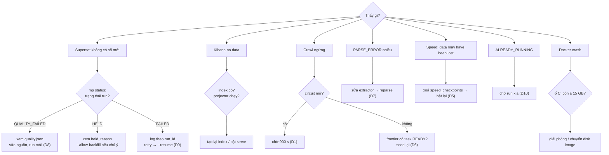

# 20. Sự cố theo triệu chứng

> Đúng với: commit `f82f5b5` · Cập nhật: 2026-11-02 · Nguồn chân lý: `docs/RUNBOOK.md`, `src/ecomdata/ops/` (`status`, `validate`, drills), `docs/OBSERVABILITY.md` §6

**Dùng ở đâu:** `docs/RUNBOOK.md` (mục mới "sự cố theo triệu chứng", bước B6 của brief), phụ lục báo cáo phần vận hành.

**Câu hỏi:** thấy triệu chứng X thì kiểm gì trước, và xử lý thế nào?

**Loại và bố cục:** flowchart trên → dưới, dạng cây quyết định.

- Gốc: "Thấy gì?".
- Tầng 1 có 7 nhánh triệu chứng.
- Mỗi nhánh đi xuống theo chuỗi: hình thoi (kiểm tra) → hộp (xử lý) → nhãn nhỏ "drill liên quan".

Màu theo tầng giống hình 01. Nếu cây quá rộng thì tách thành 2 hình: (a) dữ liệu không tới người dùng, (b) máy và hạ tầng.

## Thành phần (triệu chứng → kiểm tra → xử lý)

| # | Triệu chứng | Kiểm tra (theo thứ tự) | Xử lý | Drill |
|---|---|---|---|---|
| 1 | Dashboard Superset không có số mới | `mp status`: run gần nhất ở trạng thái nào? → `QUALITY_FAILED`: xem `failing_checks` trong `_runs/<run>/quality.json`; `HELD`: xem `held_reason`; `FAILED`: xem log Airflow theo `run_id` | dữ liệu sai thì sửa nguồn rồi chạy run mới; `HELD` do backfill thì `--allow-backfill` nếu chủ ý; `FAILED` thì retry (Airflow tự thêm `--resume`) | D8, D9 |
| 2 | Kibana "no data" | index `marketplace-*` có không → `es-projector` có log `projected` gần đây không → khoảng thời gian của dashboard | tạo lại index theo template; bật `serve` | D4 |
| 3 | Crawl ngừng (cảnh báo "Crawl ngừng" 20 phút) | container crawl-worker có chạy → `audit.crawl_source_state.opened_until` (circuit mở?) → frontier có task `READY` đến hạn? | chờ circuit tự đóng (900 s); seed lại; xem `last_error_kind` | D1, D6 |
| 4 | Nhiều `PARSE_ERROR` của một nguồn | `audit.crawl_request_attempt.error_message`; mở raw artifact | sửa extractor, rồi `reparse` các artifact đó (chỉ đọc) để chứng minh; không cần crawl lại | D7 |
| 5 | Speed không khởi động: "Some data may have been lost" | volume `kafka_data` có bị mất? | xoá volume `speed_checkpoints` của đúng project, rồi bật lại speed | D5 |
| 6 | Batch báo `ALREADY_RUNNING` | có run khác đang giữ lock không | chờ run kia xong; không xoá lock bằng tay | D10 |
| 7 | Docker treo hoặc crash, image hỏng | dung lượng trống ổ C: (ổ chứa `docker_data.vhdx`) | giải phóng ổ C: hoặc chuyển disk image sang ổ khác trước khi bật lại; chạy `.\scripts\h7.ps1` thì script tự kiểm ≥ 15 GB | — |

**Ràng buộc máy** (khung ghi chú bên cạnh, theo brief):

- **Ổ C:** một lần C: đầy đã làm Docker crash và hỏng image `elasticsearch:8.18.0`.
- **pyspark:** phải là bản 4. Bản 3.5 có python worker chết khi chạy với Python 3.12 + Java 21.
- **Đồng hồ VM Docker:** chạy trước Windows khoảng 30 s, nên độ trễ đo giữa host và container lệch đúng ngần ấy.
- **RAM:** áp lực bộ nhớ nằm ở máy Windows, không nằm trong VM; xem `docs/evidence/refactor-20261025/`.

## Quan hệ

Mỗi dòng của bảng là một nhánh: `gốc → triệu chứng → kiểm tra 1 → kiểm tra 2 → xử lý`. Kiểm tra nào trả lời "có" thì rẽ sang xử lý ngay, không đi tiếp.

**Chú thích:** "Lối vào xử lý sự cố theo cái người vận hành nhìn thấy. Mỗi nhánh trỏ tới drill đã tái hiện đúng sự cố đó trên stack thật."

## Bản nháp Mermaid

## Kiểm chứng

`docs/RUNBOOK.md` (mục "Two constraints that bite", "Kafka lost its topics", "When Kibana shows 'no data'"), `src/ecomdata/ops/drills.py`, `src/ecomdata/processing/batch/cli.py` (`ALREADY_RUNNING`), `docs/OBSERVABILITY.md` §6 (cảnh báo), `scripts/h7.ps1` (kiểm ổ đĩa).
