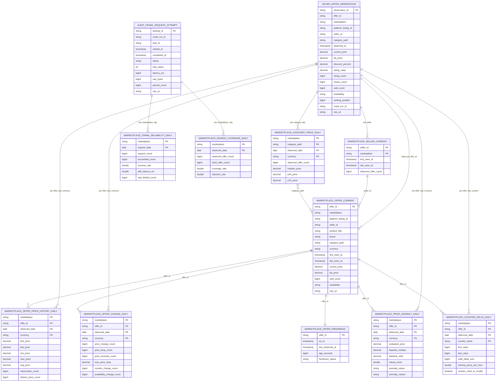
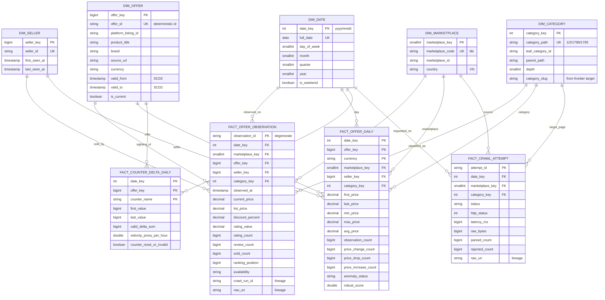

# Mô hình dữ liệu marketplace: hiện tại và star schema đề xuất

Mở file này trong VS Code (Markdown Preview Mermaid Support), trên GitHub, hoặc dán từng khối ` ```mermaid ` vào https://mermaid.live. Cũng có thể mở `star-schema.html`, file này tự vẽ cả hai sơ đồ.

## Nguồn định nghĩa trong code (branch `phase-9-tiki-category-html`)

| Phần | File |
|---|---|
| Contract của observation, change, DLQ | `config/marketplace_schema.py`; mô tả ở `docs/DATA_MODEL.md` §1 |
| 10 mart Gold (cách tính từng bảng) | `batch_layer/marketplace_marts.py`: `build_offer_current`, `build_seller_current`, `build_offer_price_history_daily`, `build_offer_change_daily`, `build_offer_freshness`, `build_category_price_daily`, `build_source_coverage_daily`, `build_crawl_reliability_daily`, `build_counter_transitions` / `build_counter_delta_daily` |
| Phát hiện giá bất thường | `batch_layer/marketplace_anomaly.py` |
| Bảng Postgres phục vụ BI (`cache.marketplace_*`, `audit.*`) | `scripts/init_postgres.sql`; mô tả ở `docs/DATA_MODEL.md` §4–5 |
| Star schema legacy (Kaggle: `DIM_DATE`, `DIM_USER`, `DIM_PRODUCT`, `DIM_CATEGORY`, `FACT_BEHAVIOR_EVENT`) | `batch_layer/warehouse_job.py`; `docs/DATA_MODEL.md` §9 |

**Hiện chưa có star schema dim/fact cho marketplace.** Gold gồm 10 mart. Mỗi mart có grain riêng và nối với các mart khác bằng natural key (`offer_id`, `seller_id`, `category_path`, `marketplace`, `observed_date`). Không có bảng dim với surrogate key.

## 1. Mô hình hiện tại (đúng với code)



## 2. Star schema đề xuất (chưa có trong code)

Các dim lấy từ những cột đang lặp lại trong các mart. Fact giữ nguyên grain của các mart hiện có. Cột nào cũng đã có trong Silver hoặc audit, không cần crawl thêm dữ liệu.



### Mỗi bảng mới lấy dữ liệu từ đâu

| Bảng đề xuất | Nguồn hiện có |
|---|---|
| `FACT_OFFER_OBSERVATION` | Silver `offer_observations`, mỗi quan sát một dòng |
| `FACT_OFFER_DAILY` | gộp `marketplace_offer_price_history_daily` + `offer_change_daily` + `price_anomaly_daily` (cả ba cùng grain `offer × ngày × tiền tệ`) |
| `FACT_COUNTER_DELTA_DAILY` | `marketplace_counter_delta_daily` |
| `FACT_CRAWL_ATTEMPT` | `audit.crawl_request_attempt` join `audit.crawl_frontier.target` |
| `DIM_OFFER` | thuộc tính mô tả trong `marketplace_offer_current`, thêm SCD2 vì tiêu đề và thương hiệu có thể đổi |
| `DIM_SELLER` | `marketplace_seller_current` |
| `DIM_CATEGORY` | các giá trị `category_path` khác nhau; slug lấy từ target `<slug>/c<id>` của frontier |
| Các mart tổng hợp (`category_price_daily`, `source_coverage_daily`, `crawl_reliability_daily`, `offer_freshness`) | giữ nguyên làm aggregate trên các fact |
