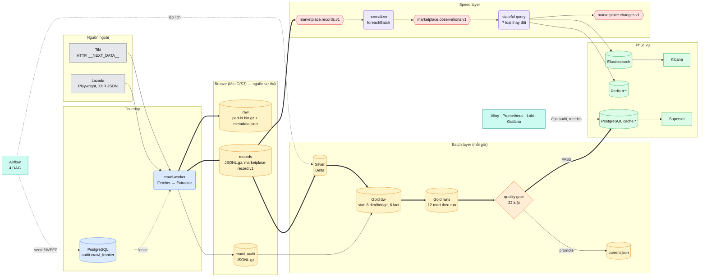
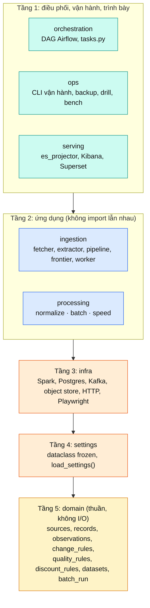
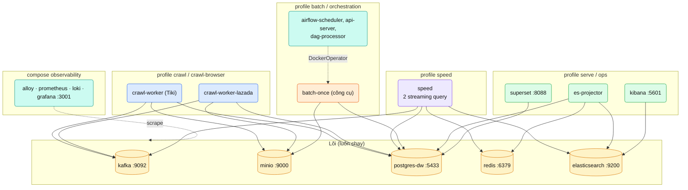
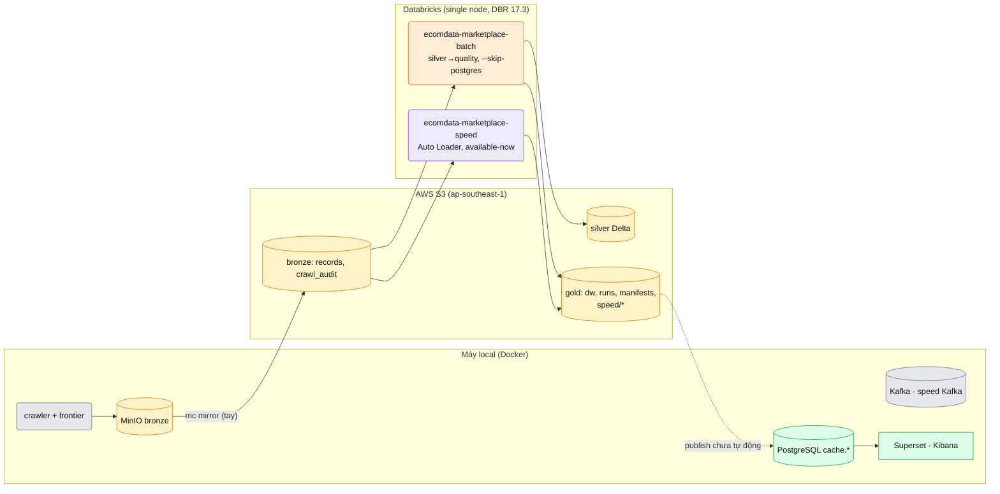

# 1. Tổng quan hệ thống

> Đúng với: commit `9c73660` · Cập nhật: 2026-11-16 · Nguồn chân lý: `src/ecomdata/`, `compose/docker-compose.yml`, `databricks.yml`, `databricks/resources/jobs.yml`

## 1.1 Bài toán và phạm vi

Hệ thống quan sát **trạng thái công khai của catalog và giá** trên sàn thương mại điện tử Việt Nam (Tiki là nguồn chính, Lazada là nguồn minh hoạ đa nguồn). Dữ liệu nó có là những gì sàn hiển thị cho một khách vãng lai trên trang danh mục: tiêu đề, giá, giá niêm yết, mức giảm, tình trạng còn hàng, điểm đánh giá, các bộ đếm công khai (đã bán, số đánh giá) và vị trí xếp hạng.

Hệ thống **không** có đơn hàng, thanh toán, giỏ hàng hay người dùng, và không mô hình nào giả lập chúng. Bộ đếm `sold_count` tăng không có nghĩa là một đơn hàng: mọi bảng chạm tới counter đều giữ cả delta thô lẫn phán quyết hợp lệ.

Ba câu hỏi nghiệp vụ hệ thống trả lời:

1. Giá của một offer thay đổi thế nào theo thời gian? Thay đổi nào bất thường so với lịch sử của chính nó? (mart `offer_price_history_daily`, `price_anomaly_daily`)
2. Mức giảm giá sàn hiển thị có đáng tin không, so với giá trước đó của chính offer? (mart `discount_credibility_daily`, ADR-0009)
3. Khi một listing thay đổi (giá, tồn kho, đánh giá), bao lâu thì thấy được? Độ phủ và độ tươi của mỗi nguồn ra sao? (speed layer, mart `source_coverage_daily`, `offer_freshness`)

## 1.2 Kiến trúc tổng thể

Hệ thống theo kiến trúc **Lambda**, thu thập theo kiểu **ELT** (ADR-0001). Crawler lưu nguyên vẹn phản hồi và từng dòng nguồn vào Bronze; mọi chuẩn hoá làm sau, trong Spark. Từ cùng một Bronze có hai đường:

- **Batch** (đúng, chạy lại được, có phiên bản): mỗi giờ dựng Silver, star `dw`, 12 mart, qua cổng chất lượng rồi publish vào PostgreSQL.
- **Speed** (nhanh): Kafka → Spark Structured Streaming → phát hiện 7 loại thay đổi theo offer → Kafka, Elasticsearch, Redis.

*Hình 1.1. Toàn cảnh. Bronze được ghi trước và là nguồn sự thật. Kafka chỉ là bản sao nhanh của Bronze/records. Batch đọc lại Bronze theo cửa sổ ngày; PostgreSQL chỉ giữ bản cache của run đã được promote.*

## 1.3 Các tầng dữ liệu

| Tầng | Nơi lưu | Định dạng | Ai ghi | Chính sách ghi | Vai trò |
|---|---|---|---|---|---|
| Frontier, audit vận hành | PostgreSQL schema `audit` | bảng | crawl-worker, batch, speed | upsert, transaction | hàng đợi việc crawl, trạng thái run, kết quả quality, số đo vận hành (Grafana đọc) |
| **Bronze/raw** | bucket `ecommerce-bronze`, `marketplace/raw/…` | gzip nhị phân + `metadata.json` | crawl-worker | append-only, không ghi đè | phản hồi HTTP nguyên vẹn, có SHA-256 |
| **Bronze/records** | `marketplace/records/source=…/observed_date=…/hour=…/` | JSONL.gz | crawl-worker | idempotent theo đường dẫn | từng dòng nguồn với toàn bộ trường (trừ PII khai báo) |
| **Bronze/crawl_audit** | `marketplace/crawl_audit/…` | JSONL.gz | crawl-worker | một file mỗi crawl run | bản lưu của audit crawl (ADR-0008) |
| Kafka | 5 topic, 3 partition | JSON canonical | crawler, speed | at-least-once | đường nhanh; không phải bản lưu |
| **Silver** | `ecommerce-silver`, `marketplace/<bảng>/` | Delta, partition `source_code, observed_date` | stage `silver` | thay nguyên partition ngày | observation chuẩn hoá, bảng rộng theo nguồn, page context, quarantine |
| **Gold `dw`** (star) | `ecommerce-gold`, `marketplace/dw/<bảng>/` | Delta (bắt buộc) | stage `dimensions`, `facts` | `MERGE` theo khoá, giữ mọi version | mô hình chiều dùng chung cho mọi run |
| **Gold runs** | `marketplace/runs/run_id=<run>/<mart>/` | Delta (mặc định) | stage `marts` | một thư mục mỗi run, không ghi đè run khác | 12 mart của một run |
| Manifest, pointer | `marketplace/manifests/run_id=<run>/manifest.json`, `marketplace/current.json` | JSON canonical | `quality`, `promote` | pointer thay nguyên file, compare-and-swap | run nào đang được phục vụ |
| **Cache phục vụ** | PostgreSQL `cache.marketplace_*` (12 bảng) | bảng | stage `publish` | TRUNCATE + INSERT trong một transaction | Superset đọc |
| Speed serving | ES `marketplace-*-v1`, Redis `rt:*` | document, hash/zset | speed, es-projector | upsert theo id | Kibana, tra cứu thời gian thực |

Nguyên tắc lưu trữ (ADR-0008, memory dự án 2026-10-26): **lake là bản lưu, PostgreSQL chỉ là cache**. Xoá sạch `cache.*` thì dựng lại được từ Gold; xoá Gold thì dựng lại được từ Bronze.

## 1.4 Tầng module trong code

Code nằm trong một package `ecomdata` (`src/ecomdata/`), chia theo Ports & Adapters (ADR-0003). `import-linter` kiểm luật import trong CI.

*Hình 1.2. Tầng trên chỉ import tầng dưới. `ingestion` và `processing` không biết nhau: chúng chỉ gặp nhau qua hợp đồng dữ liệu trong `domain` (envelope `marketplace-record.v1`) và qua Bronze.*

Hai điểm khiến batch và speed cho cùng một kết quả:

- **Một normalizer theo nguồn** (`processing/normalize/sources/{tiki,lazada}.py` + `common.py`) dùng cho cả stage `silver` lẫn query normalizer của speed.
- **Một registry**: `domain/sources.py` (mã nguồn → `SourceSpec`), `domain/datasets.py` (bảng Gold, khoá, khoá ngoại), `domain/quality_rules.py`, `domain/change_rules.py`, `domain/discount_rules.py`.

## 1.5 Công nghệ

| Mảng | Công nghệ | Phiên bản (pin trong `constraints.txt`, image) |
|---|---|---|
| Ngôn ngữ | Python | 3.12 |
| Xử lý | Apache Spark (PySpark), Structured Streaming, Delta Lake | Spark 4.0.1 (image `ecommerce/spark-marketplace:4.0.1-r4`) |
| Thu thập | `requests` (Tiki), Playwright Chromium (Lazada) | image `ecommerce/crawler-browser:1` (Playwright v1.55.0) |
| Message bus | Apache Kafka, KRaft | 4.2.0 |
| Object store | MinIO (local), S3 (Databricks) | |
| Cơ sở dữ liệu | PostgreSQL | 18.3 |
| Speed serving | Elasticsearch, Kibana; Redis | 8.18.1; 8.6.2 |
| BI | Apache Superset | 4.1.1 |
| Điều phối | Apache Airflow (LocalExecutor, DockerOperator) | 3.3.2 |
| Giám sát | Grafana Alloy, Prometheus, Loki, Grafana | 1.10.0, 3.2.1, 3.4.2, 11.5.2 |
| ML | scikit-learn Isolation Forest (chỉ xếp hạng) | |
| Cloud | Databricks Asset Bundle, DBR 17.3 (Spark 4.0) | |

## 1.6 Triển khai

### Local: Docker Compose theo profile

Mỗi stack là một compose project riêng (`env/base.env` + `env/ports.<stack>.env` + `env/<stack>.env`), được điều khiển bằng `scripts/mp.ps1`. Chi tiết từng service ở [04-pipeline.md §4.9](04-pipeline.md#49-triển-khai-và-tài-nguyên).

### Hybrid: batch và speed lakehouse trên Databricks

Từ 2026-11-05 (nhánh `phase-11/databricks`) phần tính toán chạy được trên Databricks; phần dính tới mạng nội bộ ở lại máy local.

*Hình 1.3. Job batch trên Databricks dừng ở `quality` vì `publish` và `promote` cần PostgreSQL. Job speed chạy available-now hoặc trong một cửa sổ demo, không chạy 24/7 (`databricks/resources/jobs.yml`).*

## 1.7 Nguyên tắc thiết kế

| Nguyên tắc | Thực hiện ở đâu | Hệ quả |
|---|---|---|
| **Bronze là sự thật, raw-first** | `ingestion/pipeline.py`: ghi raw trước khi kiểm HTTP status, trước khi parse | Trang lỗi 4xx/5xx vẫn còn bằng chứng; parser đổi thì `reparse` dựng lại records |
| **ID tất định** | `domain/identity.py` (`deterministic_id` = SHA-256 các phần nối bằng `\x1f`) | Ghi lại, replay Kafka, chạy lại batch đều ra cùng byte; không cần exactly-once |
| **Publish Kafka sau khi file đã ghi** | `ingestion/service.py:388-411` | Kafka không bao giờ có record mà Bronze không có |
| **Một normalizer cho batch và speed** | `processing/normalize/` | Hai đường không lệch định nghĩa |
| **Cổng chất lượng chặn publish** | `processing/batch/quality.py::decide` | Run lỗi không bao giờ tới Superset; cache giữ bản tốt cuối cùng |
| **Star đã chứng nhận** (ADR-0007) | stage `quality`: `RESTORE TABLE … VERSION AS OF` | Run bị từ chối không để lại star bẩn cho run sau |
| **Publish trước promote** (ADR-0005) | stage `publish` → `promote` | `current.json` không bao giờ trỏ vào Gold mà cache chưa có |
| **Luật trước, ML chỉ xếp hạng** (ADR-0009) | `processing/batch/discount.py` | Phán quyết đọc được lý do; Isolation Forest chỉ để sắp thứ tự xem tay |

## 1.8 Quy mô đã đo

| Số đo | Giá trị | Ngày, nguồn |
|---|---|---|
| Lượt chạy liên tục dài nhất | 9 giờ 16 phút, 10 run batch, 10/10 PROMOTED, quality PASS | 13–14/11/2026, `docs/evidence/fullrun-20261114/KET-QUA.md` |
| Dòng Gold mỗi run | 1.432.017 → 1.966.878 | như trên |
| Thời gian stage nặng nhất (`dimensions`) | khoảng 217–259 s; `marts` 88–105 s | như trên |
| Độ trễ speed p95 | khoảng 59–62 s sau khi đuổi kịp tồn đọng (trigger 30 s) | như trên |
| Task SWEEP thành công một lượt | 14.023 | như trên |
| Micro-batch speed | 6.429, 0 thất bại; p50 8,8 s với trigger 5 s | 31/10/2026, `docs/DANH_GIA_HE_THONG_20261113.md` |
| Tăng trưởng Bronze | 385 MB raw + 74 MB records trong 6 giờ crawl Tiki | 31/10/2026, như trên |
