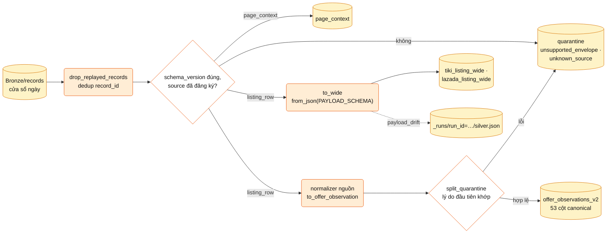
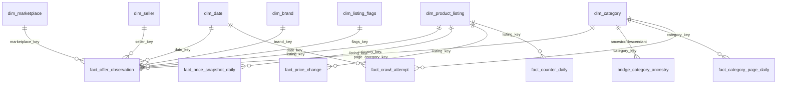
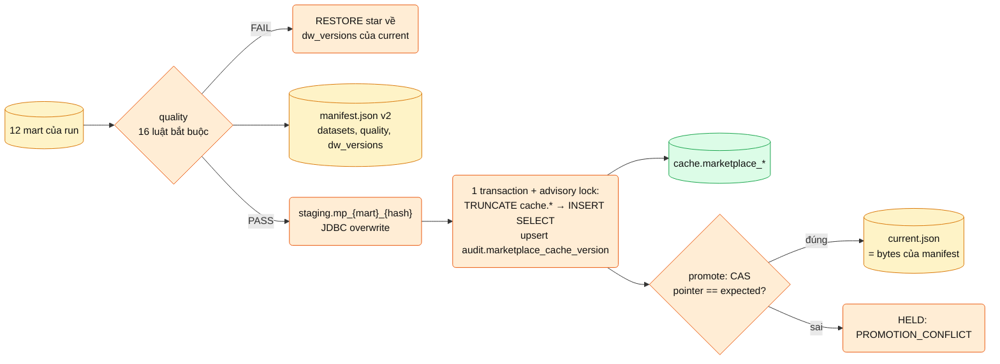
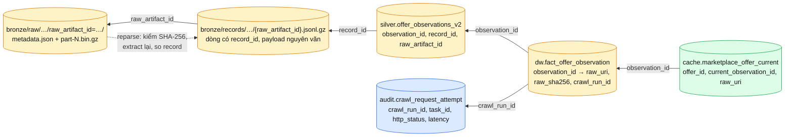

# 2. Luồng dữ liệu và biến đổi qua các tầng

> Đúng với: commit `9c73660` · Cập nhật: 2026-11-16 · Nguồn chân lý: `src/ecomdata/ingestion/`, `src/ecomdata/domain/{records,observations,identity}.py`, `src/ecomdata/processing/normalize/`, `src/ecomdata/processing/batch/`, `src/ecomdata/processing/speed/`

Tài liệu này theo **một dữ liệu** đi từ trang của sàn tới dashboard. Ở mỗi chặng (hop) nó trả lời: đầu vào là gì, ai biến đổi, biến đổi thế nào, đầu ra là gì, khoá và cách ghi lại (idempotency). Chi tiết thuật toán bên trong từng tầng nằm ở [03-xu-ly-trong-tang.md](03-xu-ly-trong-tang.md).

## 2.1 Sơ đồ luồng chi tiết

Hình có ba làn: speed ở trên, thu thập và Bronze ở giữa, batch ở dưới. Số trên cạnh là số chặng (H1…H9) dùng trong các mục sau.

```mermaid
flowchart LR
    classDef src fill:#E5E7EB,stroke:#6B7280,color:#111
    classDef acq fill:#DBEAFE,stroke:#2563EB,color:#111
    classDef lake fill:#FEF3C7,stroke:#D97706,color:#111
    classDef batch fill:#FFEDD5,stroke:#EA580C,color:#111
    classDef speed fill:#EDE9FE,stroke:#7C3AED,color:#111
    classDef kafka fill:#FEE2E2,stroke:#DC2626,color:#111
    classDef serve fill:#DCFCE7,stroke:#16A34A,color:#111

    page["Trang danh mục<br/>tiki.vn/{slug}/c{id}"]:::src
    frontier[("audit.crawl_frontier")]:::acq
    worker("crawl-worker<br/>pipeline.acquire_listing_page"):::acq

    subgraph BR["Bronze · ecommerce-bronze"]
        raw[("marketplace/raw/…/raw_artifact_id=…/<br/>part-N.bin.gz · metadata.json")]:::lake
        rec[("marketplace/records/source=…/<br/>observed_date=…/hour=…/{raw_artifact_id}.jsonl.gz")]:::lake
        caud[("marketplace/crawl_audit/…/<br/>{crawl_run_id}.jsonl.gz")]:::lake
    end

    subgraph SP["Speed"]
        krec{{"marketplace.records.v1"}}:::kafka
        norm("normalizer query<br/>foreachBatch"):::speed
        kdlq1{{"records.v1.dlq"}}:::kafka
        kobs{{"marketplace.observations.v1"}}:::kafka
        stf("stateful query<br/>applyInPandasWithState(offer_id)"):::speed
        kdlq2{{"observations.v1.dlq"}}:::kafka
        kchg{{"marketplace.changes.v1"}}:::kafka
        es[("ES marketplace-changes-v1<br/>marketplace-offers-current-v1")]:::serve
        rd[("Redis rt:offer:*, rt:change:*,<br/>rt:changes:recent")]:::serve
    end

    subgraph BA["Batch (mỗi giờ, theo run_id + as_of)"]
        ssil("stage silver"):::batch
        silver[("Silver · Delta<br/>offer_observations_v2 · tiki_listing_wide ·<br/>lazada_listing_wide · page_context · quarantine")]:::lake
        sstar("stage dimensions · facts"):::batch
        dw[("Gold dw · Delta MERGE<br/>7 dim + 1 bridge · 6 fact")]:::lake
        smart("stage marts"):::batch
        runs[("Gold runs/run_id=…<br/>12 mart")]:::lake
        sq{"stage quality<br/>22 luật"}:::batch
        man[("manifests/run_id=…/manifest.json")]:::lake
        spub("stage publish"):::batch
        cache[("PostgreSQL cache.marketplace_* (12)")]:::serve
        sprom("stage promote"):::batch
        cur[("current.json")]:::lake
    end

    frontier -. lease .-> worker
    page -->|H1 GET| worker
    worker ==>|H1| raw
    worker ==>|H2| rec
    worker -->|kết thúc crawl run| caud
    rec ==>|H3 publish, acks=all| krec
    krec -->|H4| norm
    norm --> kobs
    norm --> kdlq1
    kobs -->|H5| stf
    stf --> kchg & es & rd
    stf --> kdlq2
    rec ==>|H6 cửa sổ ngày| ssil --> silver
    silver ==>|H7| sstar --> dw
    caud --> sstar
    dw ==>|H8 VERSION AS OF, cắt as_of| smart --> runs
    runs ==>|H9| sq --> man
    sq -->|PASS| spub --> cache
    spub --> sprom --> cur
    cache --> superset["Superset"]:::serve
    es --> kibana["Kibana"]:::serve
```



*Hình 2.1. Đường đi của dữ liệu. Bronze/records là điểm rẽ nhánh: speed đọc bản sao trên Kafka, batch đọc lại chính file. Hai đường dùng chung normalizer nên định nghĩa một observation giống nhau.*

## 2.2 Bảng tóm tắt các chặng

| # | Từ → Tới | Thành phần | Biến đổi chính | Hạt (grain) đầu ra | Khoá, cách ghi lại an toàn |
|---|---|---|---|---|---|
| H1 | Trang sàn → Bronze/raw | crawl-worker (`pipeline.py`, `raw_store.py`) | không biến đổi; gzip, SHA-256 từng part | một **phản hồi** (document + XHR) | `raw_artifact_id` = hash(code, URL, `fetched_at`, `body_sha256`); không ghi đè |
| H2 | raw → Bronze/records | extractor theo site, `domain/records.build_records` | tách mảng dòng và page context; bỏ trường PII; bọc envelope | một **dòng nguồn** (record) | `record_id` = hash(`raw_artifact_id`, kind, index); file gzip `mtime=0`, byte tất định |
| H3 | records → Kafka `records.v1` | `service.publishing_executor` | chỉ `listing_row`, JSON canonical | một record | key `"<source>\|<target>"`; at-least-once, chỉ publish sau khi file đã ghi |
| H4 | `records.v1` → `observations.v1` | speed normalizer | chuẩn hoá về cột canonical; bỏ quảng cáo; tách quarantine → DLQ | một **observation** | `event_id = observation_id`; key `"<code>:<listing_id>"` |
| H5 | `observations.v1` → changes, ES, Redis | speed stateful query | so với state của offer → 0..n thay đổi | một **thay đổi** / một trạng thái offer | `change_id` = hash(offer, obs, type, rule_version); ES `_id` cố định |
| H6 | Bronze/records → Silver | stage `silver` | dedup `record_id`; chuẩn hoá; quarantine; bảng rộng có kiểu | observation (giữ quảng cáo, có cờ) | thay nguyên partition ngày (`replaceWhere`/dynamic overwrite) |
| H7 | Silver → star `dw` | stage `dimensions`, `facts` | surrogate key xxhash64; SCD2 listing; tổng hợp theo ngày | xem bus matrix §2.4.7 | Delta `MERGE` theo khoá registry; mỗi run một version |
| H8 | star → mart theo run | stage `marts` | đọc star tại version vừa dựng, cắt `observed_at ≤ as_of`, bỏ quảng cáo; tổng hợp, chấm điểm | 12 grain (bảng §2.4.8) | thư mục `run_id=…` mới, ghi đè tĩnh |
| H9 | mart → manifest → cache → pointer | stage `quality`, `publish`, `promote` | kiểm 22 luật; sao 12 mart sang Postgres; compare-and-swap pointer | không đổi grain | TRUNCATE+INSERT trong một transaction; pointer CAS |

## 2.3 Đường thu thập: từ trang tới Bronze và Kafka

### H1. Trang sàn → Bronze/raw

**Đầu vào.** Một task trong `audit.crawl_frontier`: `target = {"page": 1, "target": "dien-thoai-may-tinh-bang/c1789"}`, `resource_type = LISTING_PAGE`.

**Biến đổi.** Không có. Worker lấy URL từ extractor, kiểm robots.txt, chờ throttle (≥ 2 s cộng jitter 0–1 s theo host; Lazada ≥ 5 s), gọi fetcher:

- Tiki (`HttpFetcher`): một GET → một part (HTML có `__NEXT_DATA__`).
- Lazada (`BrowserFetcher`, Playwright): mở trang, ghi lại mọi phản hồi khớp `[?&]ajax=true` → part 0 là HTML, các part sau là XHR JSON.

Mọi part được ghi **trước** khi kiểm HTTP status, nên một trang 429 hay 503 vẫn để lại bằng chứng.

**Đầu ra** (`ingestion/raw_store.py:84-213`, định dạng v2):

```
ecommerce-bronze/marketplace/raw/marketplace=tiki/observed_date=2026-11-14/hour=03/
    crawl_run_id=crawl_run_…/raw_artifact_id=raw_…/
        part-0.bin.gz
        metadata.json        # schema marketplace-raw-artifact-metadata.v2
```

`metadata.json` giữ `parts[]` (index, url, http_status, content_type, role, sha256 của body chưa nén, bytes), `request{target,page}`, `response{retry_after, elapsed_ms}`. `body_sha256` của artifact là SHA-256 của danh sách part dạng canonical; `raw_uri` trỏ tới `part-0`.

### H2. raw → Bronze/records

**Biến đổi** (`ingestion/sources/<site>/extractor.py`, `domain/records.py`):

1. **Extract**: tìm mảng dòng và ngữ cảnh trang, **không ép kiểu, không chọn trường**.
   - Tiki: `__NEXT_DATA__ → props.initialState.catalog.data`; context gồm `categoryData, filters, sellers, paging, sort_options, amplitude, metaTitle, h1`.
   - Lazada: XHR đầu tiên có `mods.listItems`; context gồm `mods.{filter,breadcrumb,sortBar}, mainInfo, seoInfo`.
2. **Bỏ PII** theo `SourceSpec.pii_row_fields`/`pii_context_fields` (đường dẫn có dấu chấm; Lazada bỏ `mainInfo.userId`, `mainInfo.anonUid`). Tên trường đã bỏ được ghi vào `dropped_fields`.
3. **Bọc envelope** `marketplace-record.v1`: một record `page_context` (index 0) và n record `listing_row` (index theo thứ tự hiển thị).

**Đầu ra.** Một file JSONL.gz cho mỗi raw artifact:

```
ecommerce-bronze/marketplace/records/source=tiki/observed_date=2026-11-14/hour=03/raw_….jsonl.gz
```

| Trường envelope | Ý nghĩa |
|---|---|
| `schema_version` | `marketplace-record.v1` |
| `record_id` | `deterministic_id("rec", raw_artifact_id, kind, index)` |
| `source_code`, `marketplace_id` | `tiki` / `marketplace-tiki` |
| `record_kind`, `record_index` | `listing_row` hoặc `page_context`; vị trí trên trang |
| `raw_artifact_id`, `raw_uri`, `body_sha256` | lineage về H1 |
| `crawl_run_id`, `adapter_version`, `extractor_version` | phiên bản code đã sinh record |
| `request_target`, `request_page`, `fetched_at`, `http_status` | ngữ cảnh lần tải |
| `payload` | **nguyên văn JSON của nguồn**, trừ PII |
| `dropped_fields` | các trường PII thực sự đã bỏ |

Hạt dữ liệu đổi từ "một phản hồi" sang "một dòng nguồn". Payload Tiki giữ hơn 50 trường (`id, sku, name, url_key, price, original_price, list_price, discount, discount_rate, rating_average, review_count, quantity_sold.value, seller_id, seller_name, brand_id, brand_name, primary_category_path, category_ids, availability, shippable, advertisement, badges_v3, …`). Chưa có trường nào được đổi tên hay ép kiểu.

### H3. Bronze/records → Kafka `marketplace.records.v1`

Sau khi file records đã ghi xong, `publishing_executor` (`ingestion/service.py:388-411`) gửi **từng** `listing_row` (không gửi `page_context`) với `acks=all`, chờ ack từng record (timeout 30 s). Giá trị là JSON canonical (khoá sắp xếp, không khoảng trắng); key là `"<source_code>|<request_target>"`. Nếu gửi lỗi ở record thứ k, task được retry (`PUBLISH_ERROR`). Lần retry ghi lại cùng file, cùng byte, rồi gửi lại từ đầu; phía speed loại bản trùng bằng `observation_id`.

## 2.4 Đường batch: Bronze → Silver → star → mart → cache

### H6. Bronze/records → Silver

**Đầu vào.** Các partition `observed_date` của **cửa sổ ngày**: ngày của `as_of` và `late_days` ngày trước (mặc định 1), hoặc từ `--silver-since`, hoặc toàn bộ khi `--rebuild` (`stages/silver.py:65-78`). Silver **không** cắt tại `as_of`; chỉ các stage sau mới cắt.

**Biến đổi** (`stages/silver.py:105-176`, `processing/normalize/common.py`):



Ánh xạ trường nguồn → cột canonical (Tiki, `normalize/sources/tiki.py:229-258`):

| Cột canonical | Từ payload Tiki | Quy tắc |
|---|---|---|
| `platform_listing_id` | `$.id` | |
| `product_title` | `$.name` | |
| `current_price` | `$.price` | `try_cast decimal(38,6)`; giữ nếu ≥ 0 |
| `list_price` | `$.list_price`, nếu không thì `$.original_price` | chỉ giữ nếu > 0 |
| `discount_amount`, `discount_percent` | `$.discount`, `$.discount_rate` | ngoài miền (âm, > 100 %) → null |
| `rating_value`, `rating_scale` | `$.rating_average`, `"5"` | thang chỉ đặt khi có điểm |
| `review_count`, `sold_count` | `$.review_count`, `$.quantity_sold.value` | số nguyên ≥ 0, nếu không → null |
| `availability` | `$.availability` + `$.shippable` | `IN_STOCK`/`OUT_OF_STOCK`/`UNKNOWN` |
| `seller_id` | hash(code, `$.seller_id`) | |
| `brand`, `brand_id`, `category_path`, `category_ids` | `$.brand_name`, `$.brand_id`, `$.primary_category_path`, `$.category_ids` | |
| `source_url` | `https://tiki.vn/` + `url_key` + `.html` | |
| `is_advertisement` | `$.advertisement` không rỗng | |
| `ranking_position` / `search_rank` | vị trí trong các dòng **organic** / mọi dòng | `(page-1)*40 + rank` |
| `observed_at`, `fetched_at` | `fetched_at` của record | hai cột bằng nhau |
| `offer_id` | `sha256("offer", code, listing_id)` | |
| `observation_id` | `sha256("obs", code, listing_id, observed_at, body_sha256)`; quảng cáo thêm `"ad", record_index` | |

Lý do quarantine, lấy lý do **đầu tiên** khớp (`common.py:436-447`): `missing_listing_id`, `duplicate_listing_on_page` (một offer organic xuất hiện hai lần trên cùng trang), `missing_title`, `missing_or_invalid_price`, `missing_fetched_at`, `missing_lineage`.

**Đầu ra.** Bốn bảng Delta, partition `source_code, observed_date`, thay nguyên các partition của cửa sổ. Hạt vẫn là một dòng nguồn, nhưng giờ có kiểu và tên chung cho mọi nguồn. Bảng rộng giữ **mọi** trường đã khai báo của nguồn (cột struct `p` và `payload_json`), để star lấy thuộc tính riêng của từng sàn (official store, origin, SKU…) mà không phải đọc lại Bronze.

### H7. Silver → star `gold/marketplace/dw`

**Đầu vào.** Toàn bộ `offer_observations_v2` (gồm cả quảng cáo, không cắt `as_of`), bảng rộng, `page_context`, crawl audit trong lake.

**Biến đổi** (`processing/batch/dimensions.py`, `facts.py`, `star_inputs.py`, `keys.py`):

1. `deduplicate_observations`: một dòng mỗi `observation_id`. Cùng id mà nội dung khác thì dừng với lỗi `ConflictingObservationError`.
2. Ghép thuộc tính bảng rộng theo `record_id` (`star_inputs.py:62-93`).
3. **Surrogate key** = `xxhash64(natural key)`; bất kỳ phần nào NULL → `-1`, và mọi dimension có dòng "unknown member" khoá `-1`. `date_key = yyyyMMdd`.
4. Dimension: lấy giá trị mới nhất (`max_by` theo thứ tự `(observed_at, fetched_at, observation_id)`). Riêng `dim_product_listing` là SCD2 (§3.6).
5. Fact: gắn khoá ngoại; `listing_key` lấy bằng range join `valid_from ≤ observed_at < valid_to`; tổng hợp theo ngày cho các fact snapshot.
6. Ghi bằng `MERGE … WHEN MATCHED AND (cột khác) UPDATE / NOT MATCHED INSERT / NOT MATCHED BY SOURCE DELETE`, nên mỗi bảng bằng đúng kết quả dựng lại, còn dòng không đổi thì không bị ghi lại.

**Bus matrix** (fact × dimension):

| Fact (grain) | date | marketplace | listing | seller | brand | category | flags |
|---|:-:|:-:|:-:|:-:|:-:|:-:|:-:|
| `fact_offer_observation` (một sighting) | ✓ | ✓ | ✓ | ✓ | ✓ | ✓ listing + trang | ✓ |
| `fact_price_snapshot_daily` (offer × ngày × tiền tệ, organic) | ✓ | ✓ | ✓ | ✓ | ✓ | ✓ | ✓ |
| `fact_price_change` (sighting có giá khác lần trước) | ✓ | ✓ | ✓ | ✓ | ✓ | ✓ | |
| `fact_counter_daily` (offer × ngày × counter) | ✓ | ✓ | ✓ | | | | |
| `fact_category_page_daily` (trang danh mục × ngày × tiền tệ) | ✓ | ✓ | | | | ✓ trang | |
| `fact_crawl_attempt` (một HTTP attempt) | ✓ | ✓ | | | | ✓ trang | |



*Hình 2.2. Star schema rút gọn. Cột đầy đủ ở `docs/model/star-schema.dbml`.*

**Đầu ra.** 14 bảng Delta ở `gold/marketplace/dw/<bảng>/`, nằm ngoài thư mục run. Fact partition theo `date_key`. Số dòng, version Delta và chế độ ghi của từng bảng được ghi vào `_runs/run_id=…/{dimensions,facts}.json`.

### H8. star → 12 mart theo run

**Đầu vào** (`stages/marts.py:55-88`, `star_sightings.py`):

- `fact_offer_observation` và 6 dimension, đọc tại **đúng version Delta mà run này vừa dựng** (`versionAsOf`), cắt `observed_at ≤ as_of`. `sightings_from_facts` đưa về lại cột canonical: biến `-1` thành NULL, lấy tiêu đề theo version listing.
- `organic_only`: bỏ dòng quảng cáo.
- Crawl audit với `completed_at ≤ as_of`.

**Biến đổi và đầu ra:**

| # | Mart | Grain | Biến đổi |
|---|---|---|---|
| 1 | `offer_current` | offer | sighting mới nhất; `first_seen_at = min(observed_at)` |
| 2 | `seller_current` | seller × sàn | first/last seen, số offer khác nhau |
| 3 | `offer_price_history_daily` | offer × ngày × tiền tệ | giá đầu/cuối ngày, min/max/avg, số observation, số giá khác nhau |
| 4 | `offer_change_daily` | offer × ngày × tiền tệ | `lag` theo offer: đếm đổi giá, giảm, tăng, đổi rating, counter, availability |
| 5 | `offer_freshness` | offer | `age = as_of − last_observed_at` → `FRESH` (≤ 6 h) / `STALE` / `FUTURE` |
| 6 | `category_price_daily` | đường dẫn danh mục × ngày × tiền tệ | min, p25, median, p75, max, avg; path NULL → `__UNKNOWN__` |
| 7 | `source_coverage_daily` | sàn × ngày | lịch đủ điều kiện của từng offer so với số thực thấy; ghép audit parsed/rejected |
| 8 | `crawl_reliability_daily` | sàn × ngày request | chỉ từ crawl audit: tỉ lệ thành công, p95 latency, đếm 5 loại lỗi |
| 9 | `counter_delta_daily` | offer × ngày × counter | phân loại từng bước chuyển (VALID, GAP_TOO_LONG > 48 h, COUNTER_DECREASED…); delta thô và delta hợp lệ; `velocity_proxy_per_hour` |
| 10 | `price_anomaly_daily` | offer × ngày × tiền tệ | từ mart 3: robust z (MAD) hoặc rào IQR so với 14 ngày quan sát trước |
| 11 | `discount_credibility_daily` | offer × ngày × tiền tệ | từ mart 3: 5 luật so với 30 ngày trước, điểm, trạng thái, hạng Isolation Forest |
| 12 | `discount_daily` | danh mục × ngày × tiền tệ | sighting cuối mỗi offer-ngày × mart 11: tỉ lệ có giảm, phân vị mức giảm, số vượt trần, số QUESTIONABLE/SUSPECT |

Mart ghi vào `gold/marketplace/runs/run_id=<run>/<mart>/`. Mart theo ngày quan sát partition theo `(marketplace, observed_date)`, mart 8 theo `(marketplace, request_date)`, các mart 1, 2, 5 không partition.

### H9. mart → manifest → PostgreSQL cache → pointer



Chặng này không đổi dữ liệu, chỉ đổi **nơi phục vụ**. Lake giữ mọi run; PostgreSQL chỉ giữ đúng một run, run mà `current.json` trỏ tới. Manifest ghi version Delta của từng bảng `dw` (`dw_versions`), nên một run có thể được tái lập trên đúng star mà nó đã đọc.

## 2.5 Đường speed: Kafka → thay đổi thời gian thực

### H4. `records.v1` → `observations.v1`

Query `marketplace-speed-v1-normalizer` (trigger 30 s) dùng **cùng** normalizer của H6, rồi:

- bỏ dòng quảng cáo (`normalizer.py:34`); speed chỉ theo dõi listing organic;
- dòng hợp lệ → `observation_event_json`: envelope + `payload.offer` + `payload.observation` (`normalize/wire.py:42-80`), key `"<code>:<platform_listing_id>"`;
- dòng lỗi → `marketplace.records.v1.dlq`, key `record_id`, value `{"reason", "record"}`;
- `page_context` bị bỏ qua.

| Nhóm | Trường của `marketplace-observation.v1` |
|---|---|
| envelope | `event_id` (= `observation_id`), `schema_version`, `event_type=OFFER_OBSERVED`, `occurred_at` (= `observed_at`), `produced_at`, `marketplace`, `partition_key`, `crawl_run_id`, `raw_uri` |
| `payload.offer` | `offer_id`, `marketplace_id`, `platform_listing_id`, `seller_id`, `product_title`, `brand`, `category_path`, `source_url`, `currency`, `first_seen_at`, `last_seen_at`, `active_status` |
| `payload.observation` | `observation_id`, `offer_id`, `observed_at`, `fetched_at`, giá (`current_price`, `list_price`, `shipping_price`, `discount_*`), rating, counter, `availability`, `promotion`, `ranking_position`, lineage (`raw_uri`, `raw_sha256`, `adapter_version`, `crawl_run_id`) |

### H5. `observations.v1` → thay đổi, trạng thái offer

Query `marketplace-speed-v1` giải mã và kiểm hợp đồng từng event. Event sai hợp đồng thành `INVALID` và đi vào `marketplace.observations.v1.dlq`. Event đúng được nhóm theo `offer_id` rồi so với state đã lưu bằng `domain/change_rules.py`. Mỗi event cho ra 0..n thay đổi thuộc 7 loại `NEW_OFFER, PRICE_CHANGED, LARGE_PRICE_DROP, RATING_CHANGED, COUNTER_CHANGED, AVAILABILITY_CHANGED, OFFER_STALE` (luật ở §3.4).

| Đích | Nội dung | Khoá |
|---|---|---|
| Kafka `marketplace.changes.v1` | `marketplace-change.v1`: `event_id, change_type, detected_at, offer_id, previous/current_observation_id, field_name, previous_value, current_value, rule_version` | key `offer_id` |
| ES `marketplace-changes-v1` | từng thay đổi | `_id = event_id` |
| ES `marketplace-offers-current-v1` | trạng thái mới nhất của offer | `_id = offer_id` |
| Redis | `rt:changes:recent` (ZSET, 5000 mới nhất), `rt:change:{id}` (TTL 24 h), `rt:offer:{offer_id}` (HASH, TTL 24 h), `rt:source:{m}:last_observation` | |
| PostgreSQL | `audit.marketplace_speed_batch` (đếm, thời gian từng sink, latency p50/p95/max), `audit.marketplace_stream_progress` | `(query_name, query_id, batch_id)` |

### Biến thể lakehouse (Databricks)

`processing/speed/lakehouse.py` thay Kafka bằng file. Query 1 đọc file Bronze/records (text source hoặc Auto Loader `cloudFiles`) và chạy cùng `normalize_micro_batch` để ghi bảng Delta `observations`. Query 2 đọc stream Delta đó, giả lập các cột Kafka (`source_topic="lakehouse.observations"`, offset = số dòng trong batch) và gọi lại đúng `service.start_query`, nên dùng cùng luật thay đổi. Đầu ra nằm dưới `gold/speed/`:

| Bảng Delta | Nội dung | Cách ghi |
|---|---|---|
| `observations` | observation đã chuẩn hoá | append idempotent (`txnAppId`, `txnVersion`) |
| `records_dlq` | record lỗi | append |
| `outputs` | mọi đầu ra của query có trạng thái, gồm cả `INVALID` | append idempotent |
| `offer_state` | trạng thái mới nhất mỗi offer | `MERGE`, chỉ tiến theo `(event_time, observation_id)` |
| `price_changes` | **cả 7 loại** thay đổi (tên bảng gây hiểu nhầm) | `MERGE` insert-once theo `change_id` |
| `stream_progress` | tiến độ query | append |

## 2.6 Hạt dữ liệu qua từng tầng

| Tầng | Một dòng là | Số dòng tương đối |
|---|---|---|
| Bronze/raw | một phản hồi của một trang (1 + số XHR part) | 1 mỗi task |
| Bronze/records | một dòng nguồn hoặc một page context | tối đa 40 + 1 mỗi trang Tiki (`PAGE_SIZE = 40`, `normalize/common.py:53`) |
| Kafka `records.v1` | một `listing_row` | như trên trừ context |
| Silver `offer_observations_v2` | một observation hợp lệ (gồm quảng cáo) | ≤ số `listing_row` |
| `fact_offer_observation` | một sighting, đã dedup | = Silver sau dedup |
| `fact_price_snapshot_daily` | offer × ngày × tiền tệ (organic) | giảm theo số lần thấy mỗi ngày |
| Mart `offer_current` | một offer | số offer khác nhau |
| `marketplace.changes.v1` | một thay đổi đã phát hiện | chỉ khi khác lần trước |

## 2.7 Truy ngược một dòng mart về byte gốc

Mọi tầng giữ lineage của tầng trước, nên từ một con số trên Superset đi ngược được tới byte HTTP mà crawler đã nhận.



*Hình 2.3. Truy ngược lineage. `ingestion/reparse.py` kiểm SHA-256 của từng part trước khi parse lại. Một artifact hỏng không bao giờ được đưa vào parser; kết quả là IDENTICAL, DIVERGED, RECORDS_MISSING, CHECKSUM_MISMATCH, PARSE_FAILED hoặc ADAPTER_VERSION_CHANGED.*
