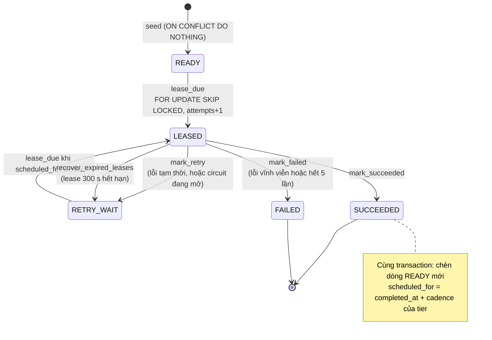
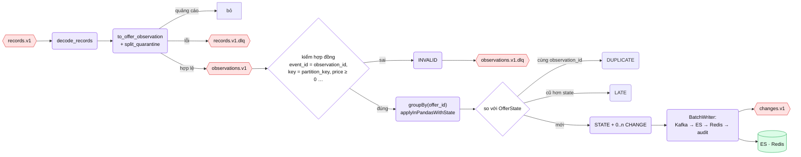
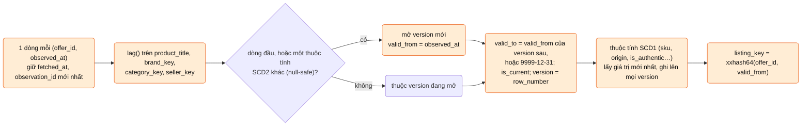
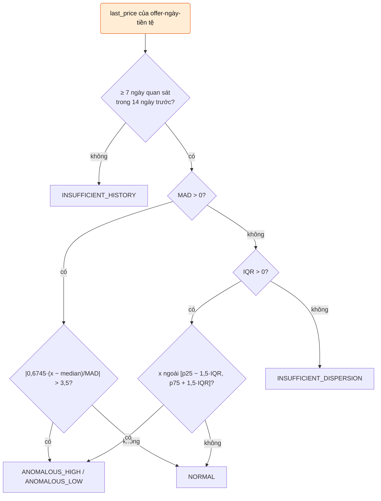
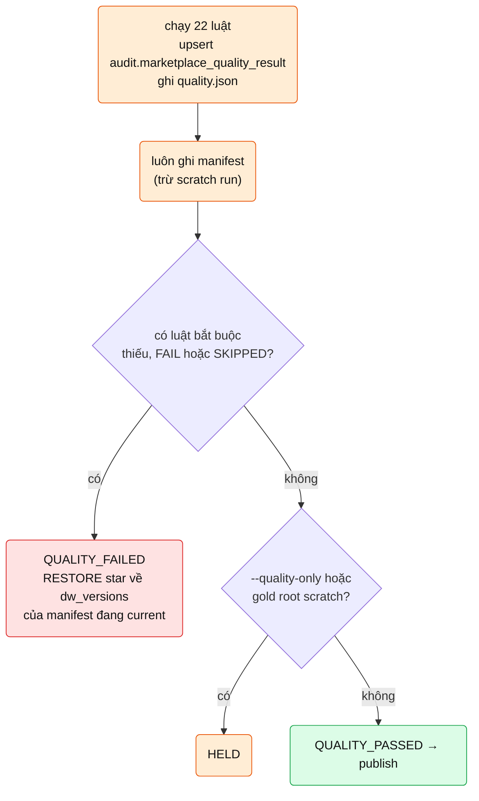

# 3. Xử lý trong từng tầng

> Đúng với: commit `9c73660` · Cập nhật: 2026-11-16 · Nguồn chân lý: `src/ecomdata/ingestion/`, `src/ecomdata/domain/`, `src/ecomdata/processing/`, `src/ecomdata/serving/`, `scripts/init_postgres.sql`, `observability/`

[02-luong-du-lieu.md](02-luong-du-lieu.md) trả lời câu hỏi dữ liệu đi qua tầng nào. Tài liệu này trả lời câu hỏi **trong một tầng, xử lý theo luật nào**: trạng thái, ngưỡng, quyết định, và chuyện gì xảy ra khi lỗi.

## 3.1 Tầng thu thập

### Nguồn

| | Tiki | Lazada |
|---|---|---|
| `marketplace_id` | `marketplace-tiki` | `marketplace-lazada` |
| Fetcher | `http` (`requests`) | `browser` (Playwright Chromium) |
| Discovery | `TikiSitemapDiscovery`: sitemap_index → `sitemap_categories` → `<slug>/c<id>` | `LazadaConfiguredDiscovery`: 20 danh mục trong `categories.json` |
| Phân trang | chỉ trang 1 | có, tối đa 102 trang |
| Delay tối thiểu | 2,0 s | 5,0 s |
| Counter | `rating_count`, `review_count`, `sold_count` | `review_count` |
| PII bỏ | không | `mainInfo.userId`, `mainInfo.anonUid` |
| Nhận diện bị chặn | trang không có `__NEXT_DATA__` | URL/HTML khớp `punish`, `captcha`, `slide to verify`… |

Toàn bộ khai báo nằm trong một `SourceSpec` ở `domain/sources.py`. Thêm một nguồn mới không phải sửa batch, speed hay ops (ADR-0004).

**Lịch sự với site** (`infra/http.py`): `Throttle` chờ `max(CRAWL_REQUEST_DELAY_SECONDS, min_delay của nguồn)` cộng jitter 0–1 s, tính theo host. robots.txt được cache 1 giờ; không tải được robots, hoặc robots trả 401/403, thì coi như cấm toàn bộ. User-agent tự khai danh tính: `EcommercePriceResearchBot/0.1 (+thesis project; rate-limited)`.

### Frontier: vòng đời một task

Mỗi dòng của `audit.crawl_frontier` là **một lần xuất hiện** của một target. `task_id = hash(code, resource_type, target, scheduled_for)`, unique trên `(marketplace_code, resource_type, target, scheduled_for)`.

*Hình 3.1. Vòng đời task. Thành công thì sinh lần xuất hiện kế tiếp, nên frontier tự duy trì lịch. FAILED chấm dứt chuỗi của target đó cho tới lần seed sau.*

| Tier | Cadence | Dùng cho |
|---|---|---|
| `ACTIVE` | 60 phút | tập nhỏ danh mục theo dõi sát (25 trang mỗi giờ trong lượt 14/11) |
| `HOT` | 120 phút | khai báo, chưa có code seed |
| `NORMAL` | 240 phút | mặc định của lệnh `seed` |
| `COLD` | 720 phút | |
| `SWEEP` | 1440 phút | toàn bộ danh mục từ discovery, DAG `source_discovery` seed mỗi ngày |

Cadence chỉnh được qua `CRAWL_<TIER>_CADENCE_MINUTES`. Worker lấy 10 task mỗi lần, poll 5 s, nghỉ 30 s khi rảnh; `worker_id = hostname:pid`.

### Phân loại lỗi, retry, circuit breaker

| `FailureKind` | Nguyên nhân | Retry | Mở circuit |
|---|---|:-:|:-:|
| `RATE_LIMITED` | HTTP 429 | ✓ | ✓ |
| `TRANSIENT_NETWORK` | lỗi transport, timeout, 408/425 | ✓ | ✓ |
| `SERVER_ERROR` | HTTP 5xx | ✓ | ✓ |
| `BLOCKED` | khớp mẫu chặn; Tiki thiếu `__NEXT_DATA__` | ✓ | ✓ |
| `STORAGE_ERROR` | ghi MinIO lỗi | ✓ | ✓ |
| `PUBLISH_ERROR` | gửi Kafka lỗi | ✓ | |
| `ROBOTS_DENIED` | robots cấm | | |
| `PARSE_ERROR`, `VALIDATION_ERROR` | extractor hoặc envelope lỗi | | |
| `CLIENT_ERROR` | 4xx khác | | |
| `UNKNOWN` | còn lại | | |

**Backoff** (`scheduling.py:304-339`): có `Retry-After` thì dùng nó (có trần); nếu không thì chờ `30 · 2^(n-1)` giây, trần 1800 s, ±20 % jitter. Hết `max_attempts = 5` thì chuyển FAILED.

**Circuit breaker theo nguồn** (`audit.crawl_source_state`): 5 lỗi liên tiếp thuộc nhóm "mở circuit" thì mở circuit 900 s. Trong lúc mở, task vừa lease bị trả về `RETRY_WAIT` mà không gọi site. Một lần thành công thì reset chuỗi lỗi.

### Một lượt thu thập (Template Method)

Các bước cố định của `ingestion/pipeline.py::acquire_listing_page`: dựng URL → kiểm robots → throttle → fetch → **ghi raw** → kiểm HTTP status → extract → `build_records` → **ghi records** → trả `AcquisitionReport`. Sau đó decorator `publishing_executor` publish Kafka và worker ghi audit. Sơ đồ sequence ở [04-pipeline.md §4.2](04-pipeline.md#42-p1--thu-thập-crawl).

Mỗi lần thử ghi một dòng `audit.crawl_request_attempt` (status, http_status, latency_ms, raw_bytes, parsed_count, error_kind). Mỗi lần lease mở một `audit.crawl_run` (`crawl_run_id = hash(task_id, attempts, lease_expires_at)`). Khi run kết thúc, toàn bộ run và các attempt được ghi thêm một bản vào lake (`bronze/marketplace/crawl_audit/`, schema `marketplace-crawl-audit.v1`). Ghi lake lỗi chỉ để lại cảnh báo; `ops audit-export` dựng lại được bản này từ PostgreSQL.

## 3.2 Tầng Bronze

| Quy tắc | Chi tiết |
|---|---|
| Thứ tự ghi | các part trước, `metadata.json` sau; records sau raw; Kafka sau records |
| Toàn vẹn | SHA-256 của từng part (body chưa nén) và của cả danh sách part |
| Tất định | JSON canonical, gzip level 6 với `mtime=0`: ghi lại một artifact cho ra cùng byte |
| Partition | raw: `marketplace=<code>/observed_date/hour/crawl_run_id/raw_artifact_id`; records: `source=<code>/observed_date/hour`; crawl audit: theo ngày bắt đầu của run |
| Tương thích | đọc được raw v1 (`body.bin`), chỉ ghi v2 |
| Lưu giữ | `ops prune-raw` (DAG bảo trì, hằng tuần) xoá raw cũ hơn `MARKETPLACE_RAW_RETENTION_DAYS` = 30 ngày. Records, Silver, Gold không bị xoá |
| Reparse | `python -m ecomdata.ingestion.reparse`: kiểm checksum, extract lại, so từng record; chỉ đọc, không ghi |

## 3.3 Tầng Kafka

| Topic | Producer | Consumer | Key | Value |
|---|---|---|---|---|
| `marketplace.records.v1` | crawl-worker | speed normalizer | `"<source>\|<target>"` | `marketplace-record.v1` (chỉ `listing_row`) |
| `marketplace.records.v1.dlq` | speed normalizer | (xem tay) | `record_id` | `{"reason", "record"}` |
| `marketplace.observations.v1` | speed normalizer | speed stateful query | `"<code>:<listing_id>"` | `marketplace-observation.v1` |
| `marketplace.observations.v1.dlq` | speed stateful query | es-projector → `marketplace-dlq-v1` | `dlq_id` | `marketplace-observation-dlq.v1` |
| `marketplace.changes.v1` | speed stateful query | (người dùng hạ nguồn) | `offer_id` | `marketplace-change.v1` |

Mỗi topic có 3 partition, RF 1, retention theo mặc định của broker (7 ngày); topic được tạo bởi `kafka-init`. Producer dùng `kafka-python-ng` với `acks=all`, `retries=5`, `max_in_flight=1`, nên giao **ít nhất một lần**. Độ đúng không dựa vào exactly-once mà dựa vào ID tất định và ghi idempotent ở phía nhận.

Kafka **không phải bản lưu**: mất toàn bộ Kafka thì batch không ảnh hưởng, còn speed dựng lại state được từ Bronze bằng cách replay.

## 3.4 Tầng speed

### Hai query trong một tiến trình

| | Normalizer | Stateful |
|---|---|---|
| Tên query | `marketplace-speed-v1-normalizer` | `marketplace-speed-v1` |
| Nguồn | Kafka `records.v1`, `startingOffsets=earliest` | Kafka `observations.v1`, có thể giới hạn `maxOffsetsPerTrigger` |
| Trigger | `processingTime` 30 s (`MARKETPLACE_STREAM_TRIGGER`) | như bên trái |
| Checkpoint | `<root>/v1-normalizer` | `<root>/v1` (volume `speed_checkpoints`) |
| State | không | theo `offer_id`: `OfferState` JSON đầy đủ + `observed_at` + `observation_id` |
| Timeout | | `ProcessingTimeTimeout`, đặt lại mỗi lần thành `observed_at + 21600 s − now`; không dùng watermark |

### Luật thay đổi (`domain/change_rules.py`, `rule_version = speed-rules.v1`)

| Loại | Điều kiện | `field_name` | Giá trị trước → sau |
|---|---|---|---|
| `NEW_OFFER` | chưa có state | null | null → toàn bộ offer |
| `PRICE_CHANGED` | `current_price` khác | `current_price` | giá cũ → giá mới |
| `LARGE_PRICE_DROP` | giá giảm **và** (giảm ≥ 100.000 **hoặc** giảm/giá cũ ≥ 20 %) | `current_price` | giá cũ → `{previous_price, current_price, drop_amount, drop_ratio}` |
| `RATING_CHANGED` | `(rating_value, rating_count)` khác | `rating` | `{value, count}` |
| `COUNTER_CHANGED` | `review_count` hoặc `sold_count` khác | `public_counters` | chỉ các counter đã đổi |
| `AVAILABILITY_CHANGED` | khác, và không bên nào là `UNKNOWN` | `availability` | cũ → mới |
| `OFFER_STALE` | timeout: 6 giờ không thấy offer, và chưa phát lần nào | null | `observed_at` → mốc hết hạn |

Một observation có thể sinh nhiều thay đổi cùng lúc (ví dụ giảm giá lớn sinh cả `PRICE_CHANGED` lẫn `LARGE_PRICE_DROP`). `OFFER_STALE` nghĩa là crawler chưa nhìn lại offer đó, **không** có nghĩa là offer đã ngừng bán.

### Lỗi và chạy lại

`BatchWriter` ghi một dòng audit trước (`begin_batch`). Nếu batch đó đã `SUCCEEDED` thì bỏ qua, vì đây là lần replay. Có ngoại lệ thì đánh dấu FAILED và ném lại lỗi; Spark chạy lại micro-batch từ checkpoint. Vì `change_id`, `_id` của ES và khoá Redis đều tất định, chạy lại không sinh bản trùng. Một dòng sai hợp đồng thành `INVALID` thay vì làm sập query, nhờ đó query không replay mãi một dòng độc.

## 3.5 Tầng Silver

Biến đổi đã mô tả ở [02 §H6](02-luong-du-lieu.md#h6-bronzerecords--silver). Phần còn lại là cách kiểm soát:

- **Tóm tắt `_runs/run_id=…/silver.json`**: `silver_rows`, `quarantine_by_reason`, `page_contexts`, `payload_drift` (khoá payload mới chưa khai báo trong `PAYLOAD_SCHEMA`, kèm số lần), `window`, `rebuild`, `duplicates_before_dedup = {record_id, observation_id, identical_content}`.
- **Drift không chặn run**: trường mới của sàn vẫn nằm trong `payload_json`, chỉ chưa có cột có kiểu. Drift là tín hiệu để cập nhật schema của nguồn.
- **Ghi**: ghi đè động theo partition của cửa sổ; `--rebuild` ghi đè tĩnh kèm `overwriteSchema`. Partition Delta lệch layout → `SilverLayoutMismatch`.
- **Vì sao không cắt `as_of`** (ADR-0007): Silver là ảnh chụp đầy đủ của các ngày đã có; mỗi run cắt khi đọc. Hai run khác `as_of` vì vậy dùng chung được Silver.

## 3.6 Tầng Gold: star `dw`

| Bảng | Khoá tự nhiên | Lịch sử | Cách dựng |
|---|---|---|---|
| `dim_date` | `full_date` | tĩnh, 2019-01-01 đến 2030-12-31 | lịch sinh sẵn: ngày đôi (`day == month`), ngày lễ Việt Nam gồm Tết âm lịch, Giỗ Tổ (`dim_date.py`) |
| `dim_marketplace` | `marketplace_code` | SCD1 | mã đã thấy × thuộc tính registry |
| `dim_seller` | `seller_id` | SCD1 | giá trị mới nhất có mặt (`max_by`) |
| `dim_brand` | (`marketplace_code`, `brand_id`) | SCD1 | không có id thì không có dòng |
| `dim_category` | (`marketplace_code`, `category_id`) | SCD1, dựng lại | `posexplode` đường dẫn; tranh chấp cha được giải theo: page context > lần thấy mới nhất > path lớn hơn; danh mục chỉ được request nhưng chưa thấy sản phẩm thành "inferred member" |
| `bridge_category_ancestry` | (`ancestor_key`, `descendant_key`) | dựng lại | bao đóng bắc cầu theo `parent_key`, gồm chính nó ở depth 0 |
| `dim_product_listing` | (`offer_id`, `valid_from`) | **SCD2** | xem dưới |
| `dim_listing_flags` | 9 cờ | tĩnh | sinh đủ mọi tổ hợp (junk dimension) |

**SCD2 của `dim_product_listing`** (`dimensions.py:556-640`):

Ví dụ: một offer đổi tiêu đề ngày 12/11 sẽ có hai version. Fact ngày 10/11 trỏ tới version 1, fact ngày 13/11 trỏ tới version 2. Quality kiểm mỗi offer chỉ có đúng một version `is_current`, và `valid_to` của version trước bằng `valid_from` của version sau.

**Fact**: các logic đặc biệt:

- `fact_price_snapshot_daily`: `open_price`/`close_price` bằng `min_by`/`max_by` theo thứ tự `(observed_at, fetched_at, observation_id)`; `in_stock_ratio`; chỉ organic.
- `fact_price_change`: `lag` theo offer; `is_large_drop` cùng ngưỡng với speed (≥ 100.000 hoặc ≥ 20 %, cùng tiền tệ).
- `fact_counter_daily`: dùng lại bộ phân loại bước chuyển của mart counter (§3.7).
- `fact_category_page_daily`: đếm theo **trang** chứa sản phẩm (`page_category_key`), giá theo giá cuối ngày của từng offer organic, `listed_product_count` lấy từ page context.
- `fact_crawl_attempt`: `attempt_id = xxhash64(crawl_run_id, task_id, attempt_number)`.

## 3.7 Tầng mart: các luật phân tích

### Biến động giá bất thường (`anomaly.py`)

Mỗi offer chỉ được so với **lịch sử của chính nó**, không so với offer khác. Tham số (`window_days`, `min_samples`, `mad_threshold`, `iqr_multiplier`, `anomaly_rule_version`) được ghi kèm trên từng dòng.

### Độ tin cậy của khuyến mãi (`discount.py`, `domain/discount_rules.py`, ADR-0009)

Các đại lượng: `displayed% = (list − price) / list`; giá tham chiếu `reference_min_price` là giá thấp nhất trong **30 ngày lịch trước** (không tính ngày đang xét, theo quy tắc Omnibus); `effective% = (ref_min − price) / ref_min`; `claim_gap = displayed − effective`.

| Lý do | Bật khi | Trọng số | Cần lịch sử (≥ 3 ngày) |
|---|---|:-:|:-:|
| `PRICE_ABOVE_LIST` | displayed < 0 | 40 | |
| `DISCOUNT_OVER_CAP` | displayed > 50 % (trần theo Nghị định 81/2018) | 30 | |
| `LIST_PRICE_RAISED` | giá niêm yết > mọi giá niêm yết trong cửa sổ | 30 | ✓ |
| `CLAIM_EXCEEDS_HISTORY` | claim_gap > 20 điểm | 50 | ✓ |
| `NOT_BELOW_REFERENCE` | có hiển thị giảm nhưng effective ≤ 0 | 20 | ✓ |

`rule_score` là tổng trọng số (trần 100). Trạng thái: `SUSPECT` khi điểm ≥ 50, `QUESTIONABLE` khi ≥ 20, `CREDIBLE` khi không có lý do và đủ lịch sử, `INSUFFICIENT_HISTORY` khi không có lý do nhưng thiếu lịch sử, `NO_DISCOUNT` khi không hiển thị giảm và điểm 0.

**Isolation Forest** chỉ dùng để xếp hạng: chạy trên các dòng có displayed > 0, cần ít nhất 50 dòng, lấy mẫu tất định tối đa 200.000 dòng (seed 20261113), `n_estimators = 100`. Đặc trưng gồm displayed, effective, claim_gap, list_raised, distinct_price_count. `ml_rank_percent` là `percent_rank` trong từng sàn-ngày. Thiếu scikit-learn thì `ml_method = NONE`. Lượt 14/11 đo được thời gian fit khoảng 0,11–0,13 s trên 56–67 nghìn dòng (`docs/evidence/fullrun-20261114/KET-QUA.md`).

### Counter: phân loại bước chuyển (`marts.py:511-617`)

Mỗi cặp observation liên tiếp của một counter được gán **một** nhãn: `MISSING_VALUE`, `SEMANTICS_UNREGISTERED`, `SEMANTICS_VERSION_CHANGED`, `NON_POSITIVE_INTERVAL`, `GAP_TOO_LONG` (cách nhau > 172.800 s = 48 h, khớp với cadence SWEEP), `COUNTER_DECREASED` hoặc `VALID`. Delta âm **không bị cắt**: dòng đó được đánh dấu `counter_reset_or_invalid`, lý do ghi trong `invalid_reasons_json`. `velocity_proxy_per_hour` chỉ đo tốc độ con số hiển thị thay đổi, không phải doanh số.

### Độ phủ và độ tươi

- `offer_freshness` chấm điểm tại `as_of` của run, không phải lúc truy vấn: `FRESH` khi tuổi ≤ 21.600 s, `STALE` khi lớn hơn, `FUTURE` khi `observed_at > as_of` (lỗi đồng hồ).
- `source_coverage_daily` trải lịch của mỗi offer từ ngày đầu thấy tới `min(ngày cuối, as_of)`. Offer đủ điều kiện là offer không `INACTIVE`. Mart so số đủ điều kiện với số thực sự được thấy trong ngày, ghép thêm `parsed`/`rejected` từ crawl audit.

## 3.8 Cổng chất lượng

22 luật trong `domain/quality_rules.py` (16 bắt buộc, 6 khuyến nghị), cài đặt trong `processing/batch/quality.py`:

| Nhóm | Luật bắt buộc | Luật khuyến nghị |
|---|---|---|
| Lineage | `raw_artifact_checksum_and_uri_present`, `silver_observation_raw_lineage_complete` | |
| Khoá, duy nhất | `observation_id_unique` (tính cả bản trùng trước dedup), `offer_listing_key_unique`, `offer_current_single_row_per_offer` | |
| Miền giá trị | `offer_key_and_price_complete`, `price_non_negative`, `currency_valid` (USD, VND), `observed_at_within_future_tolerance` (≤ 300 s) | |
| Đối soát | `silver_parse_attempt_reconciliation` (dòng Silver + quarantine = `parsed_count` của audit, với crawl run đã ổn định), `gold_daily_row_count_reconciles`, `gold_daily_price_aggregates_reconcile` | |
| Phiên bản luật | `freshness_rule_version_and_as_of_applied` | |
| Star | `star_foreign_keys_resolve`, `star_surrogate_keys_unique`, `star_listing_versions_consistent` | `star_unknown_member_rate` (≤ 50 %) |
| Phân tích | | `counter_invalid_transition_rate` (≤ 50 %), `price_anomaly_evaluation_coverage`, `discount_credibility_evaluation_coverage`, `source_coverage_rate_denominator_present`, `crawl_reliability_evidence_present` |

*Hình 3.2. Quyết định của cổng. Một luật bắt buộc bị SKIPPED cũng chặn run như FAIL. Luật khuyến nghị không bao giờ chặn.*

Bằng chứng: run 11:00 ngày 07/11 bị `QUALITY_FAILED`, Superset vẫn giữ bản ngày 31/10 (`docs/DANH_GIA_HE_THONG_20261113.md`, `docs/evidence/run-20261107/NHAT-KY-LOI.md`).

## 3.9 Tầng phục vụ

| Kho | Ghi bởi | Nội dung | Ai đọc |
|---|---|---|---|
| PostgreSQL `cache.marketplace_*` (12 bảng) | stage `publish` | đúng một run, run mà `current.json` trỏ tới | Superset dashboard `marketplace-batch-gold` (13 chart), ops |
| `audit.marketplace_cache_version` | stage `publish` | dòng duy nhất: `run_id`, số dòng, `manifest_uri` | backup (kiểm khớp pointer), Grafana |
| ES `marketplace-changes-v1`, `marketplace-offers-current-v1` | speed | thay đổi, trạng thái offer | Kibana `marketplace-realtime-changes-v1` |
| ES `marketplace-speed-batches-v1`, `marketplace-dlq-v1`, `marketplace-source-health-v1`, `marketplace-crawl-attempts-v1` | `serving/es_projector.py` (30 s một lần, chồng lấn 900 s) | chiếu từ `audit.*`, topic DLQ, Redis | Kibana `marketplace-source-health-v1`, `marketplace-live-demo` |
| Redis `rt:*` | speed | thay đổi gần nhất, trạng thái offer (TTL 24 h) | tra cứu thời gian thực |

**Publish nguyên tử** (`repositories.py:311-384`): mỗi mart được ghi JDBC vào `staging.mp_<mart>_<sha256(run_id)[:16]>`. Sau đó, trong **một** transaction có `pg_advisory_xact_lock`, kiểm lại số dòng, `TRUNCATE` cả 12 bảng `cache.*`, `INSERT … SELECT` từ staging, upsert `audit.marketplace_cache_version`. Người đọc chỉ thấy toàn bộ run cũ hoặc toàn bộ run mới.

## 3.10 Audit và giám sát

| Bảng `audit.*` | Ghi bởi | Một dòng là |
|---|---|---|
| `crawl_frontier` | seed, worker | một lần xuất hiện của một target |
| `crawl_run` | worker | một lần lease (RUNNING → COMPLETED/PARTIAL/FAILED) |
| `crawl_request_attempt` | worker | một HTTP attempt |
| `crawl_source_state` | worker | trạng thái circuit của một nguồn |
| `marketplace_batch_run` | batch runner | một run: status, `last_completed_status`, `as_of`, số dòng, thời gian |
| `marketplace_quality_result` | stage `quality` | một luật của một run |
| `marketplace_cache_version` | stage `publish` | run đang nằm trong cache |
| `marketplace_speed_batch` | speed | một micro-batch: đếm `input = invalid + applied + duplicate + late`, thời gian từng sink, latency p50/p95/max |
| `marketplace_stream_progress` | speed | tiến độ query (offset, rows/s) |

Giám sát (`observability/`): **Alloy** là collector duy nhất. Nó gom log container và log task Airflow vào Loki, đồng thời đẩy metrics sang Prometheus, gồm cAdvisor, Kafka lag, Redis, ES, StatsD của Airflow, các probe HTTP, và **truy vấn SQL trên bảng `audit.*`** (`mp_crawl_*`, `mp_batch_*`, `mp_quality_*`, `mp_speed_*`…). Grafana có 5 dashboard (`lambda-overview`, `-pipeline`, `-resources`, `-orchestration`, `-logs`) và 19 luật cảnh báo:

| Nhóm | Cảnh báo |
|---|---|
| Hạ tầng | endpoint-down, host-memory > 90 %, disk > 85 %, OOM, restart-loop, no-metrics |
| Pipeline | crawl-stopped, crawl-blocked (> 20 % RATE_LIMITED/BLOCKED), circuit-open, speed-stale, speed-lag (> 5000 offset), batch-stale (window promote mới nhất > 2,5 h), batch-failed, quality-mandatory FAIL, dlq-burst (> 100/30 phút), consumer-lag (> 10.000), error-burst (Loki) |
| Điều phối | dag-failed, scheduler-heartbeat (> 120 s) |
