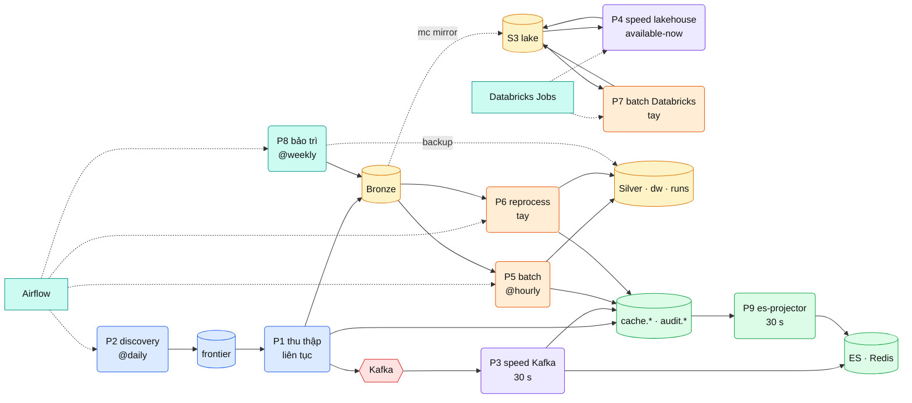
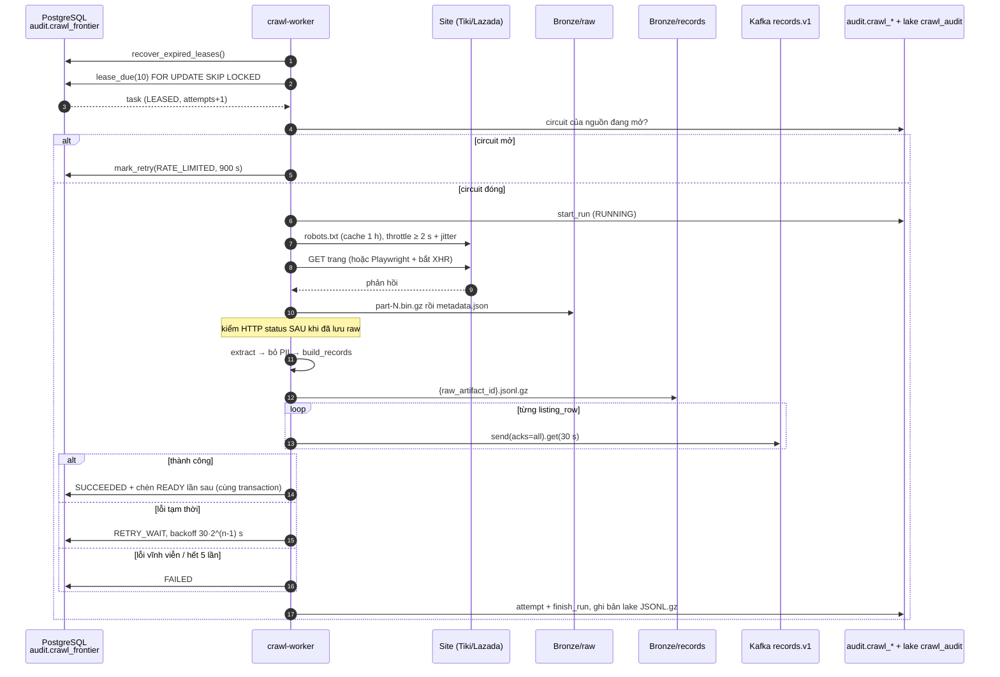
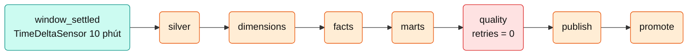
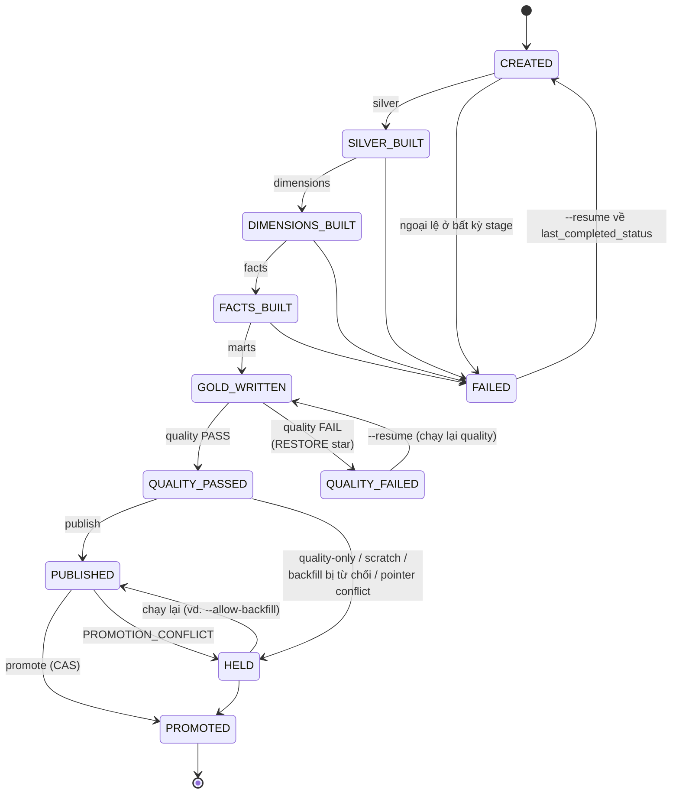
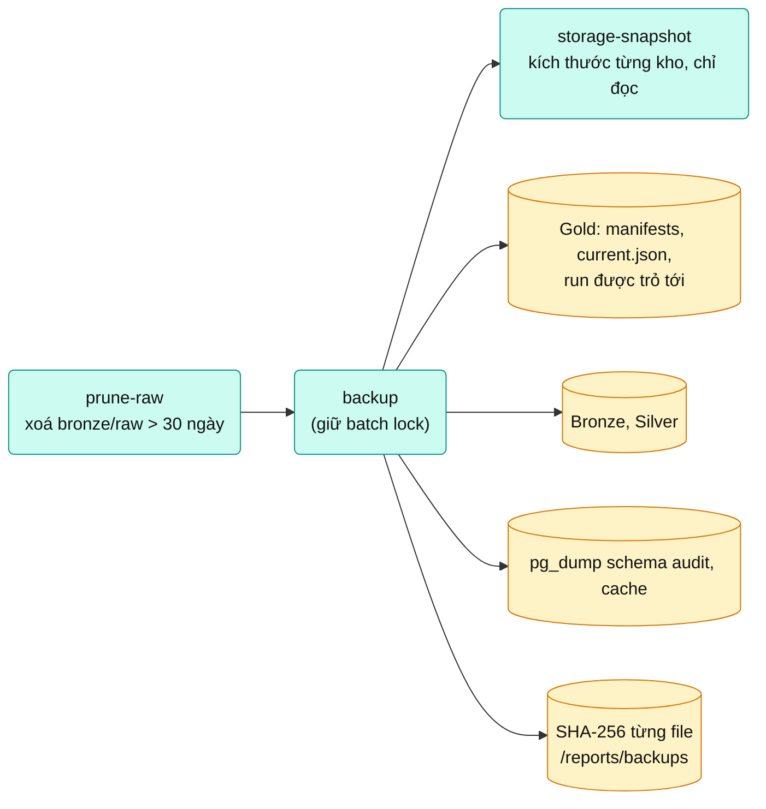

# 4. Các pipeline: tổng quan và chi tiết

> Đúng với: commit `9c73660` · Cập nhật: 2026-11-16 · Nguồn chân lý: `src/ecomdata/orchestration/`, `src/ecomdata/ingestion/service.py`, `src/ecomdata/processing/{batch,speed}/`, `compose/docker-compose.yml`, `databricks/resources/jobs.yml`, `scripts/mp.ps1`

## 4.1 Danh mục pipeline

| Mã | Pipeline | Kiểu | Kích hoạt | Chạy ở đâu | Đầu vào → đầu ra | Entrypoint |
|---|---|---|---|---|---|---|
| P1 | Thu thập | tiến trình dài hạn | liên tục, theo `scheduled_for` trong frontier | container `crawl-worker`, `crawl-worker-lazada` | site → Bronze, Kafka `records.v1`, `audit.crawl_*` | `python -m ecomdata.ingestion.service --sources tiki` |
| P2 | Discovery, seed | theo lịch | DAG `source_discovery`, `@daily` | DockerOperator (image python) | sitemap/`categories.json` → `audit.crawl_frontier` (tier SWEEP) | `python -m ecomdata.ingestion.seed --from-discovery` |
| P3 | Speed (Kafka) | streaming | trigger 30 s | container `speed` | `records.v1` → `observations.v1` → changes, ES, Redis | `python -m ecomdata.processing.speed.service` |
| P4 | Speed lakehouse | streaming, available-now | job Databricks (lịch 15 phút, đang PAUSED) hoặc chạy tay | Databricks | Bronze/records → Delta `gold/speed/*` | `ecomdata-speed-lakehouse --available-now --auto-loader` |
| P5 | Batch theo giờ | theo lịch | DAG `marketplace_batch`, `@hourly` | DockerOperator (image Spark), 8 task | Bronze → Silver → `dw` → mart → `cache.*` → `current.json` | `python -m ecomdata.processing.batch run --stage …` |
| P6 | Reprocess | chạy tay | DAG `marketplace_reprocess` (không lịch) | như P5 | như P5, cửa sổ `--silver-since` hoặc `--rebuild` | như P5 |
| P7 | Batch trên Databricks | chạy tay, có tham số | job `ecomdata-marketplace-batch` | Databricks | S3 Bronze → Silver, `dw`, mart, quality (không publish) | `ecomdata-batch run … --skip-postgres` |
| P8 | Bảo trì | theo lịch | DAG `marketplace_maintenance`, `@weekly` | DockerOperator (image python) | prune raw, backup, đo dung lượng | `python -m ecomdata.ops prune-raw / backup / storage-snapshot` |
| P9 | Chiếu audit sang ES | tiến trình dài hạn | vòng lặp 30 s | container `es-projector` | `audit.*`, DLQ, Redis → ES `marketplace-*-v1` | `python -m ecomdata.serving.es_projector` |

*Hình 4.1. Bản đồ pipeline. Nét đứt là điều khiển (lập lịch). P1, P3, P9 là tiến trình dài hạn; P2, P5, P6, P8 do Airflow khởi động; P4, P7 do Databricks khởi động.*

### Một giờ vận hành điển hình

```mermaid
gantt
    title Một giờ (UTC), stack local đầy đủ
    dateFormat HH:mm
    axisFormat %H:%M
    section P1 thu thập
    ACTIVE (25 trang/giờ) + SWEEP đến hạn      :active, 10:00, 60m
    section P3 speed
    micro-batch mỗi 30 s                         :active, 10:00, 60m
    section P5 batch (run mp-…T1000Z)
    window_settled (chờ 10 phút)                 :crit, 10:00, 10m
    silver                                       :10:10, 2m
    dimensions                                   :10:12, 4m
    facts                                        :10:16, 2m
    marts                                        :10:18, 2m
    quality → publish → promote                  :10:20, 3m
    section P9 projector
    vòng 30 s                                    :active, 10:00, 60m
```

*Hình 4.2. Thời lượng từng stage chỉ là minh hoạ theo bậc độ lớn đo ngày 13–14/11: `dimensions` 217–259 s, `marts` 88–105 s, `silver` 38–189 s (`docs/evidence/fullrun-20261114/KET-QUA.md`). `max_active_runs = 1` nên các run không chồng lên nhau.*

## 4.2 P1 — Thu thập (crawl)

**Mục đích.** Biến một task của frontier thành bằng chứng trong Bronze và một luồng record trên Kafka.

*Hình 4.3. Một lượt thu thập. Thứ tự raw → records → Kafka đảm bảo không tầng sau nào có dữ liệu mà tầng trước không có.*

| Hạng mục | Giá trị |
|---|---|
| Tài nguyên | 1 container mỗi nguồn; Lazada `shm_size` 1 GB, batch 1 |
| Healthcheck | heartbeat file, tuổi tối đa 600 s; dừng êm trong 120 s |
| Đo được | 14.023 task SWEEP thành công trong một lượt quét, khoảng 4 giờ (13/11, `docs/evidence/fullrun-20261114/KET-QUA.md`); Lazada bị chặn sau 76 trang (31/10, `docs/evidence/e2e-run-20261031/BAO-CAO-CHI-SO.md`) nên chỉ dùng để minh hoạ đa nguồn |
| Khi lỗi | xem §3.1; worker khởi động lại phải chờ lease cũ hết hạn (5 phút) |

## 4.3 P2 — Discovery và seed

DAG `source_discovery` (`@daily`, `catchup=False`) có **một task cho mỗi nguồn khai báo `discovery`**, các task chạy song song: `python -m ecomdata.ingestion.seed --source <code> --from-discovery --tier SWEEP`. Seed chèn một task READY cho mỗi danh mục × trang, `scheduled_for` neo ở `1970-01-01Z`, `ON CONFLICT DO NOTHING`, nên seed lại nhiều lần cũng vô hại. Tier `ACTIVE` được seed tay bằng `mp.ps1 seed`.

## 4.4 P3 — Speed qua Kafka

| Hạng mục | Giá trị |
|---|---|
| Tiến trình | 1 container `speed`, 2 query Spark (§3.4); vòng watchdog dừng tiến trình nếu query normalizer chết |
| Trigger | 30 s (`MARKETPLACE_STREAM_TRIGGER`); `spark.sql.shuffle.partitions = 4` |
| Checkpoint | volume `speed_checkpoints` → `/data/checkpoints/v1` và `/v1-normalizer` |
| Khởi động lại | `restart: unless-stopped`; tiếp tục từ checkpoint, ID tất định nên replay không sinh trùng |
| Reset | đổi `MARKETPLACE_STREAM_CHECKPOINT_VERSION` thì đọc lại từ `earliest` với state rỗng: mọi offer phát lại `NEW_OFFER` |
| Đo được | p95 khoảng 59–62 s sau khi đuổi kịp; `failed = 0`, `invalid = 0`, DLQ = 0 trong 9 giờ (13–14/11, `fullrun-20261114/KET-QUA.md`) |

## 4.5 P4 — Speed lakehouse (Databricks)

```mermaid
flowchart LR
    classDef lake fill:#FEF3C7,stroke:#D97706,color:#111
    classDef speed fill:#EDE9FE,stroke:#7C3AED,color:#111
    src[("S3 bronze<br/>marketplace/records/")]:::lake --> q1("Query 1<br/>Auto Loader cloudFiles (text)<br/>normalize_micro_batch"):::speed
    q1 --> obs[("gold/speed/observations")]:::lake
    q1 --> dlq[("gold/speed/records_dlq")]:::lake
    obs --> q2("Query 2<br/>Delta stream → cột giả Kafka<br/>service.start_query (cùng luật)"):::speed
    q2 --> out[("outputs")]:::lake
    q2 --> st[("offer_state · MERGE tiến")]:::lake
    q2 --> ch[("price_changes · MERGE theo change_id")]:::lake
    q2 --> pr[("stream_progress")]:::lake
```

Với `--available-now`, query 2 chỉ bắt đầu khi query 1 đã xử lý hết file hiện có, sau đó cả hai dừng. Job: `ecomdata-marketplace-speed`, timeout 6 giờ, lịch quartz `0 0/15 * * * ?` (Asia/Ho_Chi_Minh), **đang PAUSED**. Biến thể này không ghi Kafka, ES hay Redis.

Rủi ro chưa kiểm (`docs/DATABRICKS_READINESS.md` §8): `ProcessingTimeTimeout` có thể không bắn dưới `availableNow` (nghĩa là có thể không có `OFFER_STALE`); pyarrow bị wheel ghi đè; S3A trên DBR 17.3.

## 4.6 P5 — Batch theo giờ

### DAG `marketplace_batch`

| Thuộc tính | Giá trị |
|---|---|
| Lịch | `@hourly`, bắt đầu 2026-10-25 UTC, `catchup=False`, `max_active_runs=1`, `dagrun_timeout` 3 h |
| Task | `DockerOperator`, image `ecommerce/spark-marketplace:4.0.1-r4`, `auto_remove=success`, timeout 45 phút mỗi stage |
| Lệnh | `python3 -m ecomdata.processing.batch run --stage <s> --run-id mp-<YYYYMMDDTHHMMZ> --as-of <data_interval_end> [--resume] [--allow-backfill]` |
| Retry | 2 lần, cách 2 phút; lần thử thứ 2 trở đi tự thêm `--resume`; `quality` không retry |
| Tham số | `allow_backfill` (mặc định False) |
| Khoá | advisory lock `pg_try_advisory_lock(820801)` trên kết nối riêng, giữ suốt lệnh; bị chiếm thì thoát mã 75 |

### State machine của một run (ADR-0005)

*Hình 4.4. Trạng thái của run trong `audit.marketplace_batch_run`. `FAILED`, `QUALITY_FAILED`, `PROMOTED` là trạng thái cuối. `--resume` mở lại run ở `last_completed_status`; stage nào đã đạt mốc thì bị bỏ qua.*

### Đầu vào, đầu ra từng stage

| Stage | Đọc | Ghi | Trạng thái sau |
|---|---|---|---|
| `silver` | Bronze/records của cửa sổ ngày (không cắt `as_of`) | 4 bảng Silver, `_runs/<run>/silver.json` | `SILVER_BUILT` |
| `dimensions` | toàn bộ Silver (gồm quảng cáo), bảng rộng, page context, crawl attempts | 7 dim + 1 bridge (`MERGE`), `dimensions.json` | `DIMENSIONS_BUILT` |
| `facts` | Silver, `dim_product_listing`, crawl audit | 6 fact (`MERGE`, partition `date_key`), `facts.json` | `FACTS_BUILT` |
| `marts` | star tại version vừa dựng, cắt `as_of`, bỏ quảng cáo; audit cắt `as_of` | 12 mart vào `runs/run_id=<run>/`, `marts.json` | `GOLD_WRITTEN` |
| `quality` | Silver cắt `as_of`, mart, star, audit | `audit.marketplace_quality_result`, `quality.json`, manifest | `QUALITY_PASSED` / `QUALITY_FAILED` / `HELD` |
| `publish` | mart, manifest | `staging.*` → `cache.marketplace_*`, `audit.marketplace_cache_version` | `PUBLISHED` / `HELD` |
| `promote` | manifest, `current.json` | `current.json` (CAS) | `PROMOTED` / `HELD` |

Sau mỗi stage, runner ghi `timings/<stage>.json` và chép dòng audit ra `_runs/run_id=<run>/run.json`, để lake tự mô tả được lịch sử run.

### Cờ dòng lệnh

| Cờ | Tác dụng |
|---|---|
| `--stage <s>` (lặp được) / `--all` | chọn stage |
| `--resume` | mở lại run FAILED/QUALITY_FAILED |
| `--force` | chạy lại một stage đã đạt mốc, không đổi trạng thái |
| `--allow-backfill` | cho promote run có `as_of` cũ hơn run đang current |
| `--quality-only` | dừng ở HELD sau quality, không publish |
| `--silver-since D`, `--late-days N`, `--rebuild` | cửa sổ của stage `silver` |
| `--silver-uri`, `--gold-root-uri` | đổi gốc lưu; gold root khác mặc định → scratch run (không manifest, HELD) |
| `--skip-postgres` | audit và quality trong bộ nhớ, không lock, không publish (dùng cho Databricks) |

## 4.7 P6 — Reprocess

DAG `marketplace_reprocess` (không lịch, chạy bằng *Trigger DAG w/ config*) có 7 stage như P5, nhưng không có sensor, timeout 4 giờ mỗi task, 1 retry. `run_id = mp-reprocess-<ts>`. Tham số: `since` (thêm `--silver-since`) hoặc `rebuild` (dựng lại Silver từ toàn bộ Bronze). Dùng khi normalizer đổi, khi Bronze được bổ sung ngày cũ, hoặc khi dựng lại sau sự cố. Kết hợp với `ingestion/reparse.py`: parser đổi thì reparse dựng lại records từ raw, rồi reprocess dựng lại mọi tầng sau.

## 4.8 P7 — Batch trên Databricks

| Hạng mục | Giá trị |
|---|---|
| Job | `ecomdata-marketplace-batch`, một task `python_wheel_task`, entry point `ecomdata-batch` |
| Lệnh | `run --run-id dbx-{{job.run_id}} --as-of {{job.parameters.as_of}} --stage silver … --stage quality --skip-postgres` |
| Cluster | single node (`num_workers: 0`), `SINGLE_USER`, `local[*,4]`, `m5d.large`, DBR `17.3.x-scala2.13` |
| Cấu hình | `DATA_LAKE_PROFILE=s3`, `DATA_LAKE_TABLE_FORMAT=delta`, `MARKETPLACE_CRAWL_AUDIT_SOURCE=lake`; khoá S3 lấy từ secret scope `ecomdata` |
| Đồng thời | `max_concurrent_runs: 1`, thay cho advisory lock |
| Không gồm | `publish`, `promote` (cần PostgreSQL `cache.*` ở local) |

Lệnh: `databricks bundle deploy -t dev`, rồi `databricks bundle run -t dev marketplace_batch --params as_of=…`. Bronze được đưa lên S3 bằng `mc mirror` chạy tay.

## 4.9 Triển khai và tài nguyên

| Profile compose | Service | Kiểu |
|---|---|---|
| (lõi) | `kafka` (4.2.0, KRaft), `kafka-init`, `minio`, `minio-init` (bucket `ecommerce-bronze/silver/gold`), `redis` 8.6.2, `postgres-dw` 18.3 (chạy `init_postgres.sql`), `elasticsearch` 8.18.1 (heap 1 GB) | dịch vụ, `unless-stopped` |
| `crawl` / `crawl-browser` | `crawl-worker`, `crawl-worker-lazada` | dài hạn |
| `speed` | `speed` | dài hạn |
| `batch` | `batch-once` | công cụ một lần (`run --rm`) |
| `orchestration` | `airflow-init`, `airflow-api-server` (:8084), `airflow-scheduler`, `airflow-dag-processor` | dịch vụ |
| `serve` | `kibana`, `kibana-marketplace-setup`, `superset`, `superset-init` | dịch vụ, khởi tạo một lần |
| `ops` | `ops` (`python -m ecomdata.ops`), `es-projector` | công cụ, dài hạn |
| `smoke` | `stub-source` (site giả, cổng 8000) | kiểm thử offline |
| `legacy-scheduler` | `batch-scheduler` (vòng lặp cũ trước Airflow) | không dùng nữa |
| file observability | `loki`, `prometheus`, `alloy`, `grafana` (:3001), bind 127.0.0.1 | dịch vụ |

Mọi service chạy **một bản**. Tham số chung do Airflow truyền vào container theo tiền tố (`KAFKA_`, `POSTGRES_`, `MINIO_`, `DATA_LAKE_`, `CRAWL_`, `MARKETPLACE_`, `SPARK_`…). Container gắn nhãn `ecomdata.project/layer/service` để Alloy nhận diện.

Điều khiển hằng ngày qua `scripts/mp.ps1 -EnvFile env/<stack>.env <verb>`:

| Verb | Việc |
|---|---|
| `up [-With speed,serve,…]` | bật lõi + các profile |
| `status`, `validate` | trạng thái crawl/speed/batch/pointer; kiểm tra tính đúng |
| `seed`, `migrate` | thêm task frontier; áp lại DDL |
| `batch -AsOf … [-AllowBackfill] [-QualityOnly]` | chạy batch `--all` ngoài Airflow |
| `dags list\|pause\|unpause` | điều khiển DAG |
| `backup`, `restore -BackupId` | sao lưu, khôi phục |
| `smoke`, `drill d1..d11`, `bench`, `evaluate`, `evidence`, `demo` | kiểm thử, diễn tập sự cố, đo, gom bằng chứng |

## 4.10 P8 — Bảo trì, sao lưu, khôi phục

DAG `marketplace_maintenance` (`@weekly`): `prune_raw` → `backup` → `storage_snapshot`.

- Backup chép Gold **trước**, sau đó tới Bronze và Silver. Backup bị từ chối nếu `run_id` của pointer khác `audit.marketplace_cache_version.run_id`.
- Restore ghi `current.json` **cuối cùng**, sau đó chạy các kiểm tra `validate --restored`.
- Không sao lưu: Kafka, Elasticsearch, Redis, checkpoint speed. Những thứ này dựng lại được từ Bronze.
- Không có bảo trì Delta (`OPTIMIZE`, `VACUUM`) và không xoá run Gold cũ. Xem rủi ro ở [05](05-sai-lech-va-rui-ro.md).

## 4.11 Ma trận lỗi: hỏng chỗ nào thì mất gì

| Thành phần hỏng | Ảnh hưởng tức thời | Dữ liệu mất? | Phục hồi |
|---|---|---|---|
| Site chặn, rate limit | circuit mở 15 phút, task chuyển RETRY_WAIT | không | tự động; cảnh báo `crawl-blocked`, `circuit-open` |
| MinIO | crawler lỗi `STORAGE_ERROR` (retry), batch dừng | không, vì raw chưa ghi thì task chưa thành công | tự động khi MinIO lên lại |
| Kafka | crawler `PUBLISH_ERROR` (retry); speed dừng | không: Bronze đã có; batch không phụ thuộc Kafka | tự động; speed đọc tiếp từ checkpoint |
| Speed container | không có thay đổi mới trên Kibana | không | restart, tiếp tục từ checkpoint (đã diễn tập E1–E5 ngày 31/10, `docs/evidence/e2e-run-20261031/`) |
| ES, Redis | micro-batch speed lỗi, replay | không | restart; ghi idempotent |
| Một stage batch lỗi | run FAILED; cache giữ run trước | không | Airflow retry với `--resume` |
| Quality FAIL | run QUALITY_FAILED, star được RESTORE | không; Superset giữ bản tốt cuối | sửa nguyên nhân, `--resume` |
| PostgreSQL | frontier dừng, batch không publish | cache dựng lại được từ Gold; audit có bản trong lake | khôi phục từ backup, hoặc publish lại từ lake |
